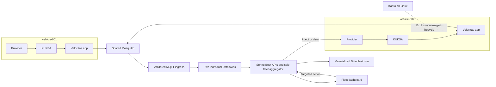

# Software-Defined Vehicle Health Monitoring and Diagnostic System

A reproducible local platform for monitoring simulated vehicle sensors, maintaining
individual digital twins and demonstrating targeted diagnosis and recovery.
It evaluates a health-monitoring pipeline, not a complete self-driving system.

## Current scope

**Phase V1 uses exactly two synthetic vehicles:** `vehicle-001` and `vehicle-002`.
Each has its own provider, KUKSA broker and Velocitas application. Vehicle-specific
MQTT events update isolated Ditto twins; Spring Boot exposes their live state,
routes fault/clear commands and drives a basic fleet dashboard.

Compared with the recorded single-vehicle MVP, V1 adds:

- Explicit vehicle identity, source timestamps, validation and persisted ordering.
- Backend-routed LiDAR obstruction/clear with observed recovery and vehicle-001 isolation.
- One Spring Boot fleet aggregator and fleet-twin materializer.
- Repeatable two-vehicle CI and recorded real-service verification.
- A same-device Linux Kanto managed restart pilot and an interactive prepared-demo launcher.

## Architecture



| Component | Responsibility |
|---|---|
| Synthetic providers / KUKSA | Generate observations and expose per-vehicle signals. |
| Velocitas | Classify sensor health; publish identified QoS 1 events. |
| Mosquitto / ingress | Deliver, validate and persist ordered observations without fabricating healthy state. |
| Ditto | Store individual snapshots and the derived fleet summary. |
| Spring Boot | Read individual twins, route actions and own the **single fleet aggregation/write implementation**. |
| Frontend | Display vehicle/fleet health and availability; send backend actions. |
| Kanto | Manage app-002 on Linux, with Docker app-002 excluded during Kanto use. |

The fleet API derives its response from individual twins; it does not read the
materialized fleet Thing. Scenario acknowledgement is dispatch acceptance, not
proof that a fault or recovery has reached the dashboard.

## Local setup

Start with **[Local setup and run guide](docs/local-setup.md)**. It covers prerequisites,
Windows PowerShell versus WSL2, Linux/macOS commands, real Ditto authentication and
safe provisioning, startup order, ports, readiness, cleanup and known gaps.

| Mode | Platform boundary |
|---|---|
| Source inspection / unit development | Windows-native, Linux and macOS instructions; platform test limits documented. |
| Core two-vehicle Docker workflow | Linux; Windows through WSL2/Docker Desktop; macOS subject to image architecture support. |
| Interactive V1 demo / Kanto pilot | Current orchestration requires a prepared Linux host; not native Windows/macOS. |
| Legacy single-vehicle MVP | Separate historical mode; do not run alongside V1 on conflicting ports. |

### Prepared two-vehicle edge

After completing the guide's configuration/provisioning and checking free ports,
run from the repository root in **Bash** (Linux, macOS or WSL2):

```bash
docker compose -p qa-sdv-v1 -f vehicle-simulator/docker-compose.v1.yml up -d --no-build
```

This starts already built edge images only. Ditto, the sole ingress, backend and
frontend are separate prerequisites; container status alone does not prove readiness.
First-time builds and persistent storage are explained in the setup guide.

### Interactive narrated demo

On the prepared Linux/Kanto deployment, with reviewed runtime configuration,
verified imported image, built backend and private credentials available:

```bash
bash scripts/run-v1-demo.sh
```

The launcher prints observed component tables, walks through backend fault/clear
and managed restart, and saves secret-free evidence. It **does not install or
provision the complete system**. [Usage and recovery](velocitas-app/kanto/LINUX-RUNTIME.md#interactive-phase-v1-demo-launcher).

### Development checks

With Java 21, Python 3.12 plus test dependencies/generated Protobuf files, and Node 22
prepared as described in the guide, run in Bash:

```bash
(cd backend && bash ./mvnw --batch-mode --no-transfer-progress clean verify)
"$PYTHON" -B -m pytest -q -ra -m 'not integration'
(cd frontend && npm test)
```

These are component/regression checks, not substitutes for live MQTT/Ditto or Kanto
validation. Windows-native equivalents and lightweight mock workflows are in the guide.

## Verification and limitations

[Recorded merged-main verification](evidence/v1/merged-main-20261115/README.md)
at `4afbbd8` includes clean first-observation initialization, real Spring reads/fleet
writes through upstream nginx, targeted fault/clear and three Kanto managed cycles
with clean exits and fresh MQTT/Ditto identity. [Demo rehearsal](evidence/v1/demo-launcher-development-20261115/README.md)
records its working-copy boundary and later changes covered only by focused tests.

Remote-LAN Kanto behavior, automatic crash recovery and full V1 acceptance are not
claimed. Owner approvals, production authentication/TLS, timing/freshness decisions
and skill-provenance qualifications remain explicit. Historical MVP/V1 measurements
are not a matched performance comparison. Source inspection and previous Linux/macOS
records do not establish fresh cross-platform runtime testing of the setup guide.

## Documentation and evidence

- [Source of truth](docs/SOURCE-OF-TRUTH.md), [scope/acceptance](docs/08-project-scope-and-acceptance.md), [task distribution](docs/10-detailed-task-distribution.md).
- [Interface contracts](docs/v1-interface-contracts.md), [architecture](docs/09-architecture-diagrams.md), [independent development](docs/v1-independent-development.md).
- [Implementation findings](docs/findings/v1-implementation-verification.md), [release readiness](docs/findings/v1-release-readiness.md), [MVP → V1 comparison](docs/findings/mvp-to-v1-comparison.md).
- [Evidence index](evidence/README.md), [skill use/provenance](evidence/v1/skill-sources.md), [Linux Kanto runbook](velocitas-app/kanto/LINUX-RUNTIME.md).
- [Legacy MVP evidence](evidence/v1/baseline.md), [iteration-3 guide](docs/Version_1/12-iteration-3-demo-guide.md), [historical overview and contributor attribution](https://github.com/ankit-suman-07/QA-SDV-Project/blob/e406e36bc38ad6f7abe3e6b5a450e33e3d4643c3/README.md).

## Phase V2 and contributions

Phase V2 targets three CARLA vehicles, broader runtime/diagnostic validation,
agreed real uProtocol/OpenSOVD operations and evaluated customized skills. These
are separate from current V1 runnable claims. Historical in-process uProtocol and
OpenSOVD-compatible mapping are not proof of distributed integration.

V1 records retain Emmanuel's edge/scenario, Bayan's messaging/twin/Kanto-preparation
and Ankit's backend/fleet/integration contributions. The current task distribution
assigns remaining V1 work to Ankit. Follow [contribution guidelines](docs/00-github-contribution-guidelines.md).
Source is provided under [LICENSE](LICENSE); external components retain their own licences.
