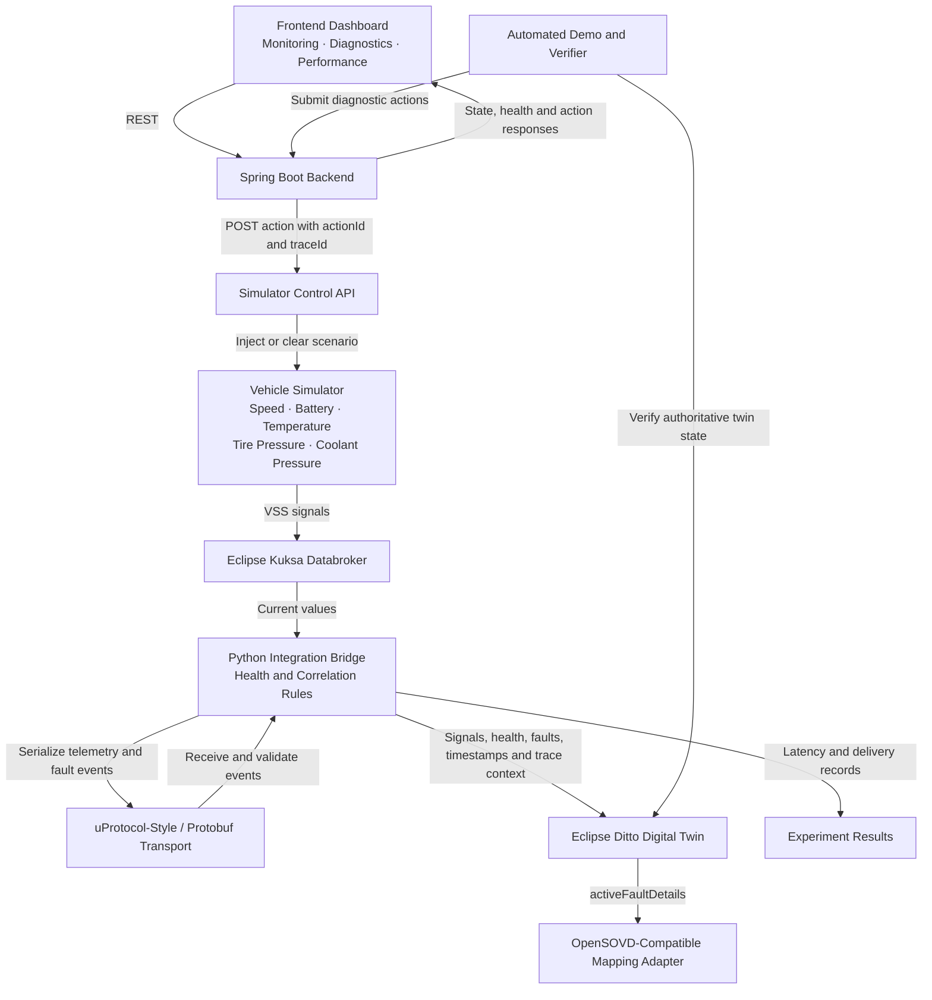
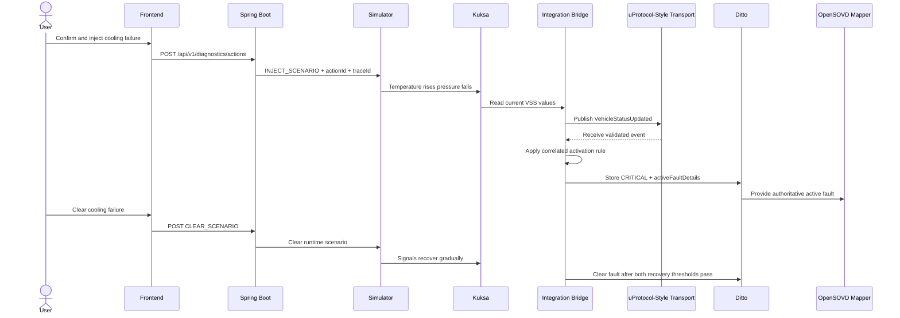
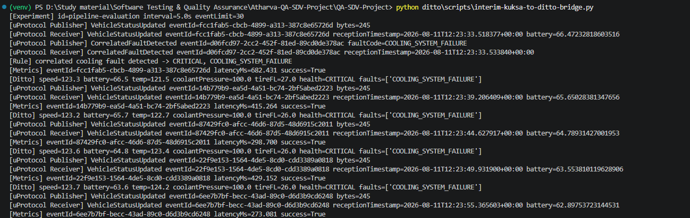
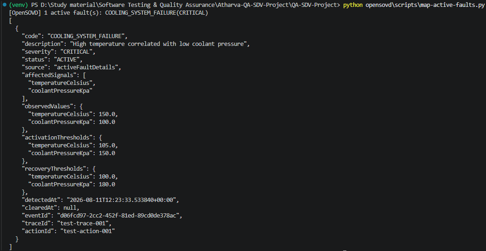
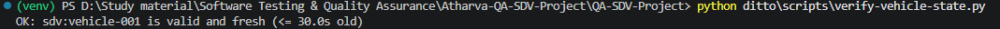
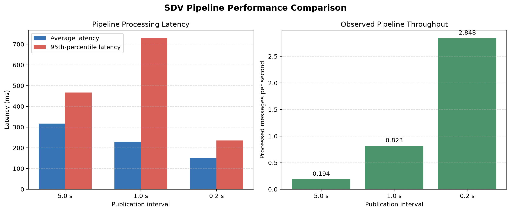

# Software-Defined Vehicle Health Monitoring and Diagnostic System

An end-to-end graduate software-engineering project for vehicle telemetry, digital-twin synchronization, correlated fault detection, remote diagnostic control, automated verification, and performance evaluation.

[](backend/)
[](ditto/scripts/)
[](vehicle-simulator/docker-compose.yml)
[](#testing-and-validation)

> **Demo video:** [Watch the final end-to-end demonstration](https://www.youtube.com/watch?v=7wSngiLC3co)

## Overview

This project integrates open-source automotive and cloud components into a working monitoring and diagnostic system for one simulated vehicle, `vehicle-001`. The completed system:

- Generates speed, battery, engine-temperature, tire-pressure, and coolant-pressure signals.
- Publishes VSS-aligned signals through Eclipse Kuksa.
- Serializes telemetry and diagnostic events using Protobuf and a uProtocol-style layer.
- Evaluates individual and correlated health rules with recovery hysteresis.
- Synchronizes telemetry, health, and detailed fault records to Eclipse Ditto.
- Maps active faults into an OpenSOVD-compatible diagnostic representation.
- Exposes Spring Boot REST APIs for monitoring and diagnostic actions.
- Provides a browser dashboard for monitoring, diagnostic control, and performance results.
- Supports runtime injection and clearing of a cooling-system failure.
- Preserves `eventId`, `traceId`, and `actionId` across the workflow.
- Measures processing latency, throughput, delivery success, detection time, and recovery time.

## Final Architecture

This diagram reuses the layout of the original README while representing the complete post–Iteration 3 system.



Two cooperating paths form the final system:

1. **Telemetry and diagnostic state:** Simulator → Kuksa → bridge → uProtocol-style transport → Ditto → OpenSOVD-compatible mapper.
2. **Diagnostic control:** Frontend or demo runner → Spring Boot → simulator control API → simulator. The resulting signals return through the telemetry path and activate or clear the Ditto fault.

The project uses an in-process **uProtocol-style** transport and an **OpenSOVD-compatible** mapper; it does not claim to deploy the complete production reference stacks.

## End-to-End Diagnostic Flow



## Iteration 3 Extensions

Iteration 3 converted the earlier monitoring pipeline into a controllable, traceable diagnostic system.

### Simulator and Kuksa

- Added `coolantPressureKpa` and the VSS path `Vehicle.Powertrain.CombustionEngine.EngineCoolant.Pressure`.
- Added a coolant-pressure VSS overlay and Databroker configuration.
- Added gradual pressure reduction during failure and recovery after clearing.
- Added a threaded control server on port `8090`.
- Added scenario injection, clearing, state lookup, and chunked-request handling.

### Correlated health rule

Activation requires both abnormal signals:

```text
temperatureCelsius >= 105.0
AND coolantPressureKpa <= 150.0
```

Recovery requires both signals to return to safe ranges:

```text
temperatureCelsius <= 100.0
AND coolantPressureKpa >= 180.0
```

Separate activation and recovery thresholds provide hysteresis.

### uProtocol-style events

- Extended `VehicleStatusUpdated` with coolant pressure.
- Added `CorrelatedFaultDetected` and `CorrelatedFaultCleared` messages.
- Added diagnostic-action request and lifecycle messages.
- Preserved event, trace, action, vehicle, and timestamp metadata.
- Validated missing, duplicate, corrupted, and invalid events.

### Ditto and OpenSOVD-compatible diagnostics

- Added coolant pressure and `diagnostics.activeFaultDetails` to the Thing.
- Persisted fault code, description, severity, status, affected signals, observed values, activation/recovery thresholds, timestamps, `eventId`, `traceId`, and `actionId`.
- Added bounded retry handling for transient Ditto HTTP timeouts.
- Updated the mapper to use complete detailed records while retaining a simple-fault fallback.

### Spring Boot backend

- Added real `POST /api/v1/diagnostics/actions` and `GET /api/v1/diagnostics/actions/{actionId}` endpoints.
- Added validation, action storage, identifiers, timestamps, and lifecycle responses.
- Added a real HTTP adapter forwarding actions to the simulator.
- Added configurable development/HTTP simulator modes and browser CORS.
- Extended the state model and health engine with coolant-pressure correlation.

### Frontend and automation

- Added Vehicle Dashboard, Diagnostics, and Performance pages.
- Added real clients for state, health, action submission, and action lookup.
- Added action confirmation and connected, stale, disconnected, validation, and status states.
- Added one-command startup/shutdown and automated scenario execution.
- Verified `HEALTHY → CRITICAL → HEALTHY`, full fault details, ID correlation, mapping, and latency output.

## Iteration 3 Evidence

| Correlated fault detection | OpenSOVD-compatible output | Ditto verification |
|---|---|---|
|  |  |  |

See [Iteration 3 evidence](docs/evidence/iteration-3/evidence.md).

## Components

| Component | Final responsibility |
|---|---|
| Vehicle Simulator | Generates five signals and exposes scenario control. |
| Eclipse Kuksa | Stores VSS-aligned vehicle data over gRPC. |
| Integration Bridge | Reads Kuksa, evaluates rules, updates Ditto, and records metrics. |
| uProtocol-Style Layer | Serializes Protobuf events and validates delivery metadata. |
| Eclipse Ditto | Maintains the authoritative twin, health state, and detailed faults. |
| OpenSOVD Mapper | Produces an OpenSOVD-compatible diagnostic shape. |
| Spring Boot | Exposes monitoring/action APIs and controls the simulator. |
| Frontend | Provides monitoring, diagnostics, and performance views. |
| Verifier | Checks twin completeness, consistency, freshness, and fault details. |

## Vehicle Signals

| Signal | Unit | VSS path |
|---|---:|---|
| Speed | km/h | `Vehicle.Speed` |
| Battery state of charge | % | `Vehicle.Powertrain.TractionBattery.StateOfCharge.Current` |
| Engine coolant temperature | °C | `Vehicle.Powertrain.CombustionEngine.EngineCoolant.Temperature` |
| Engine coolant pressure | kPa | `Vehicle.Powertrain.CombustionEngine.EngineCoolant.Pressure` |
| Front-left tire pressure | psi | `Vehicle.Chassis.Axle.Row1.Wheel.Left.Tire.Pressure` |

## REST APIs

| Service | Method | Endpoint | Purpose |
|---|---|---|---|
| Spring Boot | `GET` | `/api/vehicles/{vehicleId}/state` | Read backend vehicle state. |
| Spring Boot | `GET` | `/api/vehicles/{vehicleId}/health` | Read evaluated health. |
| Spring Boot | `POST` | `/api/v1/diagnostics/actions` | Inject or clear a scenario. |
| Spring Boot | `GET` | `/api/v1/diagnostics/actions/{actionId}` | Retrieve an action. |
| Simulator | `GET` | `/health` | Check control service availability. |
| Simulator | `POST` | `/api/v1/scenarios/actions` | Apply a runtime scenario action. |
| Simulator | `GET` | `/api/v1/scenarios/COOLING_SYSTEM_FAILURE` | Read scenario/action context. |

```bash
curl -X POST http://localhost:8082/api/v1/diagnostics/actions \
  -H "Content-Type: application/json" \
  -d '{"vehicleId":"vehicle-001","action":"INJECT_SCENARIO","scenario":"COOLING_SYSTEM_FAILURE"}'
```

## Repository Structure

```text
QA-SDV-Project/
├── backend/                  # Spring Boot APIs, adapters, health engine and tests
├── ditto/                    # Thing configuration, bridge, verifier and fault rules
├── docs/                     # Contracts, plans and evidence
├── experiments/              # Measurement, summaries, CSVs and chart
├── frontend/                 # Dashboard, Diagnostics and Performance pages
├── opensovd/                 # Action adapter and diagnostic mapper
├── scripts/                  # Start, stop and full-scenario automation
├── tests/                    # Root Python validation
├── uprotocol/                # Protobuf contracts and transport
└── vehicle-simulator/        # Kuksa Compose stack, simulator and control API
```

## Ports

| Service | Port |
|---|---:|
| Frontend | `3000` |
| Ditto Nginx API | `8080` |
| Ditto gateway | `8081` |
| Spring Boot | `8082` |
| Simulator control | `8090` |
| Kuksa Databroker | `55556` |

## Quick Start

### 1. Prepare the repository

```bash
git clone https://github.com/ankit-suman-07/QA-SDV-Project.git
cd QA-SDV-Project
python3 -m venv .venv
source .venv/bin/activate
pip install -r vehicle-simulator/requirements.txt
```

### 2. Start external Eclipse Ditto

From its Docker deployment directory:

```bash
docker compose up -d
docker compose up -d nginx   # only if nginx remains in Created state
docker compose ps -a
```

Verify it:

```bash
curl -s -u ditto:ditto -o /dev/null \
  -w "Eclipse Ditto: HTTP %{http_code}\n" \
  http://localhost:8080/api/2/things
```

### 3. Initialize the policy and Thing

```bash
curl -u ditto:ditto -X PUT -H "Content-Type: application/json" \
  --data-binary @ditto/config/vehicle-policy.json \
  http://localhost:8080/api/2/policies/sdv:vehicle-001-policy

curl -u ditto:ditto -X PUT -H "Content-Type: application/json" \
  --data-binary @ditto/config/vehicle-001-thing.json \
  http://localhost:8080/api/2/things/sdv:vehicle-001
```

### 4. Start all repository services

```bash
source .venv/bin/activate
./scripts/start-demo.sh
```

- Frontend: <http://localhost:3000/index.html>
- Backend health: <http://localhost:8082/actuator/health>
- Simulator health: <http://localhost:8090/health>
- Ditto Thing: <http://localhost:8080/api/2/things/sdv:vehicle-001>

### 5. Run the complete scenario

```bash
./scripts/run-demo-scenario.py
```

It passes only after validating injection, `CRITICAL`, detailed correlated fault data, matching identifiers, mapping, clearing, and recovery to `HEALTHY`.

### 6. Stop repository services

```bash
./scripts/stop-demo.sh
```

The external Ditto stack is intentionally left running.

## Frontend

- **Vehicle Dashboard:** vehicle identity, freshness/connectivity, temperature, coolant pressure, health, active faults, and timestamp.
- **Diagnostics:** confirmed inject/clear actions, action/trace IDs, lookup polling, and diagnostic data.
- **Performance:** retained publication-rate experiment results; it currently uses a versioned fixture because there is no live Spring metrics endpoint.

The Diagnostics action path is real. Backend state/health reads use development adapters unless real component adapters are explicitly configured.

## Testing and Validation

```bash
# Spring Boot (verified: 35 tests passing)
cd backend && ./mvnw test

# Root Python validation
python -m unittest discover -s tests -p "test_*.py" -v

# uProtocol-style transport
python -m pytest uprotocol/tests/test_transport.py \
  uprotocol/tests/test_extended_transport.py -v

# Simulator
python -m pytest vehicle-simulator/tests -v

# Live Kuksa publication, with simulator running
DATABROKER_HOST=127.0.0.1 DATABROKER_PORT=55556 \
python -m pytest vehicle-simulator/tests/test_kuksa_publication.py -v
```

Coverage includes controllers, correlation logic, HTTP action forwarding, coolant-pressure generation/publication, scenario context, chunked HTTP, Protobuf events, delivery tracking, Ditto retries, detailed faults, OpenSOVD mapping, twin verification, and experiment calculations.

## Functional and Non-Functional Implementation

**Functional:** five-signal simulation, Kuksa publication, Protobuf round trips, Ditto synchronization, correlated detection/recovery, remote inject/clear actions, REST validation, detailed fault persistence, diagnostic mapping, frontend control, and complete-scenario automation.

**Non-functional:** retries and malformed-message rejection, end-to-end traceability, independent consistency/freshness verification, layered automated testing, reproducible CSV/evidence artifacts, one-command orchestration, and latency/throughput observability.

## Performance Results

### Publication-rate evaluation

| Interval | Messages | Average | P95 | Throughput | Success |
|---:|---:|---:|---:|---:|---:|
| `5.0 s` | 30 | `316.997 ms` | `466.788 ms` | `0.194 msg/s` | `100%` |
| `1.0 s` | 30 | `227.832 ms` | `730.731 ms` | `0.823 msg/s` | `100%` |
| `0.2 s` | 30 | `150.202 ms` | `235.013 ms` | `2.848 msg/s` | `100%` |



### Iteration 3 full scenario

Five successful `HEALTHY → CRITICAL → HEALTHY` runs were recorded.

| Measurement | Minimum | Average | Median | Maximum |
|---|---:|---:|---:|---:|
| Detection | `55,169.650 ms` | `67,493.584 ms` | `69,200.510 ms` | `75,993.309 ms` |
| Recovery | `36,473.512 ms` | `52,846.890 ms` | `47,124.344 ms` | `72,920.335 ms` |

These are gradual scenario-transition times, not only bridge-processing latency.

## Troubleshooting

- **Ditto HTTP `000`:** ensure Docker and Ditto are running; start Nginx if needed.
- **`thing.notfound`:** create the policy before the Thing.
- **Port `8081` busy:** Ditto uses it; the frontend correctly uses `3000`.
- **Port `8082` busy:** inspect with `lsof -nP -iTCP:8082 -sTCP:LISTEN`.
- **Docker `429`:** retry later or authenticate with `docker login`.
- **Bridge timeout:** confirm Ditto health and inspect `.demo-runtime/logs/bridge.log`.

Runtime logs are written to `.demo-runtime/logs/bridge.log`, `backend.log`, and `frontend.log`.

## Known Limitations

- uProtocol communication is Protobuf-backed but in process, not a distributed MQTT/Zenoh deployment.
- OpenSOVD is validated through a compatible mapper because the evaluated gateway is read-only.
- The live Kuksa-to-Ditto pipeline is the Python bridge; Spring component adapters default to development implementations.
- The Performance page uses retained results rather than a live metrics endpoint.
- Stored actions remain accepted; the backend does not yet drive every action through all lifecycle states.
- The bridge reads front-left tire pressure; other wheel positions are represented but not populated from Kuksa.
- Thirty samples per publication condition limit strong tail-latency conclusions.

## Project Evolution

| Iteration | Outcome |
|---|---|
| 1 | Simulator → Kuksa → Protobuf → health rule → Ditto baseline. |
| 2 | Configurable rates, delivery tracking, verification, mapping, metrics, and 90-event evaluation. |
| 3 | Coolant pressure, correlated diagnostics, runtime control, Spring Boot, frontend, trace propagation, complete fault records, retries, and automated E2E demonstration. |

## Documentation

- [Vehicle health contracts](docs/04-vehicle-health-contracts.md)
- [Testing and results](docs/05-testing-and-results.md)
- [Iteration 3 task distribution](docs/09-final-iteration-task-distribution.md)
- [Iteration 3 contract](docs/10-iteration-3-contract.md)
- [Frontend API contract](docs/11-frontend-api-contract.md)
- [Iteration 3 evidence](docs/evidence/iteration-3/evidence.md)

## Team

Developed by Ankit Suman, Emmanuel Adegboye, Benjamin Emeshili, Atharva Rajadhyaksha, and Hasin Anzum Mehtaj at Ontario Tech University.

## License

Project source is provided under [LICENSE](LICENSE). External components remain subject to their respective licenses.
