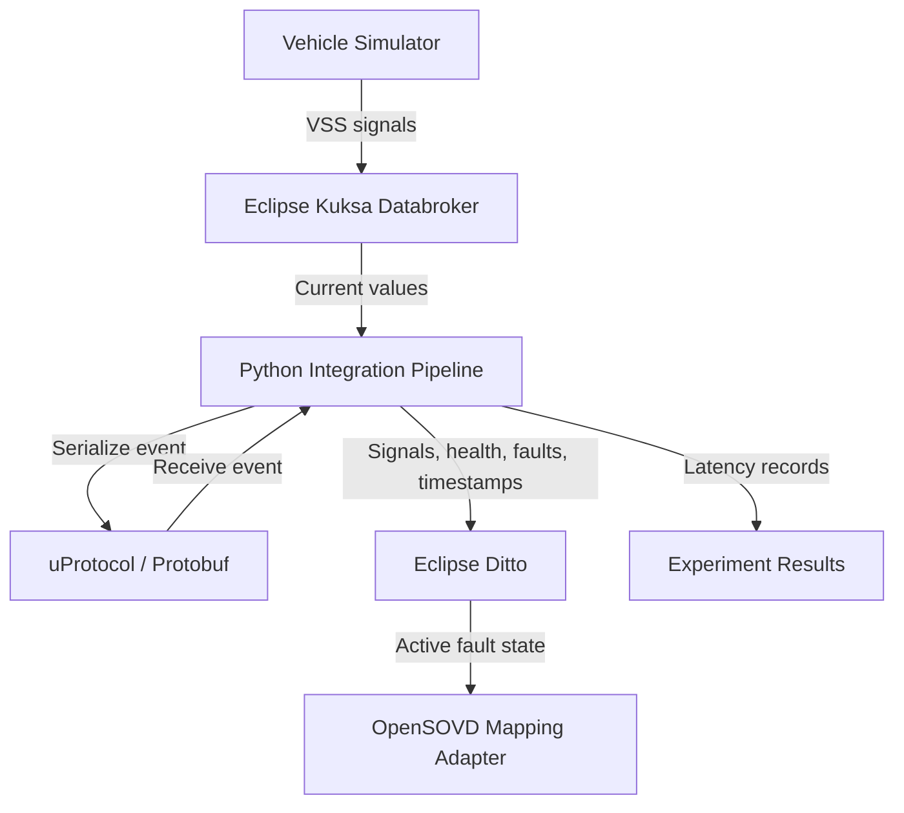

# Software-Defined Vehicle Health Monitoring and Diagnostic System

## Project Overview

This graduate project implements and evaluates a health-monitoring and diagnostic pipeline for one simulated software-defined vehicle, `vehicle-001`.

- Demo video: [Link](https://youtu.be/w7lZ9HRNJ34)

The system:

- Generates speed, battery, temperature, and tire-pressure signals.
- Publishes the signals to Eclipse Kuksa.
- Serializes and receives vehicle-status events through a Protobuf-based uProtocol communication layer.
- Applies a vehicle-health rule and tracks active faults.
- Synchronizes signals, health state, fault count, and timestamps with an Eclipse Ditto digital twin.
- Maps active Ditto faults into an OpenSOVD-compatible diagnostic representation.
- Measures pipeline latency and throughput at multiple publication intervals.

## Iteration 2 Extension

Iteration 2 extends and evaluates the baseline pipeline through:

- Configurable simulator publication intervals: `5.0`, `1.0`, and `0.2` seconds.
- Event IDs and publication/reception timestamps for message traceability.
- Delivery tracking for missing, duplicate, and invalid events.
- Ditto state, timestamp, freshness, and fault-count verification.
- OpenSOVD-compatible fault mapping.
- Pipeline latency recording and CSV export.
- Minimum, average, median, p95, and maximum latency calculations.
- Throughput and success-rate evaluation.
- Automated tests and repeatable experiment procedures.

## Runtime Architecture



The Python bridge is the active integration runtime used for the demonstrated pipeline. The Spring Boot backend remains a project foundation and is not part of the measured Iteration 2 runtime.

## Component Roles

| Component | Role |
|---|---|
| Vehicle Simulator | Generates normal and fault-mode vehicle signals at a configurable interval. |
| Eclipse Kuksa | Stores and exposes simulated vehicle signals through VSS paths. |
| uProtocol / Protobuf | Serializes and receives traceable `VehicleStatusUpdated` events. |
| Integration Pipeline | Reads Kuksa, evaluates health, updates Ditto, and records measurements. |
| Eclipse Ditto | Maintains the synchronized digital twin for `vehicle-001`. |
| OpenSOVD Adapter | Maps active Ditto faults into a standardized diagnostic resource shape. |
| Experiment Tools | Export raw latency measurements, calculate statistics, and generate charts. |

## Current Communication Scope

The project uses Protobuf serialization with an in-process uProtocol-compatible publisher and receiver. Messages are serialized into bytes and deserialized as they would be across a wire, but a production network transport such as MQTT or Zenoh is not used.

## Repository Structure

```text
QA-SDV-Project/
├── backend/                         # Spring Boot backend foundation
├── ditto/
│   ├── config/                      # Ditto policy and Thing definitions
│   └── scripts/                     # Pipeline bridge and state verifier
├── docs/
│   ├── evidence/iteration-2/        # Iteration 2 evidence
│   └── 05-testing-and-results.md    # Evaluation report
├── experiments/
│   ├── latency_recorder.py
│   ├── pipeline_evaluator.py
│   ├── result_summary.py
│   ├── generate_performance_chart.py
│   └── results/                     # Raw CSVs, summary, and chart
├── frontend/                        # Frontend foundation
├── opensovd/
│   ├── fault_mapper.py
│   └── scripts/map-active-faults.py
├── tests/                            # Root Python automated tests
├── uprotocol/
│   ├── proto/                        # Protobuf definitions
│   ├── generated/                    # Generated Python classes
│   ├── transport.py
│   └── tests/
└── vehicle-simulator/
    ├── src/
    ├── tests/
    ├── Dockerfile
    └── docker-compose.yml
```

## Vehicle Signals

| Signal | Kuksa/VSS path |
|---|---|
| Speed | `Vehicle.Speed` |
| Battery level | `Vehicle.Powertrain.TractionBattery.StateOfCharge.Current` |
| Engine temperature | `Vehicle.Powertrain.CombustionEngine.EngineCoolant.Temperature` |
| Front-left tire pressure | `Vehicle.Chassis.Axle.Row1.Wheel.Left.Tire.Pressure` |

## Prerequisites

Install:

- Git
- Docker Desktop with Docker Compose
- Python 3.10 or newer
- `curl`
- At least 4 GB of memory allocated to Docker Desktop

The demonstrated environment uses macOS. Equivalent Docker, Python, and HTTP commands can be used on Linux or Windows.

## 1. Clone the Repository

```bash
git clone https://github.com/ankit-suman-07/QA-SDV-Project.git
cd QA-SDV-Project
```

## 2. Create the Python Environment

macOS or Linux:

```bash
python3 -m venv .venv
source .venv/bin/activate
```

Windows PowerShell:

```powershell
python -m venv .venv
.venv\Scripts\Activate.ps1
```

Install the required Python packages:

```bash
python -m pip install --upgrade pip
python -m pip install \
  kuksa_client==0.5.1 \
  requests \
  python-dotenv \
  "protobuf>=7.35.0" \
  matplotlib
```

Generated Protobuf Python classes are committed under `uprotocol/generated`, so `protoc` is not required to run the demonstrated pipeline.

## 3. Start Eclipse Ditto

The complete Eclipse Ditto source is not stored in this repository. Clone and run the official Docker deployment in a separate local directory:

```bash
mkdir -p ../tmp
git clone --depth 1 \
  https://github.com/eclipse-ditto/ditto.git \
  ../tmp/eclipse-ditto

cd ../tmp/eclipse-ditto/deployment/docker
docker compose up -d
docker compose ps
```

Initial `502 Bad Gateway` responses may occur while the Ditto cluster starts. Continue when this returns HTTP `200`:

```bash
curl -i -u ditto:ditto \
  http://localhost:8080/api/2/things
```

Return to the repository root before continuing.

## 4. Create the Ditto Policy and Vehicle Thing

Create the policy:

```bash
curl -i -u ditto:ditto \
  -X PUT \
  -H "Content-Type: application/json" \
  --data-binary @ditto/config/vehicle-policy.json \
  http://localhost:8080/api/2/policies/sdv:vehicle-001-policy
```

Create the digital twin:

```bash
curl -i -u ditto:ditto \
  -X PUT \
  -H "Content-Type: application/json" \
  --data-binary @ditto/config/vehicle-001-thing.json \
  http://localhost:8080/api/2/things/sdv:vehicle-001
```

Verify it:

```bash
curl -s -u ditto:ditto \
  http://localhost:8080/api/2/things/sdv:vehicle-001 \
  | python3 -m json.tool
```

## 5. Start Kuksa and the Vehicle Simulator

Kuksa listens on port `55555` inside Docker and is exposed on host port `55556`.

Start the simulator in normal mode with a five-second interval:

```bash
INJECT_FAULT=0 \
PUBLISH_INTERVAL_SECONDS=5.0 \
docker compose \
  -f vehicle-simulator/docker-compose.yml \
  up -d --build
```

Verify both services:

```bash
docker compose \
  -f vehicle-simulator/docker-compose.yml \
  ps
```

Verify signal publication:

```bash
docker compose \
  -f vehicle-simulator/docker-compose.yml \
  logs --tail=10 provider
```

Expected output includes:

```text
mode=normal interval=5.0 speed=... battery=... engine_temp=... tire_pressure=...
```

## 6. Run the Integration Pipeline

Keep Kuksa, the simulator, and Ditto running. From the repository root:

```bash
EXPERIMENT_ID=baseline-run \
EXPERIMENT_EVENT_LIMIT=30 \
PUBLISH_INTERVAL_SECONDS=5.0 \
EXPERIMENT_RESULTS_FILE=experiments/results/baseline-run.csv \
python ditto/scripts/interim-kuksa-to-ditto-bridge.py
```

The pipeline processes 30 events and exits after exporting the results.

Expected output includes:

```text
[uProtocol Publisher] eventId=... publicationTimestamp=...
[uProtocol Receiver] eventId=... receptionTimestamp=...
[Metrics] eventId=... latencyMs=... success=True
[Ditto] speed=... battery=... health=...
[Experiment Complete] results=...
[Summary] messages=30 successRate=...
```

Publisher and receiver event IDs should match.

## 7. Verify the Ditto Digital Twin

Run the verifier immediately after a pipeline run:

```bash
python ditto/scripts/verify-vehicle-state.py \
  --publication-interval-seconds 5.0
```

Expected result:

```text
OK: sdv:vehicle-001 is valid and fresh
```

The verifier checks:

- Required signal and health fields
- Valid health classification
- `faultCount` and `activeFaults` consistency
- ISO 8601 processing timestamps
- Digital-twin freshness

Inspect the complete state:

```bash
curl -s -u ditto:ditto \
  http://localhost:8080/api/2/things/sdv:vehicle-001 \
  | python3 -m json.tool
```

## 8. Reproduce the Low-Battery Fault

Recreate the provider in fault mode:

```bash
INJECT_FAULT=1 \
PUBLISH_INTERVAL_SECONDS=1.0 \
docker compose \
  -f vehicle-simulator/docker-compose.yml \
  up -d --force-recreate provider
```

Run a short fault pipeline:

```bash
EXPERIMENT_ID=fault-validation \
EXPERIMENT_EVENT_LIMIT=5 \
PUBLISH_INTERVAL_SECONDS=1.0 \
EXPERIMENT_RESULTS_FILE=/tmp/sdv-fault-validation.csv \
python ditto/scripts/interim-kuksa-to-ditto-bridge.py
```

Expected output includes:

```text
[Rule] battery=... < 20 -> WARNING, BATTERY_LOW
[Ditto] ... health=WARNING
```

The Ditto health state should contain:

```json
{
  "status": "WARNING",
  "activeFaults": ["BATTERY_LOW"],
  "faultCount": 1
}
```

## 9. Verify the OpenSOVD Mapping

With the fault state active:

```bash
python opensovd/scripts/map-active-faults.py
```

Expected output includes:

```text
[OpenSOVD] 1 active fault(s): BATTERY_LOW(...)
```

For continuous observation:

```bash
python opensovd/scripts/map-active-faults.py --watch
```

The available OpenSOVD mock gateway is read-only. Therefore, the project uses a tested adapter that maps current Ditto faults into the agreed OpenSOVD-compatible diagnostic shape.

## 10. Reproduce Fault Recovery

Return the provider to normal mode:

```bash
INJECT_FAULT=0 \
PUBLISH_INTERVAL_SECONDS=1.0 \
docker compose \
  -f vehicle-simulator/docker-compose.yml \
  up -d --force-recreate provider
```

Run the short pipeline again:

```bash
EXPERIMENT_ID=recovery-validation \
EXPERIMENT_EVENT_LIMIT=5 \
PUBLISH_INTERVAL_SECONDS=1.0 \
EXPERIMENT_RESULTS_FILE=/tmp/sdv-recovery-validation.csv \
python ditto/scripts/interim-kuksa-to-ditto-bridge.py
```

The health state should return to:

```json
{
  "status": "HEALTHY",
  "activeFaults": [],
  "faultCount": 0
}
```

## 11. Run Automated Tests

Run the complete root Python test suite:

```bash
python -m unittest discover \
  -s tests \
  -p "test_*.py" \
  -v
```

The validated Iteration 2 version executes 34 tests successfully.

The tests cover:

- Latency recording and CSV export
- Result-summary calculations
- Pipeline evaluation
- uProtocol serialization and delivery tracking
- Ditto state verification
- Fault-count consistency
- OpenSOVD diagnostic mapping

Optional component-specific tests:

```bash
python -m unittest discover \
  -s uprotocol/tests \
  -p "test_*.py" \
  -v
```

## 12. Reproduce the Performance Experiments

Run each experiment using the same interval for the simulator and pipeline.

### 5.0-second experiment

```bash
INJECT_FAULT=0 PUBLISH_INTERVAL_SECONDS=5.0 \
docker compose -f vehicle-simulator/docker-compose.yml \
  up -d --force-recreate provider

EXPERIMENT_ID=interval-5s \
EXPERIMENT_EVENT_LIMIT=30 \
PUBLISH_INTERVAL_SECONDS=5.0 \
EXPERIMENT_RESULTS_FILE=experiments/results/interval-5s.csv \
python ditto/scripts/interim-kuksa-to-ditto-bridge.py
```

### 1.0-second experiment

```bash
INJECT_FAULT=0 PUBLISH_INTERVAL_SECONDS=1.0 \
docker compose -f vehicle-simulator/docker-compose.yml \
  up -d --force-recreate provider

EXPERIMENT_ID=interval-1s \
EXPERIMENT_EVENT_LIMIT=30 \
PUBLISH_INTERVAL_SECONDS=1.0 \
EXPERIMENT_RESULTS_FILE=experiments/results/interval-1s.csv \
python ditto/scripts/interim-kuksa-to-ditto-bridge.py
```

### 0.2-second experiment

```bash
INJECT_FAULT=0 PUBLISH_INTERVAL_SECONDS=0.2 \
docker compose -f vehicle-simulator/docker-compose.yml \
  up -d --force-recreate provider

EXPERIMENT_ID=interval-0.2s \
EXPERIMENT_EVENT_LIMIT=30 \
PUBLISH_INTERVAL_SECONDS=0.2 \
EXPERIMENT_RESULTS_FILE=experiments/results/interval-0.2s.csv \
python ditto/scripts/interim-kuksa-to-ditto-bridge.py
```

Regenerate the chart:

```bash
python experiments/generate_performance_chart.py
```

## Iteration 2 Results

| Interval | Events | Minimum (ms) | Average (ms) | Median (ms) | P95 (ms) | Maximum (ms) | Success Rate | Throughput (messages/s) |
|---:|---:|---:|---:|---:|---:|---:|---:|---:|
| 5.0 s | 30 | 185.278 | 316.997 | 318.525 | 466.788 | 532.126 | 100% | 0.194 |
| 1.0 s | 30 | 110.405 | 227.832 | 170.275 | 730.731 | 910.352 | 100% | 0.823 |
| 0.2 s | 30 | 108.513 | 150.202 | 134.686 | 235.013 | 347.421 | 100% | 2.848 |


Detailed methodology, analysis, and limitations are documented in [`docs/05-testing-and-results.md`](docs/05-testing-and-results.md).

## Stopping the System

Stop Kuksa and the simulator:

```bash
docker compose \
  -f vehicle-simulator/docker-compose.yml \
  down
```

Stop Ditto from its deployment directory:

```bash
cd ../tmp/eclipse-ditto/deployment/docker
docker compose down
```

## Troubleshooting

### Port 55555 is already in use

The repository exposes Kuksa on host port `55556`. Confirm:

```yaml
ports:
  - "55556:55555"
```

The host-side bridge must connect to port `55556`.

### Ditto returns 502 Bad Gateway

The Ditto cluster is still initializing. Check its containers with `docker compose ps`, wait, and retry the API request.

### Protobuf generated-code/runtime mismatch

Install a Protobuf runtime compatible with the committed generated code:

```bash
python -m pip install --upgrade "protobuf>=7.35.0"
```

### Docker Hub returns 429 Too Many Requests

This indicates registry rate limiting. Reuse already-built images or wait before rebuilding.

### Verifier reports a stale digital twin

Run the verifier immediately after the pipeline, or use an explicit maximum age while diagnosing:

```bash
python ditto/scripts/verify-vehicle-state.py \
  --max-age-seconds 15
```

## Known Limitations

- uProtocol delivery is in-process rather than a distributed production transport.
- OpenSOVD uses a tested mapping adapter because the available mock gateway is read-only.
- Only the front-left tire-pressure value originates from Kuksa; the Protobuf message temporarily copies it to all four wheel fields.
- The health rule currently activates and clears the low-battery fault only.
- Ditto properties are updated through sequential HTTP requests.
- Performance measurements were collected on one local machine with 30 events per interval.
- Reported latency begins before uProtocol serialization and ends after Ditto updates; it excludes simulator-to-Kuksa delay and frontend rendering.
- The Spring Boot backend and frontend remain foundations and are not part of the measured runtime.

## Evidence and Documentation

- Iteration 2 evidence: `docs/evidence/iteration-2/`
- Testing and results: `docs/05-testing-and-results.md`
- Vehicle health contract: `docs/04-vehicle-health-contracts.md`
- Raw experiment data: `experiments/results/`

## License and External Components

Eclipse Kuksa, Eclipse Ditto, Eclipse uProtocol, and Eclipse OpenSOVD are external Eclipse Foundation projects and remain subject to their respective licenses. This repository contains the team's integration code, configuration, tests, evidence, documentation, and project-specific models.
