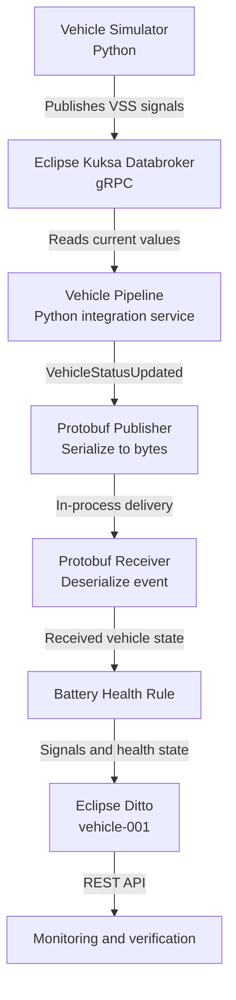

# Software-Defined Vehicle Health Monitoring and Diagnostic System

### Contributors, please read the contribution guidelines thoroughly here: [Link](https://github.com/ankit-suman-07/QA-SDV-Project/blob/main/docs/TEAM_GUIDELINES.md)

----


## Project Overview

This project implements a baseline Software-Defined Vehicle (SDV) data pipeline for one simulated vehicle, `vehicle-001`.

The system generates vehicle telemetry, publishes it to Eclipse Kuksa, transfers the normalized state through a Protobuf-based communication layer, evaluates a basic vehicle-health rule, and synchronizes the resulting state with an Eclipse Ditto digital twin.

Iteration 1 demonstrates:

- Simulated vehicle telemetry generation
- Eclipse Kuksa signal publication and retrieval
- Protobuf event serialization and reception
- Eclipse Ditto digital-twin synchronization
- A repeatable low-battery fault scenario
- Automated verification of the message flow

## Implemented Architecture



### Component Roles

| Component | Role |
|---|---|
| Vehicle Simulator | Generates speed, battery, temperature, and tire-pressure values and supports repeatable fault injection. |
| Eclipse Kuksa | Receives and exposes vehicle signals using VSS paths. |
| Vehicle Pipeline | Reads Kuksa signals and coordinates message processing, health evaluation, and Ditto synchronization. |
| Protobuf Communication Layer | Serializes `VehicleStatusUpdated` events into bytes and deserializes them at the receiver. |
| Health Rule | Produces `WARNING` and `BATTERY_LOW` when battery level is below 20%. |
| Eclipse Ditto | Stores the latest signals and calculated health state for `vehicle-001`. |

## Current Communication-Layer Scope

Iteration 1 uses Protobuf serialization with an in-process uProtocol-compatible publisher and receiver. It demonstrates observable message creation, byte serialization, delivery, deserialization, and event-ID traceability.

This baseline is not a production uProtocol transport. A distributed uProtocol transport and additional event types are planned for later iterations.

## Repository Structure

```text
QA-SDV-Project/
├── backend/                       # Spring Boot backend foundation
├── docs/                          # Project documentation
├── eclipse-components/
│   ├── ditto/
│   │   ├── vehicle-001-thing.json
│   │   ├── vehicle-policy.json
│   │   ├── uprotocol_transport.py
│   │   └── vehicle_pipeline.py
│   └── opensovd/                  # OpenSOVD prototype/evidence
├── frontend/                      # Frontend foundation
├── tests/
│   └── test_uprotocol_transport.py
├── uprotocol/
│   ├── proto/                     # Protobuf event definitions
│   └── generated/                 # Generated Python message classes
└── vehicle-simulator/
    ├── src/
    ├── Dockerfile
    └── docker-compose.yml
```

## Vehicle Signals

| Signal | Kuksa/VSS path |
|---|---|
| Speed | `Vehicle.Speed` |
| Battery level | `Vehicle.Powertrain.TractionBattery.StateOfCharge.Current` |
| Engine temperature | `Vehicle.Powertrain.CombustionEngine.EngineCoolant.Temperature` |
| Front-left tire pressure | `Vehicle.Chassis.Axle.Row1.Wheel.Left.Tire.Pressure` |

## Prerequisites

Install the following before running the project:

- Git
- Docker Desktop with Docker Compose
- At least 4 GB of memory allocated to Docker Desktop
- Python 3.10 or newer
- `curl`

The demonstrated development environment uses macOS, but the Docker and Python workflow can also run on Linux or Windows with equivalent shell commands.

## 1. Clone the Project

```bash
git clone <repository-url>
cd QA-SDV-Project
```

Replace `<repository-url>` with the private GitHub repository URL.

## 2. Create the Python Environment

From the project root:

```bash
python3 -m venv .venv
source .venv/bin/activate
```

On Windows PowerShell:

```powershell
.venv\Scripts\Activate.ps1
```

Install the runtime dependencies:

```bash
python -m pip install --upgrade pip
python -m pip install kuksa_client==0.5.1 requests python-dotenv
```

The generated Protobuf Python classes are included under `uprotocol/generated`, so `protoc` is not required merely to run the demonstrated pipeline.

## 3. Start Eclipse Ditto

The complete Eclipse Ditto source code is not stored inside this repository. Clone the official runtime into a separate local folder next to the project:

```bash
mkdir -p ../tmp
git clone --depth 1 https://github.com/eclipse-ditto/ditto.git ../tmp/eclipse-ditto
cd ../tmp/eclipse-ditto/deployment/docker
docker compose up -d
```

Wait for the Ditto services to initialize:

```bash
docker compose ps
```

Initial `502 Bad Gateway` responses can occur while the internal Ditto cluster is starting. Continue only after this request returns HTTP `200`:

```bash
curl -i -u ditto:ditto http://localhost:8080/api/2/things
```

Return to the project root:

```bash
cd ../../../QA-SDV-Project
```

If the relative path does not match the local directory layout, navigate directly to the cloned `QA-SDV-Project` folder.

## 4. Create the Ditto Policy and Vehicle Thing

From the project root, create the policy first:

```bash
curl -i -u ditto:ditto \
  -X PUT \
  -H "Content-Type: application/json" \
  --data-binary @eclipse-components/ditto/vehicle-policy.json \
  http://localhost:8080/api/2/policies/sdv:vehicle-001-policy
```

Create the digital twin:

```bash
curl -i -u ditto:ditto \
  -X PUT \
  -H "Content-Type: application/json" \
  --data-binary @eclipse-components/ditto/vehicle-001-thing.json \
  http://localhost:8080/api/2/things/sdv:vehicle-001
```

Verify the Thing:

```bash
curl -s -u ditto:ditto \
  http://localhost:8080/api/2/things/sdv:vehicle-001 \
  | python3 -m json.tool
```

## 5. Start Eclipse Kuksa and the Vehicle Simulator

The Kuksa Databroker listens on port `55555` inside Docker and is exposed on host port `55556` to avoid local port conflicts.

Ensure normal mode is configured in `vehicle-simulator/docker-compose.yml`:

```yaml
- INJECT_FAULT=0
```

Start Kuksa and the simulator:

```bash
docker compose -f vehicle-simulator/docker-compose.yml up --build -d
```

Verify both services:

```bash
docker compose -f vehicle-simulator/docker-compose.yml ps
```

The Databroker port mapping should include:

```text
0.0.0.0:55556->55555/tcp
```

Verify normal telemetry publication:

```bash
docker compose -f vehicle-simulator/docker-compose.yml logs --tail=20 provider
```

Expected output resembles:

```text
[normal] speed=60.1 battery=82.1 engine_temp=90.1 tire_pressure=32.2
```

## 6. Start the Integration Pipeline

Keep Kuksa, the simulator, and Ditto running. From the project root with the virtual environment active:

```bash
python eclipse-components/ditto/vehicle_pipeline.py
```

Expected repeating output:

```text
[uProtocol Publisher] eventId=... vehicleId=vehicle-001 bytes=...
[uProtocol Receiver] eventId=... vehicleId=vehicle-001 battery=...
[Ditto] speed=... battery=... temp=... tireFL=... health=HEALTHY
```

The publisher and receiver event IDs should match. This demonstrates that the serialized event was delivered and deserialized before the Ditto update.

## 7. Verify Continuous Ditto Synchronization

Leave the integration pipeline running. In another terminal:

```bash
curl -s -u ditto:ditto \
  http://localhost:8080/api/2/things/sdv:vehicle-001 \
  | python3 -m json.tool
```

Run the command again after several seconds. The signal values should change while the Thing ID remains `sdv:vehicle-001`.

For normal operation, the response should include:

```json
{
  "status": "HEALTHY",
  "activeFaults": []
}
```

## 8. Reproduce the Low-Battery Fault

The demonstrated functional modification is a repeatable low-battery condition.

Stop the normal provider:

```bash
docker compose -f vehicle-simulator/docker-compose.yml stop provider
```

Run the simulator locally in fault mode while keeping Kuksa running:

```bash
INJECT_FAULT=1 \
DATABROKER_HOST=127.0.0.1 \
DATABROKER_PORT=55556 \
python vehicle-simulator/src/main.py
```

Expected simulator output:

```text
[FAULT] speed=... battery=14.4 engine_temp=... tire_pressure=...
```

The integration-pipeline terminal should report:

```text
[Rule] battery=14.4 < 20 -> WARNING, BATTERY_LOW
[Ditto] ... health=WARNING
```

Verify the fault in Ditto:

```bash
curl -s -u ditto:ditto \
  http://localhost:8080/api/2/things/sdv:vehicle-001 \
  | python3 -m json.tool
```

The health feature should contain:

```json
{
  "status": "WARNING",
  "activeFaults": ["BATTERY_LOW"]
}
```

Stop the locally running fault simulator with `Control + C`.

## 9. Run the Automated Test

From the project root with the virtual environment active:

```bash
python -m unittest discover \
  -s tests \
  -p "test_uprotocol_transport.py" \
  -v
```

Expected result:

```text
Ran 1 test
OK
```

The test verifies:

- Protobuf byte serialization
- Message reception and deserialization
- Vehicle ID and event metadata
- Speed, battery, temperature, and tire-pressure values

## Demonstrated End-to-End Behaviour

The following runtime path can be reproduced using the preceding instructions:

```text
Vehicle Simulator
    -> Eclipse Kuksa
    -> Vehicle Integration Pipeline
    -> Protobuf Publisher
    -> In-process Receiver
    -> Battery Health Rule
    -> Eclipse Ditto
    -> REST API Verification
```

## Stopping the System

Stop the Kuksa and simulator containers:

```bash
docker compose -f vehicle-simulator/docker-compose.yml down
```

Stop Ditto from its deployment folder:

```bash
cd ../tmp/eclipse-ditto/deployment/docker
docker compose down
```

## Troubleshooting

### Port 55555 is already in use

The repository exposes Kuksa on host port `55556`. Confirm that `vehicle-simulator/docker-compose.yml` contains:

```yaml
ports:
  - "55556:55555"
```

The host-side integration pipeline must connect to port `55556`.

### Ditto returns 502 Bad Gateway

The Ditto cluster is still initializing. Check:

```bash
docker compose ps
```

Wait until the API responds successfully, then retry the request.

### Protobuf generated-code/runtime mismatch

Use the generated files committed under `uprotocol/generated` with the installed project dependencies. Do not regenerate them using an unrelated newer Protobuf compiler unless the runtime version is updated at the same time.

### Docker Hub returns 429 Too Many Requests

This is a registry rate limit rather than a project-code failure. Reuse already-built images or wait before rebuilding. The fault scenario can be run locally using the command in Step 8.

## Iteration 1 Evidence

Iteration 1 evidence includes:

- Kuksa and simulator container status
- Normal signal-publication logs
- Publisher and receiver logs with matching event IDs
- Consecutive Ditto API responses showing changing values
- Low-battery fault-injection output
- Ditto `WARNING` and `BATTERY_LOW` state
- Successful automated-test output

## Known Limitations

- The current message transport is in-process rather than distributed.
- Only the front-left tire-pressure signal is currently read from Kuksa. The baseline message temporarily maps that value to the four-wheel Protobuf structure.
- The initial health modification covers the low-battery scenario only.
- OpenSOVD integration, complete Spring Boot orchestration, production uProtocol transport, and the final dashboard remain future work.

## License and External Components

Eclipse Kuksa, Eclipse Ditto, and Eclipse uProtocol are external Eclipse Foundation projects and remain subject to their respective licenses. This repository contains the team's integration code, configuration, tests, documentation, and project-specific models.