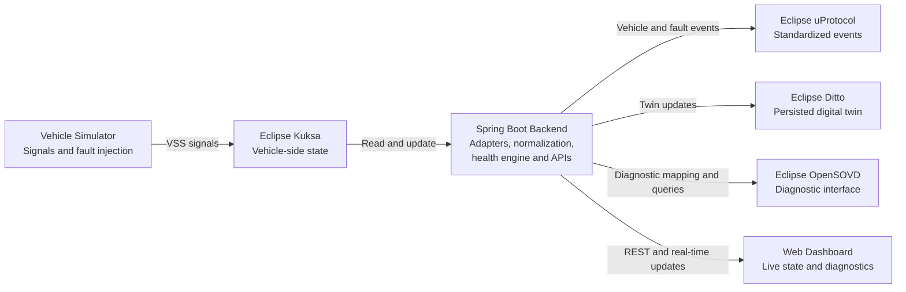

# Software-Defined Vehicle Health Monitoring and Diagnostic System

## Project Proposal

*Design and evaluation of a fault-aware Eclipse SDV pipeline*

# **1. Project Motivation and Objective**

Modern vehicles increasingly depend on software services that must exchange, persist, interpret, and expose vehicle state reliably. This project proposes a compact SDV pipeline that turns simulated vehicle signals into observable health states and diagnostic information while preserving a synchronized backend digital twin.

| **Primary objective:** Design, implement, and evaluate a fault-aware SDV pipeline in which simulated vehicle faults are detected, communicated, persisted, diagnosed, and displayed with measurable end-to-end behaviour. |
|---------------------------------------------------------------------------------------------------------------------------------------------------------------------------------------------------------------------------|

# **2. Scope and Success Criteria**

The minimum viable system models one virtual vehicle (vehicle-001); no physical vehicle is required. Scope is constrained for reliable delivery within 25 project days.

| **Category**    | **Committed scope**                                                                                 |
|-----------------|-----------------------------------------------------------------------------------------------------|
| Vehicle state   | Speed, battery state of charge, vehicle temperature, and four tire-pressure values                  |
| Fault scenarios | Low battery, high temperature, and low tire pressure; each can be activated and cleared             |
| Health output   | HEALTHY, WARNING, or CRITICAL with structured fault code, severity, value, and timestamp            |
| System output   | Live dashboard, Ditto twin, uProtocol events, OpenSOVD diagnostic responses, and test evidence      |
| Evaluation      | Functional correctness, state consistency, event delivery, and end-to-end fault-propagation latency |

# **3. Selected SDV Components**

| **Component**             | **Role and justification**                                                                                                                                                   |
|---------------------------|------------------------------------------------------------------------------------------------------------------------------------------------------------------------------|
| Eclipse Kuksa (mandatory) | Vehicle-side data abstraction and real-time state hub. It normalizes simulator output through agreed VSS/Kuksa signal paths and acts as the source of current vehicle state. |
| Eclipse Ditto (mandatory) | Backend digital-twin management. It persists the externally visible state, calculated health, active faults, and synchronization timestamps for vehicle-001.                 |
| Eclipse uProtocol         | Transport-independent messaging and event definitions. It standardizes vehicle-status and fault-lifecycle events and enables serialization and event-propagation testing.    |
| Eclipse OpenSOVD          | Vehicle diagnostic interface. It exposes vehicle information and active/cleared fault information derived from Kuksa/Ditto state and backend health logic.                   |

# **4. Proposed System Architecture**

Vehicle state originates in a configurable simulator and is published to Kuksa. The Spring Boot service reads and normalizes this state, applies custom health rules, produces standardized uProtocol events, updates the Ditto twin, and maps health results to the diagnostic interface. The dashboard consumes backend APIs rather than coupling itself to each Eclipse component.

*Figure 1. Runtime data flow, persistence, diagnostics, and modification points.*

## **4.1 Runtime Data Flow**

- The simulator publishes timestamped signal values and controlled abnormal values to Kuksa.

- The Spring Boot Kuksa adapter maps component-specific fields into a shared VehicleState model.

- The health engine evaluates thresholds, persistence, severity, and recovery conditions.

- The backend publishes uProtocol status/fault events, synchronizes Ditto, and supplies diagnostic resources.

- REST and real-time updates provide current state, twin status, and diagnostic information to the dashboard.

## **4.2 Shared Data Contract**

Before implementation, the team will freeze a shared contract covering field names, units, data types, VSS paths, backend DTOs, Protobuf fields, Ditto properties, and frontend mappings. Each record will include vehicleId, source timestamp, signal values, health status, and active faults. This contract is the primary control against incompatible component implementations.

# **5. Planned Functional Modifications**

| **Modification**           | **Implementation and observable behaviour**                                                                                                          |
|----------------------------|------------------------------------------------------------------------------------------------------------------------------------------------------|
| Repeatable fault injection | Configurable simulator scenarios inject and clear low-battery, overheating, and low-pressure conditions without code changes.                        |
| Vehicle health engine      | Spring Boot rules convert raw signals into health classifications and structured faults. Recovery margins reduce alert oscillation near thresholds.  |
| uProtocol extensions       | Protobuf schemas define VehicleStatusUpdated, HealthStatusChanged, FaultDetected, and FaultCleared events with IDs and timestamps.                   |
| Extended Ditto model       | The twin stores raw state plus calculated health, active faults, fault count, source timestamp, and diagnostic timestamp.                            |
| Diagnostic mapping         | Faults are mapped into OpenSOVD-compatible resources containing code, description, severity, affected signal, observed value, threshold, and status. |

# **6. Testing and Measurement Plan**

Evaluation is designed alongside implementation. Component tests establish local correctness, while integration and end-to-end tests verify observable behaviour across the pipeline.

## **6.1 Functional Validation**

| **Test level** | **Validation focus**                                                                                                              | **Evidence**                               |
|----------------|-----------------------------------------------------------------------------------------------------------------------------------|--------------------------------------------|
| Unit           | Health thresholds, severity aggregation, invalid values, boundary values, and fault clearing                                      | JUnit results                              |
| Component      | Kuksa publication/readback, uProtocol serialization, Ditto updates, and diagnostic queries                                        | Automated scripts and API assertions       |
| Integration    | Kuksa-to-backend mapping, backend-to-Ditto synchronization, event publication, and diagnostic mapping                             | JUnit integration tests and Postman/Newman |
| End to end     | Each injected fault appears with the correct severity in the twin, diagnostic response, and dashboard, then clears after recovery | Timestamped run log and screenshots        |

## **6.2 Non-Functional Measurement**

| **Primary metric:** End-to-end fault-propagation latency = dashboard receipt/render timestamp − simulator fault-injection timestamp. |
|--------------------------------------------------------------------------------------------------------------------------------------|

Correlation/event IDs and UTC timestamps will be recorded at injection, backend receipt, health detection, event publication, Ditto update, diagnostic availability, and dashboard receipt. At least 30 controlled runs will be performed across the three fault scenarios. The report will present minimum, mean, 95th-percentile, and maximum latency.

Reliability will be summarized as successfully observed events divided by injected events, together with missing and duplicate event counts. Backend state will also be compared with Ditto and diagnostic state after each run. These are evaluation measurements rather than performance claims made in advance.

# **7. Implementation Strategy and Schedule**

| **Phase**                       | **Days** | **Exit criterion**                                                                                     |
|---------------------------------|----------|--------------------------------------------------------------------------------------------------------|
| Architecture and contracts      | 1–2      | Scope, runtime flow, data contract, event/API contracts, risks, and fallbacks approved                 |
| Component setup                 | 3–9      | Each component demonstrates its minimum input/output independently                                     |
| Incremental integration         | 10–17    | One fault traverses the full pipeline; all four signals reach the backend and Ditto                    |
| Fault completion and automation | 18–21    | All three fault lifecycles work; automated tests, metrics, Docker Compose, and Jenkins are operational |
| Stabilization and submission    | 22–25    | Feature freeze, regression testing, results, report, demonstration, and final validation complete      |

## **7.1 Integration Approach**

Integration will proceed vertically rather than waiting for all component work to finish. Temperature will be the first signal carried from simulator to dashboard; the remaining signals and faults will be added only after this path succeeds. Component owners must provide connection instructions, sample payloads, and acceptance evidence during each handoff.

# **8. Responsibilities and Work Allocation**

| **Member**           | **Primary ownership**                    | **Key deliverables**                                                                                                            |
|----------------------|------------------------------------------|---------------------------------------------------------------------------------------------------------------------------------|
| Ankit Suman          | Backend Integration and Quality Lead     | Architecture; Spring Boot service and APIs; health engine; adapters; integration/E2E tests; latency analysis; final integration |
| Emmanuel Adegboye    | Kuksa and Vehicle Simulation Lead        | Kuksa setup; signal publisher; normal scenario; three repeatable fault scenarios; signal validation                             |
| Benjamin Emeshili    | uProtocol, OpenSOVD Support, and CI Lead | Protobuf/event schemas; serialization and propagation tests; OpenSOVD support; Jenkins pipeline                                 |
| Atharva Rajadhyaksha | Ditto and Diagnostics Lead               | Ditto model and synchronization; OpenSOVD configuration; diagnostic resources; fault lifecycle tests                            |
| Mehtaj               | Frontend and API Validation Lead         | Dashboard; live state and diagnostics; error states; Postman collection; frontend/API validation                                |

# **9. Feasibility, Risks, and Fallbacks**

The 25-day schedule provides approximately 125–250 person-hours at one to two hours per member per day. Feasibility depends on controlled scope, early contracts, incremental integration, and a feature freeze before final evaluation.

| **Risk**                         | **Mitigation and fallback**                                                                                                                                                           |
|----------------------------------|---------------------------------------------------------------------------------------------------------------------------------------------------------------------------------------|
| uProtocol integration complexity | Restrict schemas/events to the four committed types. If a full transport is not feasible, implement and disclose a bounded adapter while retaining real schema and propagation tests. |
| OpenSOVD setup or compatibility  | Prioritize vehicle information and active-fault queries. Use a documented backend adapter to map health results into the supported diagnostic representation.                         |
| Late component integration       | Freeze contracts on Day 2, require independent demonstrations by Day 9, and complete the first vertical path by Day 10–12.                                                            |
| Scope growth                     | Treat multi-vehicle support, advanced analytics, authentication, and additional fault types as optional; prohibit new features after feature freeze.                                  |
| Demo instability                 | Maintain automated smoke tests, deterministic scenarios, a clean startup guide, and backup screenshots or a short recorded run.                                                       |

# **10. Expected Outcomes and Graduate-Level Contribution**

The final deliverable will be a reproducible, containerized SDV pipeline and an evidence-based evaluation—not merely a dashboard or a collection of independently running components. The graduate-level contribution is the design of explicit component contracts and fault behaviour, the extension of messaging, twin, and diagnostic models, and the experimental assessment of propagation correctness, consistency, latency, and event reliability.

Successful completion will demonstrate: (1) correct propagation of normal and abnormal vehicle state; (2) consistent state across backend, Ditto, diagnostics, and dashboard; (3) standardized fault-lifecycle events; (4) repeatable automated tests; and (5) measured system behaviour reported with limitations.

# **11. Deliverables**

- Source code and configuration for all components in a shared GitHub repository

- Docker Compose environment and Jenkins build/test pipeline

- Web dashboard, automated test suites, Postman collection, and measurement dataset

- Architecture, data/API/event contracts, setup guide, final report, and presentation/demo materials
