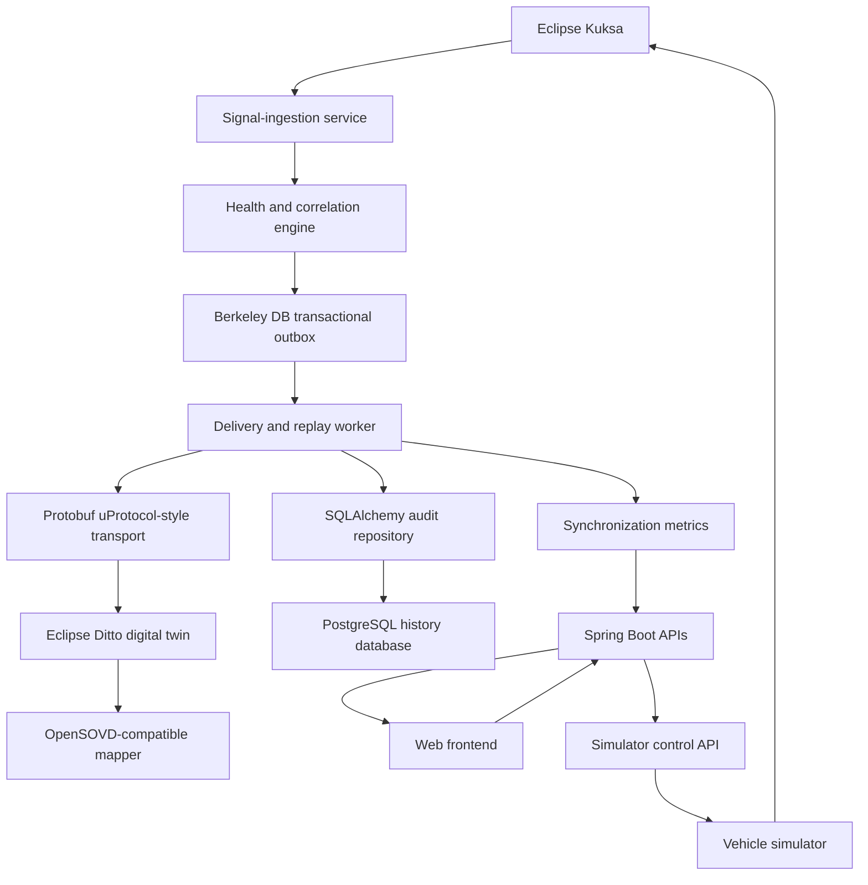

# SDV Enhancement Architecture Recommendations

## 1. Assessment

The proposed enhancement architecture is conceptually strong and can be implemented without overhauling the completed Software-Defined Vehicle platform. However, several changes are required to make it efficient, reliable, testable, and suitable for publication-oriented evaluation.

The primary concern in the initial proposal is the possibility of writing every event independently to:

- Berkeley DB.
- The SQLAlchemy-managed relational database.
- Eclipse Ditto.

These operations cannot be committed as one atomic transaction. If one write succeeds and another fails, the stores may disagree about whether an event was received, delivered, or processed. Writing synchronously to all three destinations would also add unnecessary latency to the normal telemetry path.

The recommended solution is a **transactional outbox architecture** in which Berkeley DB becomes the authoritative local record of events awaiting delivery.

---

## 2. Recommended Architecture



### Component responsibilities

| Component | Responsibility |
|---|---|
| Vehicle simulator | Generates vehicle signals and applies runtime diagnostic scenarios |
| Eclipse Kuksa | Provides standardized access to current vehicle signals |
| Signal-ingestion service | Reads, validates, normalizes, and sequences Kuksa values |
| Health and correlation engine | Evaluates health rules and produces telemetry or diagnostic domain events |
| Berkeley DB | Acts as the durable transactional outbox for events awaiting delivery |
| Delivery and replay worker | Sends new and buffered events through one consistent delivery path |
| uProtocol-style transport | Serializes and validates Protobuf-based event envelopes |
| Eclipse Ditto | Maintains the cloud-side vehicle digital twin |
| OpenSOVD-compatible mapper | Maps active faults into a standardized diagnostic representation |
| SQLAlchemy | Manages relational audit, history, delivery-attempt, and experiment records |
| PostgreSQL | Stores structured relational records for querying and analysis |
| Spring Boot | Exposes vehicle, diagnostic-action, and synchronization-status APIs |
| Web frontend | Displays vehicle state, diagnostic actions, connectivity, queue, and recovery status |

---

## 3. Recommended Event Lifecycle

### 3.1 Event creation

1. The signal-ingestion service reads current signal values from Kuksa.
2. The values are validated and assigned a vehicle-specific sequence number.
3. The health engine evaluates individual and correlated fault rules.
4. A domain event is created with a stable event ID, trace ID, timestamp, sequence number, type, priority, and payload.
5. The event is committed to Berkeley DB before it becomes eligible for delivery.

This is the **persist-before-send** rule. A process crash after persistence does not lose the event because the delivery worker can recover it from the outbox.

### 3.2 Normal delivery

1. The delivery worker reads the next eligible event from Berkeley DB.
2. It serializes the event through the Protobuf uProtocol-style transport.
3. The event is delivered to Ditto.
4. Ditto acknowledges successful processing.
5. The worker marks the outbox record as delivered or removes it according to the retention policy.
6. The outcome is recorded through SQLAlchemy for audit and performance analysis.

### 3.3 Disconnected operation

1. Delivery to Ditto fails or the cloud-health check reports an outage.
2. The event remains in the Berkeley DB outbox.
3. Subsequent events continue to be persisted locally.
4. SQLAlchemy records delivery attempts when the relational database is reachable; otherwise, audit records are generated later from the durable outbox metadata.
5. The frontend reports the system as disconnected and displays queue depth and digital-twin staleness.

### 3.4 Recovery and replay

1. The worker detects that Ditto is available again.
2. Pending events are selected according to vehicle, sequence, event type, priority, and retry eligibility.
3. Idempotency and stale-event rules are applied.
4. Events are replayed through the same transport and delivery code used during normal operation.
5. Delivery results and recovery metrics are recorded.
6. The system verifies that the final Ditto state matches the expected vehicle state.
7. The frontend changes from `REPLAYING` to `SYNCHRONIZED` after convergence is confirmed.

---

## 4. Required Architectural Changes

### 4.1 Make Berkeley DB the single transactional outbox

Every important telemetry or diagnostic event should first be written to Berkeley DB. Berkeley DB should not be treated as an optional backup used only after a network request fails.

This approach prevents the following failure:

1. The system sends an event to Ditto.
2. Ditto accepts it.
3. The bridge crashes before locally recording success.
4. The event is replayed and applied again.

The event may still be transmitted more than once, but stable identifiers and idempotent processing will prevent duplicated state changes.

### 4.2 Use one delivery path

Normal delivery and outage recovery should use the same worker and transport implementation. Separate paths create duplicated logic and make it possible for normal and replayed events to behave differently.

The worker should determine whether an event is:

- Newly created.
- Waiting for retry.
- Temporarily blocked.
- Permanently failed.
- Successfully delivered.
- Expired or superseded.

### 4.3 Avoid unsafe dual writes

Berkeley DB and PostgreSQL cannot participate in the same simple local transaction. The project should therefore avoid requiring both writes to succeed simultaneously.

Recommended ownership:

- **Berkeley DB:** Delivery-critical pending events and replay state.
- **SQLAlchemy/PostgreSQL:** Queryable history, audit records, synchronization sessions, fault lifecycles, and experimental results.
- **Eclipse Ditto:** Current authoritative cloud-side digital-twin state.

SQLAlchemy records should be derived asynchronously from delivery outcomes or reconstructable outbox metadata. Failure to write an audit row must not cause a successfully persisted event to be lost.

### 4.4 Decompose the existing integration bridge

The current Python bridge performs signal reading, serialization, fault evaluation, Ditto updates, and experiment recording. It should be separated into modules with explicit interfaces:

- `SignalReader`
- `VehicleHealthEvaluator`
- `EventFactory`
- `OutboxRepository`
- `DeliveryWorker`
- `DittoPublisher`
- `DeliveryAuditRepository`
- `SynchronizationMonitor`

These may initially run in one Python process. The goal is separation of responsibility and testability, not unnecessary microservices.

### 4.5 Complete the diagnostic-action lifecycle

Diagnostic actions currently remain in `ACCEPTED`. The enhanced workflow should support:

```text
ACCEPTED → IN_PROGRESS → COMPLETED
                         ↘ FAILED
```

- `ACCEPTED`: The backend validated and stored the request.
- `IN_PROGRESS`: The simulator accepted the action and signal transition began.
- `COMPLETED`: Ditto reached the expected fault or recovery state.
- `FAILED`: The operation could not complete within its retry or timeout policy.

This lifecycle should use the existing action and trace IDs for correlation.

### 4.6 Expose synchronization observability

Spring Boot should expose synchronization information without giving the browser direct access to either database. Recommended fields include:

- Connectivity state.
- Pending-event count.
- Oldest pending-event age.
- Current replay rate.
- Most recent successful delivery.
- Failed-attempt count.
- Dead-letter-event count.
- Digital-twin staleness.
- Last verified convergence time.

---

## 5. Event Ordering and Idempotency

Every event should include:

- `eventId`: Globally unique and stable across retries.
- `vehicleId`: Identifies the event stream.
- `sequenceNumber`: Monotonically increasing within the defined vehicle stream.
- `sourceTimestamp`: Time at which the event was generated.
- `traceId`: Correlates the end-to-end operation.
- `actionId`: Correlates runtime diagnostic actions, where applicable.
- `eventType`: Telemetry, warning, fault activation, recovery, or action lifecycle.
- `priority`: Determines replay importance.
- `schemaVersion`: Supports safe evolution of event contracts.

The receiving side should treat `eventId` as an idempotency key. Reprocessing the same event must not create a second fault, second action transition, or invalid digital-twin update.

Sequence numbers should prevent an older replayed event from overwriting newer state. The precise rule must be defined for each event category because telemetry snapshots and diagnostic transitions have different semantics.

---

## 6. Telemetry Compaction Policy

Retaining every high-frequency telemetry sample during a long outage may consume unnecessary storage and create a large recovery delay. The project should classify events according to whether they can be compacted.

| Event category | Recommended outage policy |
|---|---|
| Speed and frequently changing telemetry | Retain according to a sampling or latest-value policy |
| Periodic unchanged health snapshot | Allow coalescing or suppression |
| Warning activation or clearing | Retain every state transition |
| Critical fault activation | Always retain and prioritize |
| Critical fault recovery | Always retain in causal order |
| Diagnostic action lifecycle | Always retain |
| Experiment measurement event | Retain according to the experiment protocol |

Compaction must never remove information required to reconstruct a correct fault lifecycle.

---

## 7. Efficiency Considerations

The enhanced architecture will remain efficient if it follows these principles:

- Use one local Berkeley DB transaction per event or a controlled batch.
- Avoid synchronously updating three destinations on the ingestion thread.
- Keep network delivery and replay outside the signal-reading loop.
- Use bounded batches to increase replay throughput without starving new critical events.
- Apply exponential backoff with jitter during repeated failures.
- Use database indexes only for demonstrated query patterns.
- Batch SQLAlchemy audit inserts where appropriate.
- Apply retention and compaction policies to historical telemetry.
- Set explicit queue-size and disk-usage limits.
- Use backpressure when storage approaches its configured limit.
- Measure the overhead of persistence instead of assuming it is negligible.

---

## 8. Correctness Invariants

The implementation and tests should verify that:

1. An accepted event is durably stored before transmission.
2. A restart does not lose a committed pending event.
3. A successful event is not treated as permanently pending.
4. Replaying an event more than once does not corrupt final state.
5. An older event cannot silently overwrite a newer value.
6. Fault recovery cannot be applied before the corresponding activation.
7. Events from one vehicle cannot modify another vehicle's twin.
8. Diagnostic events are never removed through telemetry compaction.
9. Dead-lettered events remain inspectable.
10. The final Ditto state converges to the expected vehicle state after recovery.

---

## 9. Recommended Research Comparison

The publication-oriented study should compare:

### Configuration A — Current baseline

- Direct bridge-to-Ditto transmission.
- No durable pending-event queue.
- Existing retry behaviour.

### Configuration B — Transactional outbox

- Persist-before-send using Berkeley DB.
- Unified delivery and replay worker.
- Event IDs, sequence numbers, and retry handling.

### Configuration C — Complete enhanced architecture

- Berkeley DB transactional outbox.
- SQLAlchemy/PostgreSQL history and audit records.
- Ordering and idempotency controls.
- Telemetry compaction and diagnostic prioritization.
- Synchronization observability and convergence verification.

The comparison should measure event loss, duplicate delivery, ordering violations, persistence latency, normal-path latency, replay throughput, recovery time, digital-twin staleness, resource overhead, and final-state correctness.

---

## 10. Final Recommendation

The project does not require a complete architectural overhaul. Its existing simulator, Kuksa integration, health rules, uProtocol-style messaging, Ditto twin, OpenSOVD-compatible mapping, Spring Boot APIs, and frontend should be retained.

The most important modification is to replace the proposed multi-destination synchronous flow with a **Berkeley DB transactional outbox and one unified delivery/replay worker**. SQLAlchemy should manage structured historical and audit information rather than compete with Berkeley DB for ownership of pending delivery.

With modular bridge responsibilities, durable persist-before-send processing, idempotency, event ordering, compaction rules, completed action lifecycles, and synchronization observability, the architecture will be efficient, testable, industry-relevant, and suitable for a rigorous publication-oriented evaluation.
