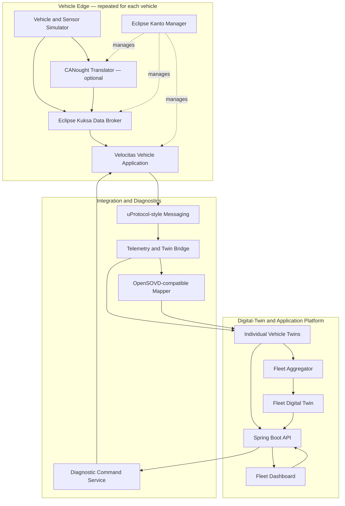
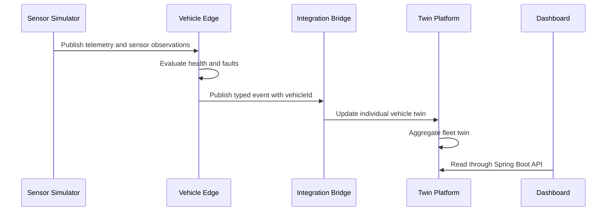

# SDV Autonomous-Fleet Platform — Proposed Architecture

## 1. Architecture Objective

Extend the completed single-vehicle SDV health-monitoring and diagnostic system into a reproducible multi-vehicle platform with autonomous-sensor monitoring, individual vehicle digital twins and an aggregated fleet-level digital twin.

The enhancement retains the existing simulator, Eclipse Kuksa, Protobuf-based uProtocol-style messaging, Eclipse Ditto, OpenSOVD-compatible mapping, Spring Boot backend, web frontend and automated tests. These components are generalized for multiple vehicles and extended with Eclipse Velocitas, Eclipse Kanto and optional Eclipse CANought.

## 2. Proposed Architecture



## 3. Architectural Layers

### 3.1 Vehicle and Sensor Simulation

The simulator creates independent telemetry and faults for 3–5 vehicles. Each vehicle has a unique `vehicleId` and simulated camera or LiDAR input. Sensor processing converts raw input into compact observations such as detected objects, nearest-obstacle distance, lane status and sensor health.

### 3.2 Vehicle Edge

- **Eclipse Kuksa:** Stores and exposes standardized vehicle and perception signals.
- **Eclipse Velocitas:** Implements vehicle-side perception-event handling, health evaluation and fault-detection logic using Kuksa signals.
- **Eclipse Kanto:** Deploys, monitors, updates and restarts the vehicle-side containerized services.
- **Eclipse CANought:** Optionally translates J1939 and UDS data into information usable by the higher-level vehicle services.

Each vehicle is logically isolated by its identifier, configuration and state. The vehicle edge environments may run as separate containers on the same development host.

### 3.3 Integration and Diagnostics

- **uProtocol-style messaging:** Carries typed telemetry, perception and health events while preserving `vehicleId`, timestamps, action IDs and trace IDs.
- **Telemetry and twin bridge:** Validates incoming events and updates the correct Ditto twin.
- **OpenSOVD-compatible mapper:** Converts detected faults into standardized diagnostic representations.
- **Diagnostic command service:** Routes dashboard actions to the selected vehicle and records the resulting lifecycle.

### 3.4 Digital-Twin Platform

An individual Eclipse Ditto twin is maintained for every vehicle. A separate fleet twin aggregates the most important operational information across all vehicles.

#### Individual vehicle twin

- Vehicle identity and operating state
- Telemetry and processed perception results
- Health classification
- Active fault details
- Diagnostic-action history
- Sensor and edge-application status

#### Fleet digital twin

- Total, active and unavailable vehicle counts
- Healthy, warning and critical vehicle counts
- Fleet-wide active alerts
- Summary state for each vehicle
- References to the individual vehicle twins

This hierarchical design avoids placing all detailed state inside one large twin while still providing one fleet-level representation of multiple cars.

### 3.5 Backend and Frontend

The Spring Boot backend provides vehicle-aware APIs for fleet summaries, individual telemetry, health, faults and diagnostic commands. The frontend becomes a fleet dashboard with fleet-level status, vehicle selection, per-vehicle monitoring and remote diagnostic controls.

## 4. End-to-End Data Flow



## 5. Remote Diagnostic Flow

1. The user selects a vehicle and diagnostic action in the dashboard.
2. Spring Boot validates the request and creates action and trace identifiers.
3. The command service routes the request to the selected vehicle application.
4. The simulator or Velocitas application applies the requested scenario.
5. Updated signals pass through Kuksa and the existing messaging bridge.
6. Health and fault logic updates the individual vehicle twin.
7. The fleet aggregator updates the fleet twin and dashboard summary.

## 6. Sensor-Data Boundary

Continuous raw video and complete LiDAR point clouds are not stored directly in Eclipse Ditto. The digital twins receive processed observations and metadata, for example:

```json
{
  "vehicleId": "vehicle-003",
  "detectedObjects": 3,
  "nearestObstacleMeters": 8.4,
  "laneStatus": "DEPARTURE_WARNING",
  "sensorHealth": "HEALTHY",
  "timestamp": "2026-09-18T12:00:00Z"
}
```

If raw samples must be retained, they are stored separately and referenced from the relevant vehicle twin.

## 7. Existing-System Evolution

| Completed system | Proposed evolution |
|---|---|
| One hard-coded vehicle | Multiple vehicles identified by `vehicleId` |
| One Ditto vehicle twin | Individual vehicle twins and one fleet twin |
| Script-based vehicle logic | Standardized Velocitas vehicle applications |
| Docker-managed local services | Kanto-managed vehicle-edge applications |
| Existing vehicle telemetry | Telemetry plus processed camera or LiDAR observations |
| Cooling-system fault scenario | Multiple vehicle, sensor and communication faults |
| Single-vehicle dashboard | Fleet summary and per-vehicle dashboard |
| Existing diagnostic actions | Vehicle-specific remote diagnostic actions |

## 8. Deployment Model

The platform is deployed as containerized services. Vehicle-edge services are logically repeated for each demonstrated vehicle, while Ditto, the integration bridge, Spring Boot and the frontend are shared platform services. The initial demonstration targets 3–5 vehicles; lightweight simulators can generate additional vehicle workloads for scalability experiments.

## 9. Quality and Evaluation

Automated Pytest and JUnit suites cover component logic, vehicle isolation, API validation, message routing, digital-twin consistency, diagnostic actions and end-to-end recovery. Experiments evaluate latency, throughput, reliability, resource consumption, fault-detection time, recovery time and behaviour under increasing vehicle workloads.
