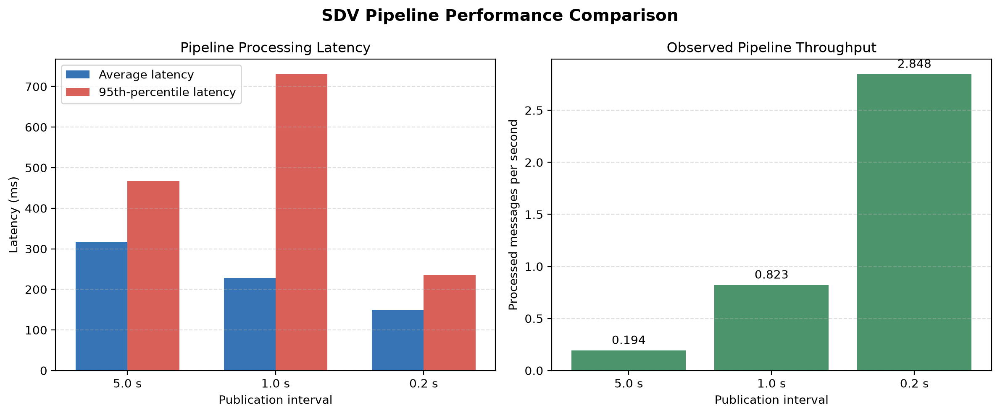

# Testing and Evaluation Results

## 1. Evaluation Objective

Iteration 2 evaluated whether the SDV pipeline continued to operate correctly under different vehicle-signal publication intervals.

The experiment compared:

- 5.0-second publication interval
- 1.0-second publication interval
- 0.2-second publication interval

Each experiment processed 30 vehicle-status events.

## 2. Measured Pipeline

The measured path was:

```text
Kuksa state read
    -> uProtocol Protobuf serialization
    -> uProtocol in-process reception
    -> health-rule evaluation
    -> Ditto digital-twin updates
```

Latency measurement started immediately before uProtocol serialization and ended after all Ditto update requests completed.

Therefore, the reported value represents backend pipeline-processing latency. It does not include the time between signal generation and the Kuksa read, network transport through a production uProtocol broker, or frontend rendering time.

## 3. Experiment Configuration

| Setting | Value |
|---|---|
| Vehicle | `vehicle-001` |
| Operating mode | Normal |
| Events per experiment | 30 |
| Publication intervals | 5.0 s, 1.0 s, and 0.2 s |
| Kuksa endpoint | `127.0.0.1:55556` |
| Ditto endpoint | `http://localhost:8080` |
| uProtocol implementation | In-process Protobuf serialization and reception |
| Execution environment | Local Docker-based development environment |

The simulator and bridge used the same publication interval during each experiment.

## 4. Performance Results

| Interval | Events | Minimum (ms) | Average (ms) | Median (ms) | P95 (ms) | Maximum (ms) | Success Rate | Throughput (messages/s) |
|---:|---:|---:|---:|---:|---:|---:|---:|---:|
| 5.0 s | 30 | 185.278 | 316.997 | 318.525 | 466.788 | 532.126 | 100% | 0.194 |
| 1.0 s | 30 | 110.405 | 227.832 | 170.275 | 730.731 | 910.352 | 100% | 0.823 |
| 0.2 s | 30 | 108.513 | 150.202 | 134.686 | 235.013 | 347.421 | 100% | 2.848 |



## 5. Result Analysis

All 90 measured events completed successfully, producing a 100% observed success rate across the three experiments.

Observed throughput increased as the publication interval decreased:

- 0.194 messages per second at 5.0 seconds
- 0.823 messages per second at 1.0 second
- 2.848 messages per second at 0.2 seconds

The 0.2-second experiment produced the lowest average latency at 150.202 ms. The 1.0-second experiment had a lower average latency than the 5.0-second experiment but produced the highest p95 and maximum values. This indicates temporary processing variability during that run rather than a strictly monotonic relationship between publication rate and latency.

The results demonstrate that the local pipeline processed the tested workload without observed request failures. They should not be interpreted as production performance guarantees.

## 6. Functional Validation

The final root Python test suite executed 34 automated tests successfully.

Validated behavior included:

- Latency recording and CSV export
- Statistical summary calculation
- Pipeline event measurement
- uProtocol serialization and reception
- Ditto state and timestamp validation
- Fault-count consistency
- OpenSOVD fault mapping

A live pipeline smoke test also confirmed:

- Kuksa signal retrieval
- uProtocol event publication and reception
- Ditto signal and health updates
- CSV result generation
- Successful Ditto freshness verification

## 7. Reproduction Artifacts

Raw measurements:

- `experiments/results/interval-5s.csv`
- `experiments/results/interval-1s.csv`
- `experiments/results/interval-0.2s.csv`

Combined results:

- `experiments/results/experiment-summary.csv`

Chart-generation script:

- `experiments/generate_performance_chart.py`

Generated chart:

- `experiments/results/pipeline-performance-comparison.png`

## 8. Limitations

- Measurements were collected on one local development machine.
- Each experiment contained only 30 events.
- uProtocol used an in-process Protobuf transport rather than a production network broker.
- Ditto properties were updated through sequential HTTP requests.
- The reported latency excludes simulator-to-Kuksa delay and frontend rendering.
- OpenSOVD integration uses a tested diagnostic-mapping adapter because the available mock gateway is read-only.
