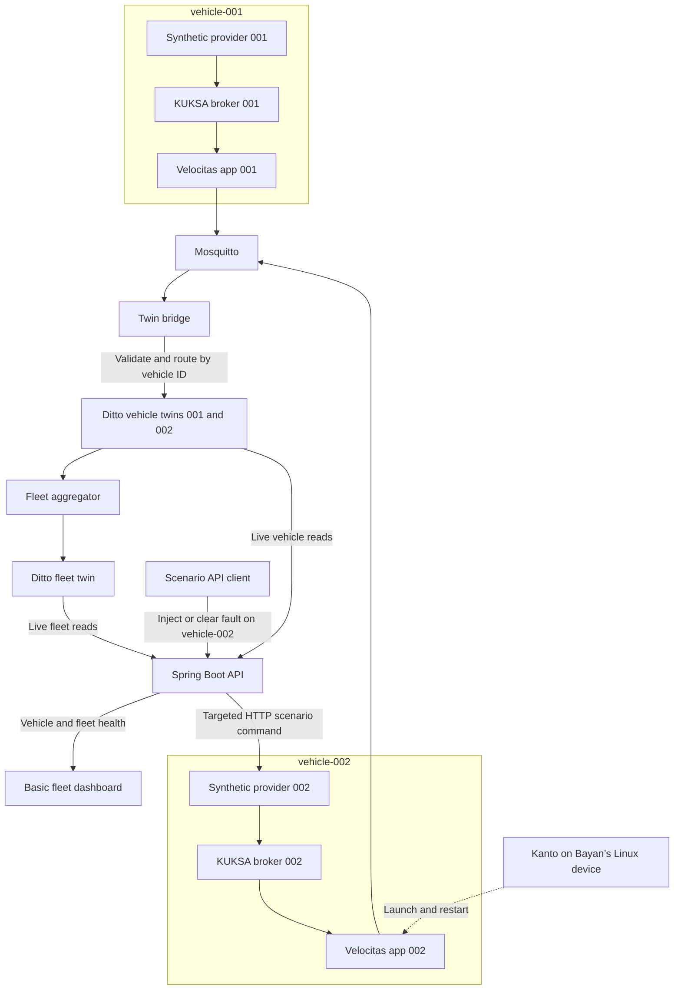
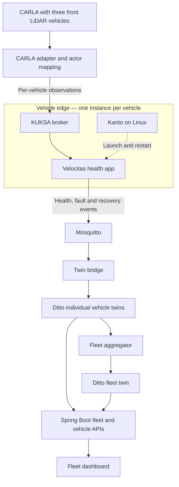
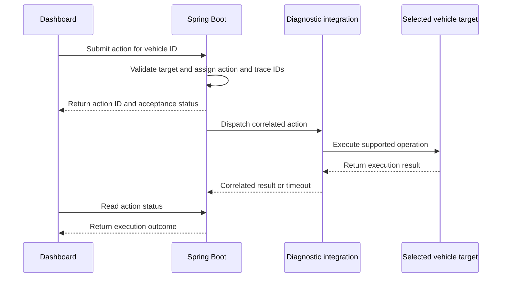

# SDV fleet enhancement architecture

Target architecture for Phase V1 and Phase V2, based on [project scope and acceptance](09-project-scope-and-acceptance.md). Both milestones run locally using host processes or containers. The diagrams describe delivery targets.

## Phase V1 — Two synthetic vehicles

One KUKSA broker and one Velocitas app serve each vehicle. The shared MQTT broker delivers vehicle-specific events to the twin bridge. Spring Boot reads live vehicle and fleet state, serves the basic dashboard, and routes simulator fault commands by vehicle ID. Bayan’s Linux device runs the Kanto pilot for vehicle-002 using the main host’s KUKSA and Mosquitto LAN endpoints.

**Acceptance run.** Start both vehicles healthy. Inject a LiDAR fault into `vehicle-002`, observe the fault in its twin and API response, then clear it and observe recovery. Verify that `vehicle-001` stays healthy and receives no corresponding fault. Verify that the fleet summary and dashboard reflect the transitions. For the Kanto pilot, capture a fresh post-restart event updating the vehicle-002 twin.

## Phase V2 — CARLA fleet telemetry

The CARLA adapter maps three actors to three project vehicle IDs. It sends compact front LiDAR observations to the matching edge instance and records the injection timeline separately for evaluation. Run CARLA and its Python adapter on a separate GPU-capable host if available. Validate one actor through the pipeline before connecting all three. Repeat the Phase V1 Kanto restart check against the CARLA-backed fleet.

Velocitas classifies LiDAR health. The bridge validates identity and freshness and applies the agreed duplicate and ordering rules. Fleet aggregation derives counts, availability and alerts from individual twin state. Store compact observations and diagnostic records in Ditto. Keep raw point clouds and labelled experiment inputs separately.

## Phase V2 — Diagnostic commands and outcomes

Demonstrate one real uProtocol exchange and one supported OpenSOVD operation. Their exact placement and operation are open contract decisions. Kanto restart is an application lifecycle action. Verify fresh events after restart. For a CARLA input dropout, restore input and verify recovery separately through the telemetry path.

## Integration handoffs

| Owner | Provides | Used by |
|---|---|---|
| Emmanuel | Vehicle IDs, signal definitions, synthetic/CARLA adapters, fault scenarios and Velocitas events | Bayan’s ingestion and Ankit’s scenario routing and verification |
| Bayan | Event validation, twin IDs and schemas, fleet state, diagnostic exchange and Kanto deployment evidence | Ankit’s live APIs, action tracking and dashboard |
| Ankit | Shared contracts, Spring Boot integration, fleet dashboard, CI and end-to-end acceptance evidence | Team integration and milestone demonstrations |

Agree vehicle-to-broker/provider/twin mappings, event IDs and source timestamps, fault and recovery thresholds, and command acknowledgements before implementing dependent interfaces. Preserve the synthetic workflow for CI and repeatable tests. Beam is optional.
