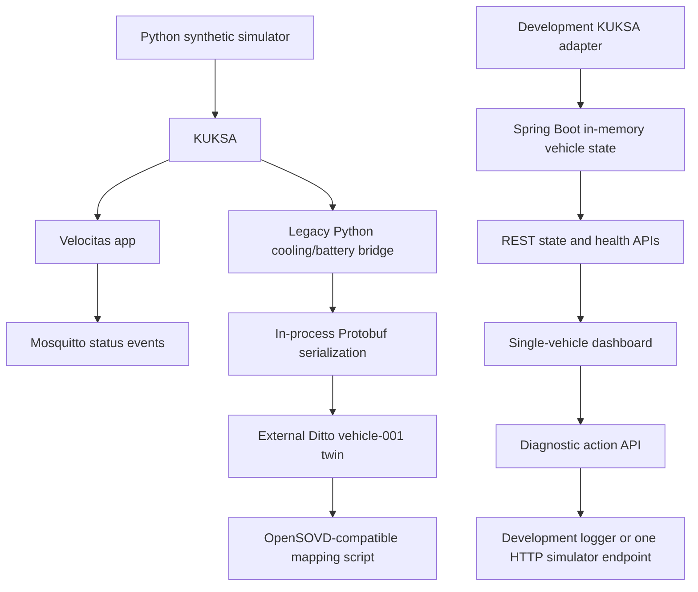

# Repository audit — November 11, 2026

The repository contains a working single-vehicle synthetic foundation, but the current implementation does not meet the documented fleet V1 acceptance criteria. V2 remains largely planned. The main architectural gap is that the LiDAR/MQTT pipeline, the legacy Ditto bridge, and the Spring Boot dashboard pipeline operate separately.

Audited `main` at `162f32807d6e5cb2b503dddad9e3790030fca75c`. The audit was read-only: no repository files changed, services started, branches changed, or persistent data modified. Git status was clean at the end of the audit. This report was saved afterward at the user's request.

Findings describe that revision and the checks performed on November 11, 2026. File links refer to the repository checkout; line numbers in the text refer to the audited revision. Historical runtime evidence is distinguished from checks performed during this audit.

## 1. Authoritative document hierarchy

The entry point is [SOURCE-OF-TRUTH.md](../SOURCE-OF-TRUTH.md), line 3. Its documented precedence is:

| Source | Authority |
|---|---|
| Approved Git revisions | Authoritative project specifications |
| [Scope and acceptance](../08-project-scope-and-acceptance.md), line 49 | Required outcomes, acceptance IDs, evidence |
| [Latest detailed task distribution](../10-detailed-task-distribution.md), line 3 | Takes precedence for phase allocation, ownership and handoffs |
| [Architecture diagrams](../09-architecture-diagrams.md), line 3 | Target architecture, explicitly labelled as delivery targets |
| Current implementation and tests | Evidence of what exists and executes |
| Evidence records | Historical observations, subject to revision and reproducibility limits |
| Earlier planning documents and `docs/Version_1/` | Supporting and historical context |
| Root README | Supplementary context; last changed September 18, before substantial October development |

Two qualifications matter:

- `docs/interface-contracts.md`, named by the entry point, does not exist at the audited revision.
- The current scope still says “proposed team agreement” and leaves some commitments proposed for review. Approval provenance cannot be established from the checkout alone. See [scope](../08-project-scope-and-acceptance.md), line 100.

The latest scope/task distribution was used provisionally for the acceptance assessment below. Confirmation of its approved revision remains outstanding.

Git history supports the distinction between implementation and newer plans:

- October 15–18: vehicle-keyed backend storage, registry, scenario isolation, synthetic LiDAR, Velocitas application and Kanto artifacts.
- October 25–26: CI baseline, Protobuf generation, synthetic integration and image publication.
- November 7: updated fleet scope, architecture, ownership, evidence and source-of-truth documentation. These commits do not establish delivery of the fleet architecture.

## 2. Current system architecture

The implemented paths are:



There is no implemented connection from Mosquitto status events to Ditto, or from live Ditto state to Spring Boot.

The Compose stack contains one KUKSA broker, Mosquitto, one provider and one Velocitas application. Ditto, Spring Boot and frontend hosting are outside that Compose deployment. See [docker-compose.yml](../../vehicle-simulator/docker-compose.yml), line 1.

## 3. Implemented components

| Component | Observed status |
|---|---|
| Vehicle simulation | Implemented synthetic cooling, LiDAR obstruction and LiDAR sensor-failure scenarios. Scenario state is keyed by vehicle, but each provider loop publishes one configured vehicle. |
| KUKSA | Real Python publication and reads; pinned databroker `0.7.0`; custom autonomous signal configuration. Only one broker is deployed. |
| Velocitas | SDK lifecycle and event publication are used. Signal reads use `kuksa_client` directly. Classification reports healthy, warning, emergency braking and sensor failure. |
| Ditto | Single-vehicle policy/Thing artifacts and an HTTP bridge exist. The bridge polls KUKSA and computes legacy cooling/battery health. Fleet routing, MQTT ingestion and aggregation are absent. |
| Spring Boot | REST controllers, configurable vehicle registry, vehicle-keyed memory storage, cooling correlation/hysteresis and diagnostic action storage are implemented. External component adapters remain development implementations. |
| OpenSOVD | Compatible fault mapping and a Python adapter forwarding actions to Spring Boot exist. Historical gateway evidence is explicitly mock/read-only. No live project diagnostic-operation integration is implemented. |
| uProtocol | Python Protobuf serialization, metadata and delivery accounting exist in process. Java publishing methods print messages. No networked uProtocol exchange is implemented. |
| Frontend | Three static pages: vehicle dashboard, diagnostics and performance. Single configured vehicle; performance uses fixtures. |
| Kanto | Descriptor, deployment script and static tests exist. Required Linux restart-to-twin runtime evidence is absent. |
| CARLA/fleet | No CARLA adapter, fleet aggregator, fleet twin or fleet dashboard implementation found. |
| CI/CD | Backend/Python/configuration checks, two container builds, single-vehicle synthetic integration and gated GHCR publication are implemented. Deployment automation is absent. |

Relevant implementation references include [simulator main](../../vehicle-simulator/src/main.py), line 1; [Velocitas signal reads](../../velocitas-app/app/src/main.py), line 106; [legacy twin bridge](../../ditto/scripts/interim-kuksa-to-ditto-bridge.py), line 151; and [backend configuration](../../backend/src/main/resources/application.properties), line 3.

No explicit deprecation declaration was found for the interim bridge. It remains operational code. The [Java uProtocol publisher](../../uprotocol/src/main/java/com/sdv/uprotocol/EventPublisher.java) is an unintegrated scaffold; the backend WebSocket dependency has no corresponding implemented messaging endpoint.

## 4. V1/V2 completion status

The current V1 milestone is **two synthetic vehicles by November 16**. V2 extends it to **three CARLA vehicles by December 5**. The 60/40 division describes estimated remaining effort, not achieved completion.

The previous single-vehicle MVP has recorded runtime evidence, but that evidence does not satisfy the fleet milestones.

V1 acceptance comes from [scope](../08-project-scope-and-acceptance.md), lines 53–61:

| Criterion | Audit assessment |
|---|---|
| V1-01: Two independent edge pipelines | **Partial foundation.** Configurable identities exist; deployment has one broker/provider/app. |
| V1-02: MQTT updates two twins safely | **Not implemented.** No MQTT twin consumer or two-twin routing. |
| V1-03: Targeted vehicle-002 LiDAR fault/recovery | **Not implemented end to end.** Backend supports only the cooling scenario and uses one simulator URL. |
| V1-04: Live twin-backed API with freshness | **Not implemented.** API reads development-generated memory state. |
| V1-05: Baseline plus two-vehicle CI | **Partial.** Single-vehicle CI exists; fleet acceptance coverage is absent. |
| V1-06: Recorded skill use and traceability | **Not evidenced.** Source records contain candidates and an empty usage template. |
| V1-07: Reproducible tagged V1 submission | **Not evidenced.** Existing `v1.0.0-iteration3` is a historical baseline tag. |
| V1-08: Live fleet summary/dashboard | **Not implemented.** |
| V1-09: vehicle-002 Kanto restart updates twin | **Artifacts only.** Current deployment targets vehicle-001 and loopback services. |

The [evidence index](../../evidence/README.md), line 7, independently marks V1-01 through V1-07 pending; it omits V1-08 and V1-09.

V2 acceptance comes from [scope](../08-project-scope-and-acceptance.md), lines 67–74:

| Criterion | Audit assessment |
|---|---|
| V2-01: Three CARLA LiDAR vehicles | Planned; implementation absent |
| V2-02: Degradation/dropout and stable recovery | Synthetic failure primitives exist; frame-age detection and recovery windows absent |
| V2-03: Consistent vehicle/fleet/dashboard views | Planned; fleet implementation absent |
| V2-04: Verifiable diagnostic outcomes | Partial action API/state-machine foundation; execution-result integration absent |
| V2-05: CARLA-backed Kanto runtime | Unverified; prerequisites absent |
| V2-06: Real uProtocol/OpenSOVD operations | Pending selection and implementation |
| V2-07: Customized skill comparison | No completed comparison evidence found |
| V2-08: Reproducible final release/evaluation | Partial historical tooling; final evidence outstanding |

## 5. Documentation inconsistencies

- **Approval status is ambiguous.** The entry point relies on approved revisions, while the latest scope retains proposed wording.
- **Several current links use obsolete numbering.** The detailed task distribution links nonexistent `09-project-scope-and-acceptance.md` and `10-architecture-diagrams.md`; actual filenames begin `08` and `09`. The architecture and evidence index repeat the scope-link problem.
- **The evidence index is incomplete:** V1-08 and V1-09 are missing.
- **The baseline links a missing log.** `evidence/v1/mvp-demo.log` is referenced but absent from tracked files. Logs are globally ignored. The baseline also acknowledges an unconfirmed original submission revision and missing revision metadata for the timing CSV. See [baseline](../../evidence/v1/baseline.md), line 3.
- **Frontend documentation contradicts code.** Its README describes mock defaults and action lookup awaiting confirmation; current configuration enables HTTP mode, and GET action lookup exists. See [frontend README](../../frontend/README.md), line 20, and [configuration](../../frontend/js/config.js), line 3.
- **Older broad objectives exceed the latest bounded scope.** Earlier documents mention 3–5 vehicles and camera and/or LiDAR; latest acceptance requires two synthetic vehicles followed by three CARLA vehicles with front LiDAR.
- **Historical success must remain historical.** Earlier cooling integration screenshots and test totals do not establish that today's refactored scenario interfaces still integrate.

## 6. Test and CI status

Safe checks executed without changing repository files:

| Check | Result |
|---|---|
| Eight existing Python `unittest` modules, loaded directly | **80 passed; zero failures/errors** |
| Existing dependency-free health, Kanto descriptor and VSS test functions | **9 passed** |
| Tracked JSON parsing | **14 valid** |
| Python AST parsing | **44 files passed** |
| `bash -n` | **5 shell scripts passed** |
| Docker Compose configuration validation | **Passed** |
| Git whitespace and final working-tree checks | **Passed; clean** |

The 80 tests cover fault mapping/details, result summaries, pipeline/latency recording, Ditto verification/retries and the compatible action adapter. HTTP interactions in these adapter/verifier tests are mocked; they do not prove live integration.

The eight modules were:

- `tests/test_fault_mapper.py`
- `tests/test_fault_details.py`
- `tests/test_result_summary.py`
- `tests/test_pipeline_evaluator.py`
- `tests/test_latency_recorder.py`
- `tests/test_verify_vehicle_state.py`
- `tests/test_ditto_http.py`
- `tests/test_action_adapter.py`

The nine additional functions came from `velocitas-app/app/tests/test_health_logic.py` (5), `velocitas-app/app/tests/test_kanto_deployment.py` (3), and `vehicle-simulator/tests/test_vss_config.py` (1). These were called directly without pytest; this was not a full pytest run. Python checks used `-B` to avoid bytecode output, JSON was parsed in memory, and Python syntax was checked with `ast.parse`.

Available build/test commands were established from workflow files and configuration:

```bash
# Backend CI command, from backend/; not executed during this audit.
bash ./mvnw --batch-mode --no-transfer-progress clean verify

# Python CI command, after dependencies and Protobuf generation; not executed.
python -m pytest -q -ra -m "not integration"

# Read-only checks executed from the repository root.
docker compose -f vehicle-simulator/docker-compose.yml config --quiet
git diff --check
git diff --exit-code
git diff --cached --exit-code
git status --porcelain=v1
```

Environment limitations:

- Python is **3.14.3**, versus CI's **3.12**.
- Pytest, KUKSA client, Protobuf and `grpc_tools` are unavailable.
- Java is **25**, versus the backend/CI target of **21**.
- No system Maven or cached Maven installation was found. The downloading wrapper was not invoked and build outputs were not created.
- Docker Compose is installed, but Docker daemon access returns **permission denied**.
- Node is unavailable.

Consequently, full pytest, Maven verification, container builds and live integration were not run. **No existing test executed in this audit failed**, but additional focused probes exposed defects described in section 7.

CI source inspection confirms:

- [ci.yml](../../.github/workflows/ci.yml), line 1: backend verification, Python tests after Protobuf generation, configuration validation and image builds.
- [integration-test.yml](../../.github/workflows/integration-test.yml), line 27: one vehicle's healthy → braking → recovery MQTT sequence plus nine KUKSA publication checks.
- [publish-images.yml](../../.github/workflows/publish-images.yml), line 48: requires both validation workflows to succeed for the same main commit before publishing AMD64 images.

Current remote Actions results and branch-protection settings were not verified. Publication rebuilds images from validated source rather than promoting the exact tested artifacts.

## 7. Technical debt and integration gaps

### High: Backend health is disconnected from live telemetry

The development KUKSA adapter returns constant `85°C` and `200 kPa` with `Instant.now()`. The dashboard can therefore show fresh healthy data independently of simulator or twin health. Only development implementations exist for backend KUKSA, Ditto, uProtocol and OpenSOVD adapters. See [DevelopmentKuksaAdapter.java](../../backend/src/main/java/com/ankit/sdv/backend/adapter/kuksa/DevelopmentKuksaAdapter.java), line 24.

### High: The cooling bridge's scenario-context URL is broken

The bridge requests `/api/v1/scenarios/COOLING_SYSTEM_FAILURE`; the simulator serves `/api/v1/vehicles/{vehicleId}/scenarios/{scenario}`. An in-memory handler probe confirmed **404** for the bridge URL and **200** for the current route. The bridge consequently falls back to unrelated/generated identifiers, undermining action-to-fault correlation. See [bridge URL](../../ditto/scripts/interim-kuksa-to-ditto-bridge.py), line 46, and [simulator route](../../vehicle-simulator/src/control_server.py), line 23.

### High: Multi-vehicle registration does not provide provider routing

Spring Boot registers three vehicles by default but sends all actions to one base URL. The simulator accepts arbitrary nonblank identities; a probe accepted `vehicle-999`. Its publishing loop processes only its configured identity, so acknowledgement can describe a scenario that no running publisher executes. See [HTTP adapter](../../backend/src/main/java/com/ankit/sdv/backend/adapter/simulator/HttpSimulatorControlAdapter.java), line 25, and [identity validation](../../vehicle-simulator/src/scenario_controller.py), line 102.

### High: Tire-pressure units disagree across boundaries

The committed VSS declares tire pressure in **kPa**, while the generator supplies approximately `30–34` and the bridge passes it unchanged into `tire_pressure_psi`. This is a confirmed schema/data mismatch. Historical reasoning that “32 looks like psi” does not resolve the declared metadata. See [VSS metadata](../../vehicle-simulator/config/vss-with-autonomous-sensors.json), line 5919; [generator](../../vehicle-simulator/src/signal_generator.py), line 12; and [bridge mapping](../../ditto/scripts/interim-kuksa-to-ditto-bridge.py), line 202.

### High: Source freshness is not preserved

The Protobuf helper assigns source time during serialization; the Velocitas event assigns publication-time `timestamp` and carries no source timestamp or event ID. Repeated reads can make old values appear current. See [metadata construction](../../uprotocol/transport.py), line 96, and [status event](../../velocitas-app/app/src/health_logic.py), line 29.

### High: Diagnostic actions have no execution-result lifecycle

Actions are stored as `ACCEPTED` before dispatch. A transition method exists, but no production caller advances it. Dispatch failures leave the stored action accepted; no explicit execution timeout or result-consumer integration exists. See [DefaultDiagnosticActionService.java](../../backend/src/main/java/com/ankit/sdv/backend/service/DefaultDiagnosticActionService.java), line 68.

### Medium: The verifier has confirmed correctness defects

Focused probes demonstrated:

- An active cooling fault at `99°C / 160 kPa` is rejected, although both recovery conditions have not been met.
- A day-old source timestamp passes freshness validation when `processedTimestamp` is current.
- A timestamp without timezone information raises `TypeError`.

See [correlated validation](../../ditto/scripts/verify-vehicle-state.py), line 159, and freshness validation in the same file, line 233. Existing tests miss these cases.

### Other material gaps

- The simulator computes warning/braking decisions; Velocitas classifies those flags. The target assigns health decisions to Velocitas. See [simulator decisions](../../vehicle-simulator/src/signal_generator.py), line 180.
- One scheduler exception aborts later vehicles in that polling cycle; there is no per-vehicle failure isolation. See [scheduler](../../backend/src/main/java/com/ankit/sdv/backend/scheduler/VehiclePipelineScheduler.java), line 28.
- Ditto updates are separate HTTP property writes, allowing inconsistent intermediate snapshots or partial success. See [bridge writes](../../ditto/scripts/interim-kuksa-to-ditto-bridge.py), line 520.
- The [transport](../../uprotocol/transport.py), line 120, counts duplicates but still returns duplicate messages; full envelope validation and ordering protection are absent.
- The frontend lacks LiDAR/fleet views and live active-fault data. Missing timestamps are displayed as connected rather than distinctly unknown. See [dashboard](../../frontend/js/dashboard.js), line 119.
- Kanto targets `vehicle-001` at loopback port `55555`, while Compose exposes KUKSA on host port `55556`; the required remote vehicle-002 pilot needs explicit configuration. See [descriptor](../../velocitas-app/kanto/autonomous-health-app.json), line 22.
- Historical latency measurements cover serialization/rules/HTTP updates, excluding acquisition and frontend delay. They cannot establish fleet performance or networked uProtocol reliability. See [testing and evaluation results](../Version_1/05-testing-and-results.md), line 15.

The implementation gaps above are confirmed by source inspection, with focused in-memory probes explicitly identified. Live failure behavior beyond those probes was not exercised in this environment.

## 8. Recommended next tasks

| Priority | Task | Acceptance connection |
|---|---|---|
| **P0** | Confirm approved specification revision and freeze the missing shared contract: identities/endpoints, units, event envelope, source time, health states, freshness and command outcomes. | A1; foundation for all V1 work |
| **P1** | Repair baseline correlation and verifier defects; resolve tire-pressure units with boundary tests. | Baseline preservation, V1-05 |
| **P1** | Deploy two isolated providers, KUKSA brokers and apps; enforce provider identity and vehicle-to-endpoint routing. | V1-01, V1-03 |
| **P1** | Implement validated MQTT ingestion, twin routing and two live twins, preserving observation identity/time. | V1-02 |
| **P1** | Connect Spring Boot to live twin state and expose missing/stale/unavailable data explicitly. | V1-04 |
| **P1** | Implement fleet aggregation, fleet API and two-vehicle dashboard. | V1-08 |
| **P1** | Add the complete targeted fault/clear/isolation acceptance run to CI. | V1-03, V1-05 |
| **P2** | Validate the vehicle-002 Kanto pilot with correlated post-restart twin evidence. | V1-09 |
| **P2** | Complete evidence mapping, skill provenance/use, release reference and reproducible submission instructions. | V1-06, V1-07 |
| **P2** | Begin bounded V2 feasibility work: one CARLA actor first, selected diagnostic operations, then result tracking and fleet expansion. | V2-01 through V2-06 |
| **P3** | Run repeated fleet measurements and controlled original/customized skill comparisons. | V2-07, V2-08 |

The remaining clarification is whether `162f328`'s scope/task distribution is approved despite its proposed wording, or another approved revision should govern the assessment. Recommendations are proposed next work; no features or fixes were implemented as part of this audit.
