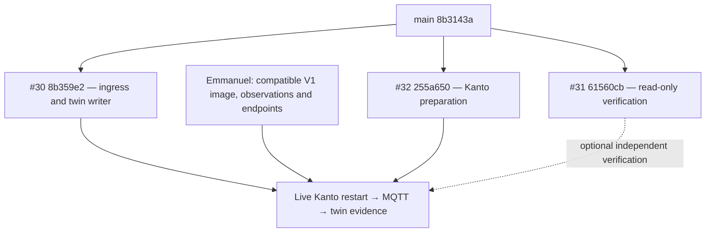

# Consolidated review and correction plan — Bayan's PRs #30, #31 and #32

Review date: November 11, 2026. Repository: `ankit-suman-07/QA-SDV-Project`.

## 1. Executive summary

**Recommendation: REQUEST CHANGES on all three PRs.** Four distinct P2 issues were confirmed. No P0, P1 or P3 findings were established. The PRs have useful focused implementations, clear ownership boundaries and extensive component tests, but passing tests do not cover the reproduced input failures and do not establish live V1 acceptance.

| PR | Purpose | Confirmed findings | Recommendation |
| --- | --- | --- | --- |
| #30 | B1/B2 V1 MQTT ingress and individual Ditto twin writer | 2 P2: deep-copy poison input; lone-surrogate serialization poison input | REQUEST CHANGES |
| #31 | B3 read-only twin verification and legacy repairs | 1 P2: deep snapshot crashes the inspector/sequence path | REQUEST CHANGES |
| #32 | B5 vehicle-002 Kanto preparation | 1 P2: IPv4-mapped IPv6 assertions fail current Python 3.12 CI | REQUEST CHANGES; live V1-09 remains unverified |
| **Total** | | **P0 0 · P1 0 · P2 4 · P3 0** | |

All three current heads were fetched again before review. They remain independent sibling commits directly off the same `main`, not stacked. Corrected #31 → corrected #30 → corrected #32 is a convenient integration sequence, not a Git dependency. #32's preparation can merge earlier once its own checks and review pass. Its live restart-to-twin evidence requires a compatible publisher and the ingress/twin capability supplied by #30. Obsolete PR #26 is outside this review and is not part of the sequence.

Individual reports contain pinned source links, reproduction details and contract assessments:

- [PR #30 review](pr-30-review.md)
- [PR #31 review](pr-31-review.md)
- [PR #32 review](pr-32-review.md)

## 2. Reviewed revisions, authority and safety

| PR | Author | Head branch | Base branch | Reviewed head SHA |
| --- | --- | --- | --- | --- |
| [#30](https://github.com/ankit-suman-07/QA-SDV-Project/pull/30) | Bayan Sayyadifar, `sayadifarbayan-lgtm` | `bayan/feature/v1-mqtt-twins` | `main` | `8b359e27ff707218d0130d7e8a6f12f957bb1125` |
| [#31](https://github.com/ankit-suman-07/QA-SDV-Project/pull/31) | Same author | `bayan/fix/v1-twin-verifier` | `main` | `61560cb2ba37f5cfd055ffaaba7058185a00ad69` |
| [#32](https://github.com/ankit-suman-07/QA-SDV-Project/pull/32) | Same author | `bayan/config/v1-kanto-pilot` | `main` | `255a6507817db08d1212dd290c09f7cafd6907c1` |

All three base SHAs, merge bases and sole commit parents are `8b3143aaa1631ee81b18042e6fb1aa34d50484dc`. Each PR is one commit ahead and zero behind that fetched base. None contains another PR's commit. These are fresh Git observations, not assumptions carried from earlier analysis.

Read the actual [source-of-truth file under docs](../SOURCE-OF-TRUTH.md), [V1 interface contracts](../v1-interface-contracts.md), [updated task distribution](../10-detailed-task-distribution.md), [scope/acceptance](../08-project-scope-and-acceptance.md), [architecture](../09-architecture-diagrams.md) and [independent-development guide](../v1-independent-development.md), plus changed files, surrounding production code/tests and CI workflows. The root README did not override these sources.

The contract remains **v1.0.0 — proposed for affected-owner review**. The scope's approval provenance and some defaults remain open. Obtain affected-owner review before finalizing shared interface changes. The latest task allocation and C1 explicitly assign fleet aggregation and fleet-twin materialization exclusively to Ankit in Spring Boot; older scope/diagram wording does not override that. None of these PRs implements a competing fleet aggregator. V1 requires two synthetic vehicles by November 16, 2026. V2 CARLA, extended diagnostic exchanges and related features were excluded.

The primary worktree started clean on local `main` at `8b3143a`. None of the four target reports existed. Prior conversational findings were preserved as history and reverified, rather than treated as current evidence. Existing unrelated audit/validation documents were preserved. A new temporary repository at `/tmp/bayan-review-ndC62A/repo` fetched the latest PR/base references; detached worktrees held each revision and the unchanged base. No primary branch switch, production edit, existing test edit, commit, push, GitHub comment/review, PR merge/closure, rebase/reset, or primary Git configuration change was performed.

## 3. Findings by PR

| ID | Severity | Status | Evidence and impact | Report |
| --- | --- | --- | --- | --- |
| PR30-F01 | P2 — Medium | Confirmed | A 1,444-byte event with a 600-level nested extension passes validation and raises `RecursionError` at `ditto/mqtt_ingress.py:196`. Subscriber lines 168–174 retry it indefinitely; later vehicle-002 events block, then queue overflow stops both vehicles. | [Details](pr-30-review.md#pr30-f01--deep-extension-blocks-subsequent-delivery) |
| PR30-F02 | P2 — Medium | Confirmed | Lone surrogate value/key passes JSON validation, then UTF-8 serialization fails at `ditto/v1_writer.py:119–122` with `INVALID_DITTO_JSON`. The same subscriber retry path cannot recover. Reproduced with 251/261-byte payloads. | [Details](pr-30-review.md#pr30-f02--lone-surrogate-cannot-be-serialized-to-ditto) |
| PR31-F01 | P2 — Medium | Confirmed | Deep finite snapshot extensions pass iterative checks and crash `copy.deepcopy` at `ditto/twin_consistency.py:105`. `TwinSequence.observe` also raises uncontrolled `RecursionError`. Prior sequence state remains intact in the reproduction. | [Details](pr-31-review.md#pr31-f01--deep-snapshot-causes-an-uncontrolled-exception) |
| PR32-F01 | P2 — Medium | Confirmed | `test_kanto_pilot.py:107,117–120` assumes a Python-patch-specific IPv6 spelling. 3.12.10 passes 144 app tests; 3.12.16 passes 142 and fails 2. Both endpoint strings have identical packed addresses. Current Python CI is red. | [Details](pr-32-review.md#pr32-f01--ipv6-spelling-assumption-breaks-ci) |

No additional suspected defects are promoted to confirmed findings. #31's acceptance of lone surrogates is a reproduced compatibility risk: UTF-8 serialization of its returned view fails, but #31 has no production serializer/subscriber retry loop and default escaped JSON can represent the string. Actual downstream backend failure was not demonstrated. Agree the consumer text policy rather than asserting that every consumer fails.

**Inherited issues, not introduced by these PRs:** legacy source-time generation during Protobuf serialization, legacy VSS kPa/psi inconsistency, legacy hard-coded Ditto auth/defaults and HTTP logging, and the existing Velocitas publisher/manifest's old topic/envelope. These still need coordinated owner follow-up, but were not counted as new PR defects. The new legacy-context caller and cooling partial-recovery fix pass their focused tests.

## 4. Prioritized correction checklist

### Critical/high issues

No P0/P1 issues were confirmed. Do not manufacture a high-severity blocker from incomplete live evidence or a documented queue limit.

### Medium issues

- [ ] **PR30-F01:** Make accepted nested structures safe through validation/copy/persistence, or reject unsupported depth with a controlled input error before enqueueing. Preserve subsequent delivery progress.
- [ ] **PR30-F02:** Reject lone surrogates in decoded values/keys/IDs before enqueueing, or agree a genuinely supported end-to-end representation. Never retry an unrepairable serialization error forever.
- [ ] **PR31-F01:** Ensure snapshot/sequence copy and comparison paths accept or safely reject deep structures without an uncontrolled exception.
- [ ] **PR32-F01:** Remove the patch-specific spelling assumption or explicitly define stable normalization; retain semantic endpoint and mapped-address restriction checks. Restore green current-Python CI.

### Low issues

No separate P3 issue was confirmed. Avoid unrelated style changes or architectural rewrites in the correction PRs.

### Cross-PR compatibility

- [ ] Agree a consistent supported structural-depth and Unicode scalar policy across #30, #31 and Ankit's live adapter. Shared-interface changes need affected-owner review and synchronized tests.
- [ ] Keep ingress duplicate rejection distinct from read-only repeated-poll recognition; preserve same-ID changed-content rejection in both roles.
- [ ] Keep source preservation in ingress distinct from availability evaluation in the backend/checker. Never replace source time with receipt/poll time.
- [ ] Preserve Ankit's exclusive fleet aggregation ownership.
- [ ] Resolve the confirmed #30/#31 `ditto/README.md` conflict in the later integration update, retaining both handoff links. No resolution was applied in this review.

### Missing regression tests

- [ ] Deep array/dictionary payloads at/around the supported limit, across ingress, writer readback/restart, snapshot inspection and sequence comparisons.
- [ ] Lone high/low surrogates in values, object keys and IDs; valid surrogate pairs/non-BMP text and near-limit Unicode payloads.
- [ ] Each deterministic bad input followed by later valid same-vehicle and other-vehicle events; verify safe rejection, unchanged twins/watermarks, progress and absence of poison-induced overflow.
- [ ] Actual transient persistence failures still withhold ACK and retry; fixes must not acknowledge failed delivery as success.
- [ ] #31 rejection preserves prior sequence state and permits later observations for both vehicles.
- [ ] Mapped IPv6 cases on 3.12.10 and current 3.12; semantic address equality plus exact bracket/port checks; forbidden mapped destinations remain rejected before CLI execution/output.

### Integration verification

- [ ] Run real Mosquitto session/reconnect/restart and unacknowledged delivery checks with an agreed isolated broker.
- [ ] Validate real Ditto policy identity/authorization, create-only provisioning reruns, successful PUT statuses, outage handling and restart watermark recovery.
- [ ] Capture healthy → vehicle-002 fault → healthy while vehicle-001 remains unaffected, through actual publisher/MQTT/twin/backend/UI boundaries.
- [ ] Verify real provider-specific context reads and original source timestamps; obtain Emmanuel's unit confirmation before runtime pressure conversion.
- [ ] Run genuine Linux/Kanto launch/restart and correlate the fresh app event to `sdv:vehicle-002`.
- [ ] Keep mocked, synthetic-baseline and live V1 results labeled separately in the evidence record.

## 5. Exact fixes required and definitions of done

### PR30-F01

**Where/what:** `ditto/mqtt_ingress.py:196`, supporting decoded-value validation, and `ditto/mqtt_subscriber.py:168–174`. Ensure every accepted structure is processable throughout the pipeline. A bounded, coordinated depth rule with `EventError` before queueing is one minimal option; safe traversal/copying is another. Merely catching all errors and acknowledging is unsafe because genuine failed writes must remain unacknowledged.

**Why/expected behavior:** An input-only deterministic error cannot recover through network backoff. It must not prevent the next valid vehicle observation. Rejecting it must not modify either twin or watermark.

**Tests/done:** The 600-array reproduction safely accepts or rejects; later valid messages for both vehicles persist and ACK. Include nested dictionaries, depth boundaries, restart readback and transient-write regressions. No poison-induced queue overflow or silent lost persistence.

### PR30-F02

**Where/what:** JSON decoded-string/key checks in `ditto/mqtt_ingress.py`, serialization handling in `ditto/v1_writer.py:119–122` and retry classification. Traverse text safely, including keys and context/event IDs. Reject lone surrogate code points with a controlled input error before the worker enters persistence retry. Preserve valid non-ASCII/non-BMP text; an escaping change alone must be validated against real supported consumers.

**Why/expected behavior:** Escaped ASCII wire bytes may decode to Python text that is not UTF-8 encodable. The exact same input cannot be fixed by retrying Ditto.

**Tests/done:** Both value and key reproductions no longer enter endless retry, invalid input leaves state unchanged, valid Unicode and near-budget payloads still round-trip, and later observations progress. Keep ACK gating intact for uncertain/failed writes.

### PR31-F01

**Where/what:** `ditto/twin_consistency.py:105,118,125`, including subsequent equality/comparison operations. Make accepted nested structures safe or reject unsupported structure using `ConsistencyError`. Do not import #30 simply to fix the standalone component, and do not add the MQTT wire-size budget to persisted snapshot inspection.

**Why/expected behavior:** The iterative finite-value traversal accepts inputs beyond the recursive copy's effective limit. A verifier must produce an interpretable invalid/unavailable outcome instead of an uncontrolled interpreter exception.

**Tests/done:** Direct inspection and sequence observation both handle the reproduction safely; no old sequence state changes on rejection; subsequent valid observations work; returned properties remain independent copies; duplicate/conflict comparison is safe for accepted shapes. Align Unicode handoff behavior as a separately explicit compatibility decision.

### PR32-F01

**Where/what:** `velocitas-app/app/tests/test_kanto_pilot.py:107,117–120`, and `_host` formatting at `render_pilot_config.py:63` only if deliberately choosing stable textual output. The smallest correction under the current contract is testing parsed endpoint equivalence, with independent checks of IPv6 brackets, ports and forbidden mapped addresses.

**Why/expected behavior:** The contract requires correct endpoints, not a specific standard-library spelling. `::ffff:c0a8:114` and `::ffff:192.168.1.20` are the same numeric IPv6 address. CI explicitly supports the current Python 3.12 patch via setup-python.

**Tests/done:** App and full non-integration suites pass both tested Python patches and current GitHub CI; loopback/unspecified/multicast/link-local restrictions remain covered. A Python downgrade or dropping mapped-address tests is not sufficient. No actual Kanto/networking success is implied by the fix.

## 6. Recommended fix order

1. Agree structural/Unicode validation expectations and retain failing regression reproductions. No implementation changes were made during review.
2. Fix #30's two poison-input paths first in runtime priority; fix #31's deep snapshot behavior using the same agreed boundary. These can be developed independently and reviewed together for agreement.
3. Fix #32's portability assertion independently; it does not require either Python implementation.
4. Rerun each focused suite and full non-integration suite with generated Protobuf modules and supported pinned dependencies. Then rerun combined compatibility/regression tests.
5. Complete affected-owner review, document pending live acceptance, and proceed with the merge sequence only when individual gates pass.

The correction priority above reflects runtime impact; it does not require #30 to merge before #31.

## 7. Recommended merge order and dependencies

| PR | Base | Depends on | Can merge independently? | Suggested order |
| --- | --- | --- | --- | --- |
| #31 | `main` | Existing contracts/fixtures; live provider/twins only for runtime evidence | Yes after F01 and review | 1 |
| #30 | `main` | Existing contracts; compatible publisher/broker/Ditto for live evidence | Yes after F01/F02 and review | 2 |
| #32 | `main` | No PR for static preparation; working ingress/twins and Emmanuel's image/edge setup for live acceptance | Yes as preparation after F01/CI fix | 3 for integration; may merge earlier as preparation |



The base arrows show confirmed direct ancestry. The live-evidence arrows show functional requirements, not stacked commits. #30 supplies the ingress/twin capability among these PRs; an equivalent approved implementation could supply it. No #31 runtime import is mandatory for #30 or #32.

### File overlap and actual conflict calculation

Only #30/#31 share a changed path: `ditto/README.md`. Both add guidance near its beginning. `git merge-tree --write-tree refs/review/30 refs/review/31`, run solely in the temporary repository, returned **exit 1** with that content conflict. #30/#32 and #31/#32 calculations returned **exit 0**. No production-source conflict appeared in these calculations. No commit was created and no conflict resolution was applied.

After merging one of #30/#31, the later PR needs an owner-managed update resolving the README links and fresh checks against the new base. Resolve only the documentation overlap unless other changes have since landed. Merge-tree against today's revisions does not guarantee future mergeability.

## 8. Cross-PR compatibility results

| Case | #30 ingress/writer | #31 inspector/sequence | Conclusion |
| --- | --- | --- | --- |
| Ordinary schema, identity, health/fault and LiDAR fields | Validates and writes exact individual V1 properties | Validates corresponding whole-Thing snapshot | Compatible in fixture/mock checks |
| Missing fields | Controlled `EventError` | Controlled `ConsistencyError` | Both reject; eventId is renamed lastEventId at the boundary |
| Invalid/naive/non-UTC V1 timestamps | Rejects | Rejects | V1 UTC format agrees; legacy aware-offset parsing is a separate intentional path |
| Equal/older timestamps with new IDs | Rejects before write | Rejects sequence advancement | Ordering agrees, including submicrosecond keys in existing tests |
| Duplicate latest ID | Rejects message without another write | Identifies unchanged poll; rejects changed content | Intentional different roles, not an incompatibility |
| Old or >1-second-future valid-format source time | Preserves source for backend evaluation | Derives availability or rejects untrusted future state | Intentional preservation versus evaluation distinction |
| Unknown/mismatched vehicle | Allowlist/topic match and mapped writer identities | Whole-Thing/attribute/V1 identity checks | Isolation checks pass in stock suites |
| Deep extensions | F01: uncontrolled copy failure; subscriber retries | F01: uncontrolled copy failure; no MQTT retry loop | Independent defects; fix both |
| Lone surrogates | F02: validation accepts, UTF-8 writer cannot encode | Accepts decoded value; later unescaped UTF-8 serialization fails | Explicit shared text policy needed; no demonstrated #31 service loop |

A new temporary 20-test compatibility suite exercised both vehicle fixtures, healthy/fault/recovery, seven missing fields, four invalid timestamps, four C4 threshold/sensor cases and writer-to-verifier sequence/isolation behavior. **20 passed, exit 0.** This suite is an investigation artifact, not a committed test addition. It does not establish live MQTT/HTTP behavior and does not cover all malformed inputs.

For the combined regression experiment, a temporary source snapshot exported the #30/#31 merge-tree result, retaining its unresolved README markers, then overlaid only #32's changed paths (none overlap). No conflict resolution, implementation fix or merge commit was made. With Protobuf generated, the combined suite reports **376 passed, 2 failed, 9 deselected, 340 subtests passed**, exit 1. The only failures are PR32-F01. Because the README remains conflicted, this is source-code compatibility evidence, not a clean merge/release candidate.

## 9. Verification record and reproducibility

### Environment and setup

Review host: Linux x86_64. Main supported test environment: CPython **3.12.16**; secondary formatting confirmation: CPython **3.12.10**, the author's stated version. Installed versions: pytest **9.1.1**, requests **2.32.5**, grpcio **1.82.1**, grpcio-tools **1.68.0**, protobuf **5.29.6**, kuksa_client **0.5.1**; Paho **2.1.0** installed for #30. The shared 3.12.16 environment included Paho when testing the other PRs; those PRs do not import it. Dependencies came from pinned project requirements without relaxing pins. No Velocitas SDK was installed into this environment.

Exact setup commands used new temporary locations:

```bash
git clone --shared --no-checkout /home/ankitsuman/Desktop/SDV/QA-SDV-Project /tmp/bayan-review-ndC62A/repo
git -C /tmp/bayan-review-ndC62A/repo fetch https://github.com/ankit-suman-07/QA-SDV-Project.git refs/heads/main:refs/review/base refs/pull/30/head:refs/review/30 refs/pull/31/head:refs/review/31 refs/pull/32/head:refs/review/32
# In the temporary repo, detached worktrees were added at refs/review/30, /31, /32 and /base.
UV_CACHE_DIR=/tmp/bayan-review-ndC62A/uv-cache UV_PYTHON_INSTALL_DIR=/tmp/bayan-review-ndC62A/python uv python install 3.12
UV_CACHE_DIR=/tmp/bayan-review-ndC62A/uv-cache UV_PYTHON_INSTALL_DIR=/tmp/bayan-review-ndC62A/python uv venv --python 3.12 /tmp/bayan-review-ndC62A/venv
UV_CACHE_DIR=/tmp/bayan-review-ndC62A/uv-cache uv pip install --python /tmp/bayan-review-ndC62A/venv/bin/python -r /tmp/bayan-review-ndC62A/pr30/requirements-test.txt
```

The old-version environment was created with the downloaded `cpython-3.12.10-linux-x86_64-gnu/bin/python3.12` and installed #32's pinned requirements. All setup completed with exit 0. An initial `uv python find 3.12` hit a read-only default cache; all subsequent cache/install paths were explicitly under the new temporary directory. This was an environment setup failure, not a PR defect.

### Commands and results

Set `PYTHONDONTWRITEBYTECODE=1` and `PY=/tmp/bayan-review-ndC62A/venv/bin/python`. For every detached worktree and the combined source snapshot, generate modules exactly as CI does, with its output directory created first:

```bash
mkdir -p uprotocol/generated
$PY -m grpc_tools.protoc -I uprotocol/proto --python_out=uprotocol/generated \
  uprotocol/proto/common.proto uprotocol/proto/health_status.proto \
  uprotocol/proto/vehicle_status.proto uprotocol/proto/vehicle_fault.proto \
  uprotocol/proto/vehicle_diagnostic.proto
$PY -B -m pytest -q -ra -p no:cacheprovider
```

The complete focused commands appear in the individual reports. Test result counts exclude subtests from the ordinary test total; deselected integration tests are not counted as skipped/passed.

| Location / command scope | Exit | Passed | Failed | Skipped | Deselected | Passing subtests |
| --- | --- | --- | --- | --- | --- | --- |
| Unchanged `main`, full pytest | 0 | 158 | 0 | 0 | 9 | 218 |
| #30, four focused test modules | 0 | 54 | 0 | 0 | 0 | 40 |
| #30, full pytest | 0 | 212 | 0 | 0 | 9 | 258 |
| #30, `-m unittest discover -s tests -p 'test_v1_*.py' -q` | 0 | 31 | 0 | 0 | N/A | N/A |
| #31, six focused modules | 0 | 79 | 0 | 0 | 0 | 82 |
| #31, full pytest | 0 | 188 | 0 | 0 | 9 | 300 |
| #32, app focused tests on 3.12.16 | 1 | 142 | 2 | 0 | 0 | 0 |
| #32, full pytest on 3.12.16 | 1 | 292 | 2 | 0 | 9 | 218 |
| #32, app focused tests on 3.12.10 | 0 | 144 | 0 | 0 | 0 | 0 |
| Combined temporary compatibility test module | 0 | 20 | 0 | 0 | 0 | 0 |
| Combined source snapshot, full pytest | 1 | 376 | 2 | 0 | 9 | 340 |

The combined compatibility command was `PYTHONPATH=. $PY -B -m pytest -q -ra -p no:cacheprovider /tmp/bayan-review-ndC62A/test_review_compat.py`, cwd `/tmp/bayan-review-ndC62A/combined`.

An initial base/combined generation attempt omitted the absent `uprotocol/generated` directory. The base generation failed with exit 1; the first combined full test attempt then exited 2 with three `common_pb2` collection errors and 9 deselections. Creating the temporary output directory and rerunning generation resolved those errors. The table reports the subsequent completed runs; the earlier collection failure is not hidden or attributed to PR code.

Read-only AST parsing of changed Python files passed (8 files for #30, 8 for #31, 3 for #32). All tracked JSON parsed (28, 28 and 30 respectively). `git diff --check 8b3143a...HEAD` passed for each. #32 validate/render commands, both documented Compose configuration checks and `sh -n velocitas-app/kanto/deploy.sh` each exited 0. These are static checks, not deployment.

Poison-input reproduction commands, run in the matching worktree with `PYTHONPATH=.`:

```bash
$PY /tmp/bayan-review-ndC62A/reproduce30.py
$PY /tmp/bayan-review-ndC62A/reproduce31.py
```

Both exited 0 because their expected bug observations were reproduced. Their minimal independent equivalents are included in the individual reports so Bayan does not need the temporary scripts or prior conversations. #30 checked nested arrays plus surrogate values/keys, retry count, ACKs, next-event blockage, other-vehicle progress and queue overflow. #31 checked inspection/sequence failure, prior sequence preservation and UTF-8 encoding of accepted surrogate data.

### Refreshed CI and limitations

| PR | GitHub result at refresh | Evidence |
| --- | --- | --- |
| #30 | All six listed checks successful | [CI](https://github.com/ankit-suman-07/QA-SDV-Project/actions/runs/43067219743), [pipeline](https://github.com/ankit-suman-07/QA-SDV-Project/actions/runs/43067219753) |
| #31 | All six listed checks successful | [CI](https://github.com/ankit-suman-07/QA-SDV-Project/actions/runs/43076375687), [pipeline](https://github.com/ankit-suman-07/QA-SDV-Project/actions/runs/43076375679) |
| #32 | Five successful; Python unit tests failed | [CI](https://github.com/ankit-suman-07/QA-SDV-Project/actions/runs/43082941968), [pipeline](https://github.com/ankit-suman-07/QA-SDV-Project/actions/runs/43082941897) |

Current local dependency installation and Protobuf generation overcame the four historical collection blockers mentioned in the PR descriptions. No unit/regression collection blocker remains in the completed runs. The nine integration tests were intentionally deselected by the repository configuration, not executed against unavailable runtime services. Java/image/synthetic pipeline checks above are GitHub observations, not new local executions. Existing pipeline CI covers the single-vehicle baseline, not full live two-vehicle V1 or Kanto.

No local genuine Mosquitto/real Ditto/provider/KUKSA/Kanto run was attempted. `kanto-cm` and Mosquitto executables were absent; no agreed configured live deployment/image was supplied. Mock loopback HTTP had socket access; Paho construction/reason codes ran without a broker. No shared services were provisioned or altered. Do not count these results as V1-02/V1-03/V1-09 live acceptance.

## 10. Per-PR merge acceptance checklist

### #30

- [ ] PR30-F01 and PR30-F02 corrected with the negative/progress/restart tests above.
- [ ] Supported pinned-dependency focused/full suites and refreshed CI pass.
- [ ] Ankit reviews read/schema/auth handoff; Emmanuel reviews topic/publisher semantics; proposed shared interfaces receive affected-owner review.
- [ ] Preserve exact vehicle/topic mapping, source/event/context IDs, atomic feature replacement, restart ordering and failed-write ACK behavior.
- [ ] Revalidate after resolving the README overlap with #31.
- [ ] Clearly track real policy/provisioning/session/fault-cycle evidence separately; component merge readiness must not be presented as completed live acceptance.

### #31

- [ ] PR31-F01 corrected across inspection, sequence copying and comparison.
- [ ] Unicode consumer policy recorded/tested; no unsupported universal UTF-8 safety claim.
- [ ] Legacy partial recovery, offset/invalid/future/source-staleness and context-route regressions remain green.
- [ ] #30/#31 shared fixture/ordering/identity/classification compatibility checks pass.
- [ ] No duplicate fleet aggregation or runtime unit conversion introduced without owner agreement.
- [ ] Review source-time/unit limitations honestly and keep live provider/twin evidence pending until executed.
- [ ] Full supported-version CI passes and affected consumers review the handoff.

### #32

- [ ] PR32-F01 corrected and CI passes current supported Python 3.12.
- [ ] Semantic mapped-address/security checks retained; descriptor/example/renderer agree.
- [ ] Emmanuel reviews actual app image/env/interface configuration; document architecture/digest/endpoints and remaining blockers.
- [ ] Preparation remains non-deploying; do not run the unchanged legacy replacement script as a V1 preparation step.
- [ ] Keep static readiness separate from live V1-09 completion; track Linux/registry/KUKSA/MQTT/twin evidence explicitly.
- [ ] If merging as a preparation-only PR, title/description/release claims continue to state that scope.

## 11. Remaining live integration

**MQTT and Ditto:** Use the actual V1 publisher, separate vehicle edge instances, agreed broker/auth settings and live Ditto policies. Record both topics, raw schema/identities, source/event/context IDs, QoS/retain, intermediate fault and recovery reads, invalid-input isolation, failed-write ACK behavior, broker reconnect/session replay and ingress restart from stored watermarks. A single final healthy snapshot is insufficient.

**Provider and observation correctness:** Verify the vehicle-specific scenario context route and correlated action/trace IDs against the actual provider. Ensure source timestamps originate at observation rather than serialization/polling. Resolve the inherited VSS kPa/legacy psi boundary with Emmanuel before conversion; do not silently change units/thresholds in a review correction.

**Backend/fleet handoff:** Ankit must independently derive availability from live read outcomes and preserved source time at an injected/captured evaluation clock, retain both registered vehicles and own the sole fleet aggregate/materialization. Stale/missing/failed reads must not become generated healthy counts. These are integration handoffs, not a request for Bayan to implement Ankit's components.

**Kanto:** Use Bayan's genuine Linux runtime with a confirmed compatible V1 Velocitas image. Verify installed CLI/descriptor behavior, architecture/registry access, effective host networking/endpoints/env/restart policy, then record pre-restart state, UTC stop/start boundaries, a new app-generated post-start source/event pair, matching `sdv:vehicle-002` V1 update and unaffected vehicle-001. Stop/start evidence does not by itself establish crash auto-restart. Placeholder images/IPs, replayed observations, CLI help, descriptor tests and container RUNNING status do not satisfy V1-09.

## 12. Final integrity and artifact handling

Only these intended persistent files are added to primary local `main`:

```text
docs/findings/pr-30-review.md
docs/findings/pr-31-review.md
docs/findings/pr-32-review.md
docs/findings/bayan-consolidated-review.md
```

The primary branch and HEAD remain `main` / `8b3143aaa1631ee81b18042e6fb1aa34d50484dc`. No implementation or existing test file was modified; existing PR branches/Git history were not changed. No commit, push, GitHub review/comment, PR merge or closure was performed. The temporary clone contains only new review refs/detached worktrees and generated test files; merge-tree created trees, not commits. It is retained under `/tmp/bayan-review-ndC62A` for inspection/reproduction, with no running test service intentionally left behind. No pre-existing worktree or user artifact was deleted. Future cleanup may remove only this newly created temporary directory.

Review applied [systematic debugging](../../skills/systematic-debugging.md) and [verification before completion](../../skills/verification-before-completion.md) from base `8b3143a`: root causes were reproduced before correction advice, and results are based on executed commands. No implementation/fix skill use or unexecuted live acceptance is claimed.
