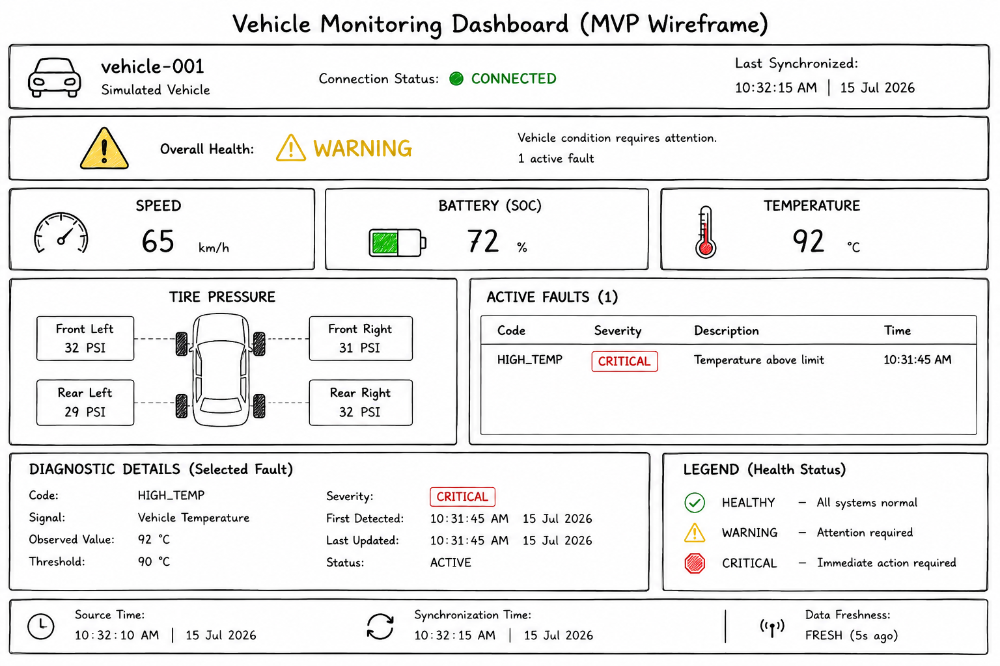

# Day 1 — Feasibility Research and Initial Direction

## Day 1 Purpose

Day 1 is a research and decision-preparation day. No member is expected to complete full component installation or production implementation. Each member must investigate their assigned area, verify the proposed approach using official sources, document risks and fallbacks, and prepare recommendations for the Day 2 architecture meeting.

The outputs from Day 1 will be used on Day 2 to finalize:

- Project scope and exclusions
- Runtime architecture
- Shared vehicle-data contract
- Health and fault behaviour
- API and event contracts
- TDD strategy and acceptance criteria
- Component integration methods
- Technical risks and fallback approaches

## Shared Day 1 Rules

1. Create a separate Git branch for the assigned research task.
2. Prefer official Eclipse, COVESA, GitHub-project, and language-library documentation.
3. Record the exact page or repository used for every important technical conclusion.
4. Do not silently select component versions, APIs, VSS paths, transports, or authentication methods.
5. Separate verified facts from assumptions and recommendations.
6. Record unsuccessful attempts, missing documentation, and compatibility concerns.
7. Do not spend the entire session troubleshooting installation. If a proof cannot be completed within the planned time, document the blocker and propose a next step.
8. Commit the research document and open a pull request before the Day 2 meeting.
9. All pull requests must use the shared template described below.

## Required Research Document Structure

Every Day 1 research document must include:

```text
# Component or Domain Name

## Objective
## Proposed Role in This Project
## Official Sources Reviewed
## Recommended Approach
## Minimum Working Example or Evidence
### Low-Fidelity Dashboard Wireframe

The proposed MVP dashboard wireframe is shown below.



The wireframe is intended to validate dashboard structure, required data fields, health-state communication, fault visibility, diagnostic information, and synchronization information. It is not a final visual design.
## Required Inputs and Produced Outputs
## Dependencies
## Technical Risks
## Fallback Approach
## Decisions Required on Day 2
## Open Questions
```

---

# Task Card 1 — Ankit Suman

## Day 1 — Draft Project Scope, Architecture, and Quality Direction

| Field                | Details                                                                                                                                                                                                                                                                         |
| -------------------- | ------------------------------------------------------------------------------------------------------------------------------------------------------------------------------------------------------------------------------------------------------------------------------- |
| **Team Member**      | Ankit Suman                                                                                                                                                                                                                                                                     |
| **Primary Role**     | Backend Integration, Test Architecture and Quality Lead                                                                                                                                                                                                                         |
| **Daily Goal**       | Create the initial project direction that the team will evaluate and finalize during the Day 2 meeting. The draft must define a realistic MVP, component responsibilities, integration assumptions, quality expectations, and the decisions required from each component owner. |
| **Estimated Effort** | Approximately 2–3 hours, including review of the assignment requirements and preparation of the Day 2 agenda.                                                                                                                                                                   |
| **Status**           | Not Started                                                                                                                                                                                                                                                                     |

### Task Instructions

1. Create a branch named:

   ```text
   docs/day-01-project-direction
   ```

2. Create the following file:

   ```text
   docs/research/day-01/project-direction.md
   ```

3. Review the professor’s project requirements and record the mandatory proposal and implementation constraints:
   - Eclipse Kuksa is mandatory.
   - Eclipse Ditto is mandatory.
   - Two additional components are Eclipse uProtocol and Eclipse OpenSOVD.
   - The project must introduce observable runtime behaviour.
   - Functional modifications must be identifiable.
   - Functional correctness must be tested.
   - At least one non-functional property must be measured.

4. Define the proposed MVP explicitly:
   - One simulated vehicle: `vehicle-001`
   - Speed
   - Battery state of charge
   - Vehicle temperature
   - Four tire-pressure values
   - Low-battery fault
   - High-temperature fault
   - Low-tire-pressure fault
   - `HEALTHY`, `WARNING`, and `CRITICAL` classifications
   - Spring Boot integration backend
   - Browser-based dashboard
   - Eclipse Kuksa, uProtocol, Ditto, and OpenSOVD integration

5. Create an initial runtime architecture showing:

   ```text
   Vehicle Simulator
          ↓
   Eclipse Kuksa
          ↓
   Spring Boot Integration Backend
          ├── Vehicle Health Engine
          ├── uProtocol Events
          ├── Eclipse Ditto Digital Twin
          ├── OpenSOVD Diagnostics
          └── Dashboard APIs
   ```

6. For every box in the architecture, document:
   - Its responsibility
   - Its required input
   - Its produced output
   - The member who owns it
   - The integration dependency
   - The minimum acceptable Day 9 demonstration

7. Draft the initial shared logical vehicle model. Do not finalize component-specific paths yet. Include:
   - `vehicleId`
   - Source timestamp
   - Speed
   - Battery percentage
   - Temperature
   - Four tire-pressure values
   - Overall health status
   - Active faults

8. Draft the initial health-rule questions for Day 2:
   - What values trigger warning and critical states?
   - Does speed contribute to health or only monitoring?
   - When does a fault clear?
   - Will recovery margins be used?
   - What happens when a signal is missing or stale?
   - How will simultaneous faults affect overall health?

9. Draft the TDD and quality expectations:
   - Test cases and acceptance criteria are designed before implementation.
   - Component owners write component-level tests.
   - Ankit owns backend, API-contract, integration, end-to-end, latency, reliability, and overall quality analysis.
   - A feature is not complete until its agreed tests pass.

10. Create a Day 2 meeting agenda containing the exact decisions required from Emmanuel, Benjamin, Atharva, and Mehtaj.

11. Add a risk table covering at least:

- uProtocol transport and Java-library feasibility
- OpenSOVD maturity and setup complexity
- Kuksa signal-path availability
- Ditto resource requirements
- macOS and Docker networking differences
- Late component integration
- Scope growth

12. Commit the document and open a pull request titled:

```text
docs: draft Day 1 project direction and Day 2 decisions
```

13. Request review from all team members before the Day 2 meeting. Do not merge the architecture as final until each component owner has reviewed their integration assumptions.

### Expected Deliverable

A pull request containing `docs/research/day-01/project-direction.md` with:

- Initial scope and exclusions
- Proposed runtime architecture
- Initial shared vehicle model
- Initial health-rule questions
- TDD and quality expectations
- Component ownership and dependencies
- Risk register draft
- Day 2 decision agenda

### Dependencies / Inputs

- Professor’s project-requirements document
- Current project proposal
- Finalized team-role distribution
- Day 1 findings from all component owners before final review

### Handoff To

- Emmanuel for validation of Kuksa assumptions and vehicle signals
- Benjamin for validation of uProtocol assumptions and event feasibility
- Atharva for validation of Ditto/OpenSOVD assumptions
- Mehtaj for validation of dashboard/API assumptions
- Entire team for Day 2 approval

### Acceptance Criteria

- The MVP, optional features, and exclusions are explicitly separated.
- Every component has a defined responsibility, input, output, owner, and minimum success condition.
- Architecture does not incorrectly present every component as a mandatory linear pass-through.
- Test design begins before implementation.
- Risks and fallbacks are documented without hiding uncertainty.
- Every team member has reviewed or commented on the pull request.
- Unresolved decisions are listed for Day 2 rather than silently assumed.

### Notes / Blockers

- Do not decide exact Kuksa paths without Emmanuel’s findings.
- Do not decide the uProtocol transport without Benjamin’s feasibility evidence.
- Do not promise full OpenSOVD behaviour until Atharva and Benjamin confirm the available implementation.
- If team findings conflict, record both options and make the decision during the Day 2 meeting.

---

# Task Card 2 — Emmanuel Adegboye

## Day 1 — Research Kuksa, VSS Paths, and Vehicle Simulation

| Field                | Details                                                                                                                                                             |
| -------------------- | ------------------------------------------------------------------------------------------------------------------------------------------------------------------- |
| **Team Member**      | Emmanuel Adegboye                                                                                                                                                   |
| **Primary Role**     | Eclipse Kuksa and Vehicle Simulation Lead                                                                                                                           |
| **Daily Goal**       | Determine how the team can run Eclipse Kuksa, publish and read vehicle signals, select or extend VSS paths, and generate repeatable normal and faulty vehicle data. |
| **Estimated Effort** | Approximately 2–3 hours. A minimum command-level proof is encouraged, but completing full Kuksa configuration is not required on Day 1.                             |
| **Status**           | Not Started                                                                                                                                                         |

### Task Instructions

1. Create a branch named:

   ```text
   research/day-01-kuksa-feasibility
   ```

2. Create the following file:

   ```text
   docs/research/day-01/kuksa-feasibility.md
   ```

3. Review the official [Eclipse Kuksa Quickstart](https://eclipse-kuksa.github.io/kuksa-website/quickstart/) and the [COVESA Vehicle Signal Specification](https://covesa.github.io/vehicle_signal_specification/).

4. Record the following from the official sources:
   - Recommended Kuksa Databroker startup method
   - Docker image or repository used by the official quickstart
   - Default API and port
   - Available CLI or SDK options
   - How a signal is published
   - How a signal is read
   - How a signal subscription works
   - Whether any macOS-specific networking or port issue is documented

5. Use `Vehicle.Speed` only as the verified initial example. Do not assume paths for battery, temperature, or tire pressure without checking the VSS catalog used by the selected Kuksa image.

6. Investigate candidate standard paths for:
   - Speed
   - Battery state of charge
   - Vehicle or powertrain temperature
   - Front-left tire pressure
   - Front-right tire pressure
   - Rear-left tire pressure
   - Rear-right tire pressure

7. For every candidate signal, document:
   - Candidate VSS/Kuksa path
   - Data type
   - Unit
   - Expected normal range
   - Proposed warning value
   - Proposed critical value
   - Example normal value
   - Example faulty value
   - Whether the path is verified in the selected VSS version

8. If a required signal is not available in the selected model, research how Kuksa supports an extended or custom signal model. Do not create a custom path yet; document the proposed path and approval required.

9. Attempt a minimal proof if time allows:
   - Start Kuksa using the official quickstart approach.
   - Publish one speed value.
   - Read the same value back.
   - Save the command output or screenshot.

10. Record the exact environment used for the proof:
    - Operating system
    - CPU architecture
    - Docker version
    - Docker Compose version, if used
    - Image tag
    - Port
    - API/CLI used

11. Propose a simulator approach for Day 2 discussion:
    - Python or Java
    - Update interval
    - Normal-driving pattern
    - Fault activation method
    - Fault clearing method
    - Timestamp generation
    - Configuration-file format

12. Record at least three risks, such as:
    - VSS paths differing between versions
    - macOS Docker networking behaviour
    - Custom-signal configuration
    - Data type or unit mismatches
    - Authentication or insecure-development configuration

13. Propose a fallback for each significant risk.

14. Commit the research and open a pull request titled:

    ```text
    docs: research Kuksa signals and simulation feasibility
    ```

15. Request review from Ankit and tag Benjamin, Atharva, and Mehtaj because all downstream models depend on the selected signal contract.

### Expected Deliverable

A pull request containing `docs/research/day-01/kuksa-feasibility.md` with:

- Official sources
- Setup and API findings
- Verified `Vehicle.Speed` example
- Candidate paths for every required signal
- Types and units
- Normal and fault examples
- Simulator recommendation
- Risks and fallbacks
- Evidence from any attempted proof
- Decisions required on Day 2

### Dependencies / Inputs

- Access to the team repository
- Docker availability for the optional proof
- Professor’s required signal/fault scope
- Initial thresholds and health questions from Ankit
- Official Kuksa and COVESA documentation

### Handoff To

- Ankit for backend DTOs, health rules, validation, and integration planning
- Benjamin for Protobuf fields and units
- Atharva for Ditto properties and diagnostic mappings
- Mehtaj for dashboard labels and units

### Acceptance Criteria

- All seven signal values have a verified path or clearly labeled candidate/custom-path proposal.
- Every signal includes type, unit, examples, and verification status.
- The document distinguishes official facts from team recommendations.
- At least one read/write approach is documented from official sources.
- The simulator recommendation supports normal operation, fault activation, fault clearing, configuration, and timestamps.
- Risks, fallbacks, and Day 2 decisions are explicit.
- Ankit reviews the pull request before the Day 2 meeting.

### Notes / Blockers

- If Docker networking prevents the proof, record the operating system, complete error, command, port, and attempted correction.
- Do not spend more than approximately 45–60 minutes on the optional proof.
- Do not use an arbitrary signal name merely to complete the table.
- Development-mode insecure settings must be identified as local-only and must not be presented as production security guidance.

---

# Task Card 3 — Benjamin Emeshili

## Day 1 — Research uProtocol Java, Protobuf, Transport, and CI Feasibility

| Field                | Details                                                                                                                                                                                                  |
| -------------------- | -------------------------------------------------------------------------------------------------------------------------------------------------------------------------------------------------------- |
| **Team Member**      | Benjamin Emeshili                                                                                                                                                                                        |
| **Primary Role**     | Eclipse uProtocol, OpenSOVD Support and CI Lead                                                                                                                                                          |
| **Daily Goal**       | Determine the smallest credible uProtocol implementation for the project, including the Java library, message definitions, transport or bounded-adapter option, test strategy, and Jenkins implications. |
| **Estimated Effort** | Approximately 2–3 hours. Full runtime integration is not expected on Day 1.                                                                                                                              |
| **Status**           | Not Started                                                                                                                                                                                              |

### Task Instructions

1. Create a branch named:

   ```text
   research/day-01-uprotocol-feasibility
   ```

2. Create the following file:

   ```text
   docs/research/day-01/uprotocol-feasibility.md
   ```

3. Review the official resources:
   - [uProtocol specification](https://github.com/eclipse-uprotocol/up-spec)
   - [uProtocol Java library](https://github.com/eclipse-uprotocol/up-java)
   - [uProtocol project site](https://uprotocol.org/)
   - [uProtocol socket transport](https://github.com/eclipse-uprotocol/up-transport-socket), if relevant

4. Record the exact Java-library release or commit examined. Do not assume the latest documentation matches a selected dependency without checking.

5. Explain, in project-specific language:
   - What uProtocol contributes beyond ordinary JSON DTOs
   - Which message-exchange pattern is relevant
   - Which services would publish and consume messages
   - Whether uProtocol is being used for schemas, runtime transport, or both
   - How the implementation will produce observable behaviour for testing

6. Propose the minimum event set:
   - `VehicleStatusUpdated`
   - `HealthStatusChanged`
   - `FaultDetected`
   - `FaultCleared`

7. For each event, propose:
   - Publisher
   - Consumer
   - Trigger condition
   - Required header/metadata fields
   - Required payload fields
   - Serialization test
   - Expected ordering or duplication behaviour

8. Identify the common fields that must be coordinated with the team:
   - Vehicle ID
   - Event ID or correlation ID
   - Source timestamp
   - Event timestamp
   - Event type
   - Signal name and value
   - Fault code
   - Severity
   - Threshold

9. Research the simplest Java and Maven/Gradle integration path. Record:
   - Dependency coordinates or build approach
   - Java-version requirements
   - Protobuf-generation requirements
   - Test framework compatibility
   - Required runtime components

10. Define three implementation levels for Day 2 selection:
    - **Preferred:** Real uProtocol runtime transport between selected services
    - **Acceptable:** Real uProtocol messages and an in-process or bounded transport adapter with publisher/subscriber tests
    - **Emergency fallback:** Real schema generation and serialization tests with a clearly disclosed mocked transport boundary

11. Define the initial test strategy:
    - Serialization/deserialization preserves all fields
    - Invalid or incomplete events are rejected or handled as documented
    - Published events can be matched by event ID
    - Duplicate events can be detected
    - Expected event ordering can be asserted

12. Create a short CI note describing how Jenkins could run:
    - Schema generation
    - Compilation
    - Unit tests
    - Serialization tests
    - Runtime propagation tests, when available

13. Record risks and fallbacks, including alpha/version instability, transport complexity, Java compatibility, and insufficient examples.

14. Commit the research and open a pull request titled:

    ```text
    docs: research uProtocol Java and transport feasibility
    ```

15. Request review from Ankit and Atharva. Tag Emmanuel and Mehtaj where event fields depend on their signal or UI models.

### Expected Deliverable

A pull request containing `docs/research/day-01/uprotocol-feasibility.md` with:

- Official sources and examined versions
- Project-specific uProtocol role
- Proposed event catalog
- Publisher/consumer mapping
- Common fields and payload requirements
- Java/build requirements
- Test approach
- Preferred, acceptable, and emergency integration levels
- CI considerations
- Risks, fallbacks, and Day 2 decisions

### Dependencies / Inputs

- Initial architecture from Ankit
- Candidate signal fields and units from Emmanuel
- Proposed fault representation from Ankit and Atharva
- Official uProtocol specification and Java-library documentation

### Handoff To

- Ankit for backend integration, event triggers, tests, and quality planning
- Atharva for event-to-diagnostic mapping and OpenSOVD support
- Emmanuel for source signal/timestamp compatibility
- Mehtaj if event history or event state becomes part of the approved UI

### Acceptance Criteria

- The document clearly states whether the recommendation uses uProtocol schemas, runtime transport, or both.
- Every proposed event has a publisher, consumer, trigger, fields, and test idea.
- The examined Java-library version or commit is recorded.
- Preferred and fallback implementations are technically distinguishable and transparent.
- The recommendation is achievable within the project schedule.
- Risks and unresolved decisions are prepared for the Day 2 meeting.
- Ankit and Atharva review the pull request.

### Notes / Blockers

- Do not claim full runtime communication if only Protobuf serialization has been demonstrated.
- Do not copy a sample without explaining how it maps to this project.
- If the official Java library is alpha or incompatible with the team’s Java version, document the exact incompatibility and recommend a bounded alternative.
- Keep the event set limited. Additional events require a clear observable benefit.

---

# Task Card 4 — Atharva Rajadhyaksha

## Day 1 — Research Ditto Digital Twin and OpenSOVD Diagnostics

| Field                | Details                                                                                                                                                                        |
| -------------------- | ------------------------------------------------------------------------------------------------------------------------------------------------------------------------------ |
| **Team Member**      | Atharva Rajadhyaksha                                                                                                                                                           |
| **Primary Role**     | Eclipse Ditto and Diagnostics Lead                                                                                                                                             |
| **Daily Goal**       | Determine how the team can represent and update `vehicle-001` in Eclipse Ditto and how a minimum OpenSOVD implementation can expose vehicle information and fault diagnostics. |
| **Estimated Effort** | Approximately 2–3 hours. Prioritize architectural and API feasibility over completing both installations.                                                                      |
| **Status**           | Not Started                                                                                                                                                                    |

### Task Instructions

1. Create a branch named:

   ```text
   research/day-01-ditto-opensovd-feasibility
   ```

2. Create the following file:

   ```text
   docs/research/day-01/ditto-opensovd-feasibility.md
   ```

3. Review official Ditto resources:
   - [Eclipse Ditto overview](https://eclipse.dev/ditto/intro-overview.html)
   - [Eclipse Ditto HTTP API](https://eclipse.dev/ditto/http-api-doc.html)
   - [Eclipse Ditto GitHub repository](https://github.com/eclipse-ditto/ditto)
   - [Ditto Docker deployment README](https://github.com/eclipse-ditto/ditto/blob/master/deployment/docker/README.md)

4. Record the exact Ditto version, branch, tag, or Docker image approach examined.

5. Document local runtime requirements, including:
   - Docker and Compose requirements
   - CPU and memory guidance
   - Required supporting services
   - Default local URL/port
   - Authentication or development credentials
   - Clean startup and shutdown approach

6. Propose a `vehicle-001` twin structure containing:
   - Vehicle identity attributes
   - Signal features or properties
   - Speed
   - Battery state of charge
   - Temperature
   - Four tire pressures
   - Overall health status
   - Active faults
   - Fault count
   - Source timestamp
   - Synchronization timestamp
   - Diagnostic timestamp

7. Explain why each field belongs in an attribute, feature, or property. Mark the structure as a proposal for Day 2 approval.

8. Identify the minimum Ditto API operations required:
   - Create or replace the thing
   - Retrieve the thing
   - Update a signal property
   - Update health/fault state
   - Perform partial updates without deleting unrelated state
   - Retrieve a timestamped current twin representation

9. Review official OpenSOVD resources:
   - [Eclipse OpenSOVD main repository](https://github.com/eclipse-opensovd/opensovd)
   - [OpenSOVD Core](https://github.com/eclipse-opensovd/opensovd-core)
   - [OpenSOVD design](https://github.com/eclipse-opensovd/opensovd/blob/main/docs/design/design.md)
   - [OpenSOVD Fault Library](https://github.com/eclipse-opensovd/fault-lib)

10. Record the exact OpenSOVD repositories, branches, or releases examined and their apparent maturity/status.

11. Define the minimum diagnostic scope for this project:
    - Retrieve vehicle information
    - Retrieve current overall health
    - Retrieve active faults
    - Represent a cleared fault or fault-clearing result
    - Return code, description, severity, signal, observed value, threshold, and timestamps

12. Map the initial data flow:

    ```text
    Health Engine Result
            ↓
    Backend Diagnostic Adapter
            ↓
    OpenSOVD-Compatible Resource or Query
            ↓
    Backend Diagnostic API
            ↓
    Dashboard
    ```

13. Explicitly identify whether OpenSOVD can be run and queried directly within the schedule or whether a bounded backend adapter will be required.

14. Define preferred, acceptable, and emergency fallback levels for OpenSOVD, similar to Benjamin’s uProtocol levels.

15. Record risks, including resource consumption, startup complexity, authentication, missing examples, emerging APIs, and mapping ambiguity.

16. Commit the research and open a pull request titled:

    ```text
    docs: research Ditto twin and OpenSOVD feasibility
    ```

17. Request review from Ankit and Benjamin. Tag Emmanuel and Mehtaj for signal and dashboard compatibility.

### Expected Deliverable

A pull request containing `docs/research/day-01/ditto-opensovd-feasibility.md` with:

- Official sources and examined versions
- Ditto runtime requirements
- Proposed vehicle-001 twin structure
- Required Ditto API operations
- Minimum OpenSOVD diagnostic scope
- Data and fault mappings
- Preferred and fallback integration levels
- Risks and Day 2 decisions

### Dependencies / Inputs

- Initial architecture and health questions from Ankit
- Candidate signal fields and units from Emmanuel
- Candidate event/fault fields from Benjamin
- Docker availability for any optional proof
- Official Ditto and OpenSOVD documentation

### Handoff To

- Ankit for the Ditto client, diagnostic adapter, backend APIs, and integration tests
- Benjamin for OpenSOVD support and event-to-diagnostic mapping
- Emmanuel for source-signal compatibility
- Mehtaj for twin/diagnostic response fields

### Acceptance Criteria

- The proposed twin contains every committed signal, health field, fault field, and timestamp.
- Required Ditto API operations and local runtime requirements are documented.
- OpenSOVD scope is limited to behaviour required for the three project faults.
- The document accurately separates verified capability from proposed adaptation.
- Preferred and fallback approaches are transparent and achievable.
- Risks and Day 2 decisions are explicit.
- Ankit and Benjamin review the pull request.

### Notes / Blockers

- Do not attempt to build Ditto from source merely to prove that it can run; prefer the official deployment approach for this project.
- Ditto may require significant Docker memory. Record resource constraints early.
- OpenSOVD is an emerging project. Do not present repository presence as proof that a required end-to-end feature already works.
- If setup consumes the entire session, stop and document exact progress, errors, and the smallest next experiment.

---

# Task Card 5 — Hasin Anzum Mehtaj

## Day 1 — Research Dashboard Architecture and Prepare the Wireframe

| Field                | Details                                                                                                                                                                        |
| -------------------- | ------------------------------------------------------------------------------------------------------------------------------------------------------------------------------ |
| **Team Member**      | Hasin Anzum Mehtaj                                                                                                                                                             |
| **Primary Role**     | Frontend Dashboard and UI Quality Lead                                                                                                                                         |
| **Daily Goal**       | Define a small, testable dashboard that communicates current signals, health, faults, diagnostic information, synchronization, and errors without expanding the project scope. |
| **Estimated Effort** | Approximately 2–3 hours, including wireframing and UI acceptance-condition design.                                                                                             |
| **Status**           | Not Started                                                                                                                                                                    |

### Task Instructions

1. Create a branch named:

   ```text
   research/day-01-dashboard-feasibility
   ```

2. Create the following file:

   ```text
   docs/research/day-01/dashboard-feasibility.md
   ```

3. Review the current project proposal, shared MVP, and assigned frontend role.

4. Define the primary dashboard user as a person monitoring the simulated vehicle and its diagnostic state. Record the five questions the interface must answer immediately:
   - Is the vehicle healthy?
   - What are the current signal values?
   - Which faults are active?
   - What diagnostic information is available?
   - Is the displayed data current and synchronized?

5. Create a low-fidelity wireframe using a tool available to the team, such as Figma, diagrams.net, Excalidraw, or a clearly labeled hand sketch.

6. Include only the committed MVP sections:
   - Vehicle identity and connection state
   - Overall health banner
   - Speed
   - Battery
   - Temperature
   - Four tire pressures
   - Active-fault list
   - Diagnostic details
   - Source and synchronization timestamps
   - Loading, disconnected, and error states

7. For each section, document the required backend fields and proposed labels/units.

8. Define the visual and behavioural states that must be tested:
   - Loading
   - Healthy
   - Warning
   - Critical
   - Active fault
   - Cleared/recovered fault
   - Missing signal
   - Stale data
   - Backend unavailable
   - Diagnostic service unavailable

9. Ensure that status is not communicated only by colour. Propose text, icons, or labels for healthy, warning, critical, and disconnected states.

10. Compare the three update methods at a high level:
    - Periodic REST polling
    - Server-Sent Events
    - WebSockets

11. For each method, record:
    - Implementation effort
    - Browser support
    - Backend complexity
    - Suitability for one simulated vehicle
    - Testing complexity
    - Reconnection behaviour

12. Recommend one primary method and one fallback for the Day 2 meeting. Do not implement it yet.

13. Draft example frontend-facing response objects for:
    - Normal vehicle state
    - Critical overheating fault
    - Cleared fault
    - Service error

14. Draft the initial frontend acceptance criteria, including:
    - Every value displays with a unit.
    - Missing fields do not crash the page.
    - Health states are understandable without colour alone.
    - Active faults include code, severity, description, and time.
    - Stale or disconnected data is clearly identified.
    - The page does not require manual refresh during normal monitoring.

15. List explicitly excluded features:
    - Authentication screens
    - Multi-vehicle selection
    - Advanced historical analytics
    - Mapping or geolocation
    - Mobile application
    - Customizable dashboards

16. Commit the research document and wireframe or link, then open a pull request titled:

    ```text
    docs: research dashboard architecture and UI states
    ```

17. Request review from Ankit and tag all component owners to confirm their fields can support the proposed display.

### Expected Deliverable

A pull request containing `docs/research/day-01/dashboard-feasibility.md` and a wireframe or stable wireframe link with:

- Target user and core questions
- MVP screen structure
- Required backend fields
- All UI states
- REST polling/SSE/WebSocket comparison
- Recommended update method and fallback
- Example responses
- Frontend acceptance criteria
- Explicit exclusions
- Day 2 decisions

### Dependencies / Inputs

- Current project proposal and MVP scope
- Initial backend/API direction from Ankit
- Candidate signal fields and units from Emmanuel
- Candidate event and diagnostic fields from Benjamin and Atharva
- Access to a wireframing tool or repository documentation folder

### Handoff To

- Ankit for backend response contracts, real-time API selection, and API tests
- Emmanuel for labels, signal units, and missing/stale signal behaviour
- Benjamin for any approved event display requirements
- Atharva for twin and diagnostic fields

### Acceptance Criteria

- Wireframe includes every committed signal and diagnostic area without optional scope.
- Every visible field has an identified backend source or is marked unresolved.
- Loading, healthy, warning, critical, recovered, stale, disconnected, and error states are defined.
- Update-method recommendation includes a fallback and clear rationale.
- Acceptance criteria are testable and not purely visual opinions.
- Ankit reviews the pull request, and component owners identify any incompatible fields before Day 2.

### Notes / Blockers

- Do not spend Day 1 polishing colours or animations.
- Do not choose WebSockets only because they sound more advanced; select the simplest method that meets the monitoring requirement.
- If a field source is unknown, mark it as a Day 2 decision instead of inventing an endpoint.
- Keep the wireframe readable on a standard laptop screen used for the final demonstration.

---

# Day 1 Team Deliverables Checklist

Before the Day 2 meeting, the repository should contain five pull requests:

- [ ] Ankit — Project direction, architecture draft, quality direction, risks, and Day 2 agenda
- [ ] Emmanuel — Kuksa/VSS/simulator feasibility and signal candidates
- [ ] Benjamin — uProtocol Java, event, transport, testing, and CI feasibility
- [ ] Atharva — Ditto twin and OpenSOVD diagnostic feasibility
- [ ] Mehtaj — Dashboard architecture, wireframe, API needs, and UI acceptance criteria

## Day 1 Completion Conditions

Day 1 is complete only when:

- [ ] Every member has committed their research document.
- [ ] Every member has opened a pull request.
- [ ] Official sources are linked for major technical conclusions.
- [ ] Verified findings are separated from assumptions.
- [ ] Risks and fallback options are documented.
- [ ] Required Day 2 decisions are listed.
- [ ] Cross-component handoffs are identified.
- [ ] No unresolved technical choice has been silently treated as final.

## Daily Check-In Format

Each member should post the following before the Day 2 meeting:

```text
Member:
Pull Request:

Completed:
-

Recommended Approach:
-

Evidence:
-

Main Risks:
-

Fallback:
-

Decisions Needed on Day 2:
-

Blockers:
-
```

# Official Starting References

## Project Requirements

- Professor-provided Software-Defined Vehicle project requirements

## Eclipse Kuksa and VSS

- [Eclipse Kuksa Quickstart](https://eclipse-kuksa.github.io/kuksa-website/quickstart/)
- [Eclipse Kuksa project site](https://eclipse-kuksa.github.io/kuksa-website/)
- [COVESA Vehicle Signal Specification](https://covesa.github.io/vehicle_signal_specification/)
- [COVESA VSS GitHub repository](https://github.com/COVESA/vehicle_signal_specification)

## Eclipse uProtocol

- [uProtocol project site](https://uprotocol.org/)
- [uProtocol specification](https://github.com/eclipse-uprotocol/up-spec)
- [uProtocol Java library](https://github.com/eclipse-uprotocol/up-java)
- [uProtocol socket transport](https://github.com/eclipse-uprotocol/up-transport-socket)

## Eclipse Ditto

- [Eclipse Ditto overview](https://eclipse.dev/ditto/intro-overview.html)
- [Eclipse Ditto HTTP API](https://eclipse.dev/ditto/http-api-doc.html)
- [Eclipse Ditto GitHub repository](https://github.com/eclipse-ditto/ditto)
- [Ditto Docker deployment README](https://github.com/eclipse-ditto/ditto/blob/master/deployment/docker/README.md)

## Eclipse OpenSOVD

- [Eclipse OpenSOVD main repository](https://github.com/eclipse-opensovd/opensovd)
- [OpenSOVD Core](https://github.com/eclipse-opensovd/opensovd-core)
- [OpenSOVD design](https://github.com/eclipse-opensovd/opensovd/blob/main/docs/design/design.md)
- [OpenSOVD Fault Library](https://github.com/eclipse-opensovd/fault-lib)
