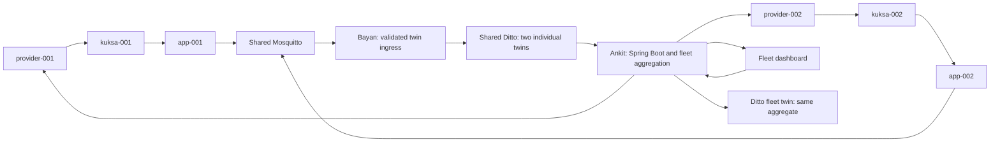

# V1 interface contracts

Version: **1.0.0 — proposed for affected-owner review**, November 11, 2026.

This is the development baseline requested by the project owner, not a claim that the running platform implements it. Ankit coordinates approval; Bayan and Emmanuel review affected boundaries before merge. The [source-of-truth entry point](SOURCE-OF-TRUTH.md), [scope](08-project-scope-and-acceptance.md), [task distribution](10-detailed-task-distribution.md), and [November 11 audit](findings/2026-11-11-repository-audit.md) remain the context. The formerly planned `docs/interface-contracts.md` is absent; this document fills that role for V1. Root README and previous-term contracts do not override this phase's agreed interfaces.

## Status and compatibility

| Category | Behavior |
|---|---|
| Existing tested behavior retained | One configured vehicle per provider; KUKSA internal port 55555; simulator POST `/api/v1/scenarios/actions`; vehicle-specific context GET; `INJECT_SCENARIO` / `CLEAR_SCENARIO`; LiDAR warning at ≤10 m and critical/braking at ≤5 m; backend action/trace IDs and acceptance semantics. |
| Proposed new contract | Two topic-specific JSON streams; exact v1 twin feature; fleet API/counting; availability windows; versioned vehicle APIs; per-provider mappings; Spring Boot fleet ownership. |
| Implementation still required | Two-edge deployment, v1 event publisher and consumer, live Ditto backend adapter, LiDAR backend action enum, routing, fleet projection/materialization and dashboard, live acceptance CI and Kanto validation. |
| Tools in this PR | Explicit development/test-only reference validation, fixtures, MQTT CLI replay/capture and HTTP mocks. They do not replace a production component or prove live acceptance. |

The existing app publishes `sdv/autonomy/status` with `healthStatus`, distance and boolean flags; its `SENSOR_FAILURE` and `EMERGENCY_BRAKING` values are not the new `health` enum. Emmanuel must add the v1 publisher/translation in his implementation PR while preserving baseline behavior. Current Java `DiagnosticScenario` supports only cooling. Ankit must add LiDAR support separately. No running interfaces change in this preparation PR.

## C1 — Architecture and ownership



Emmanuel owns observations, two isolated edge instances and Velocitas health classification. Bayan owns MQTT ingress, validation, ordered per-vehicle twin writes and individual-twin consistency. Ankit owns live reads, scenario routing, **the sole fleet aggregation implementation in Spring Boot**, fleet-twin materialization, APIs and dashboard. Bayan must not create a second aggregator.

This explicitly adjusts earlier B3 ownership at the user's direction. The scope/diagram requirement for a fleet twin is retained: Ankit writes the same derived summary to `sdv:fleet-v1`; there is no separate decision engine in Ditto. A missing fleet snapshot must not hide available individual twins. Broader V2 diagnostic action tracking, CARLA, networked uProtocol and skill customization remain outside this PR.

## C2 — Identity and configuration

| Identity | Vehicle 001 | Vehicle 002 |
|---|---|---|
| vehicleId | vehicle-001 | vehicle-002 |
| Provider service | provider-001 | provider-002 |
| KUKSA service | kuksa-001 | kuksa-002 |
| Velocitas app | app-001 | app-002 |
| MQTT topic | sdv/vehicle-001/health | sdv/vehicle-002/health |
| Ditto Thing ID | sdv:vehicle-001 | sdv:vehicle-002 |

Each app/provider receives its vehicle ID and its own KUKSA endpoint. Use existing `SIMULATED_VEHICLE_ID`, `DATABROKER_HOST`, `DATABROKER_PORT`, and SDK MQTT address conventions where possible. Both brokers listen on container port `55555`. Host examples are 55556/55557 and provider ports 8091/8092; all host endpoints must be configurable. These are proposed deployment defaults, not implemented Compose services. Use service DNS inside containers and configured LAN endpoints on a Kanto device; localhost always denotes that process's host.

The [endpoint example](../scripts/v1_dev/endpoints.example.json) is a development mapping template, **not currently consumed by Spring Boot**. Ankit must bind equivalent typed vehicle→provider/twin mappings in a separate explicit mock/live profile. Use `providerBaseUrl[vehicleId]`, never a single URL for all vehicles. Unknown, blank, padded or unregistered IDs are rejected without dispatch. Providers reject requests whose vehicle ID differs from their configured identity. A KUKSA signal resolves identity through its dedicated instance, not through an invented VSS identity field.

Credentials come from local configuration/environment, never browser code or committed real secrets. Mock HTTP services require no credentials, do not emulate Ditto authorization, and advertise `X-SDV-Mock: true`.

## C3 — MQTT JSON contract

One compact UTF-8 JSON object per publication; schemaVersion `1.0.0`. Publish with QoS 1 and **retain=false**. Subscribe to `sdv/+/health`, then allowlist the two identities/topics. Production publishers must reconnect and generate a new nonempty eventId for each new observation. Retrying one observation preserves its eventId and sourceTimestamp. No networked uProtocol dependency is required for V1.

| Field | Required type and semantics |
|---|---|
| schemaVersion | String, exactly `1.0.0` |
| eventId | Nonblank opaque string; globally unique for each new observation |
| vehicleId | String, exactly one registered ID |
| sourceTimestamp | UTC ISO 8601 with `T` and `Z` or `+00:00`; original observation time |
| health | String: HEALTHY, WARNING or CRITICAL |
| faults | Array of unique fault-code strings, canonical order as C4 |
| lidar | Object containing the following two fields |
| lidar.distanceMeters | Finite nonnegative JSON number; booleans/strings invalid; null permitted only when sensorAvailable=false |
| lidar.sensorAvailable | JSON boolean; sensor validity, not application connectivity |
| actionId / traceId | Optional nonblank strings; preserve known command context, omit when unknown |

Additional fields are allowed for compatible extensions but cannot override these meanings. NaN/Infinity, missing fields, non-object payloads and duplicate JSON object keys are invalid. Payload budget is 64 KiB. Fault arrays contain only the codes/classification in C4; legacy cooling faults remain in legacy features and do not get silently mixed into this LiDAR contract.

Healthy example (the [fixture](../tests/fixtures/v1/vehicle-001-healthy.json) is canonical):

```json
{"schemaVersion":"1.0.0","eventId":"vehicle-001-event-000","vehicleId":"vehicle-001","sourceTimestamp":"2026-01-01T00:00:00Z","health":"HEALTHY","faults":[],"lidar":{"distanceMeters":35.0,"sensorAvailable":true}}
```

Fault and recovery examples are [vehicle-002-fault.json](../tests/fixtures/v1/vehicle-002-fault.json) and [vehicle-002-recovered.json](../tests/fixtures/v1/vehicle-002-recovered.json). These dates are deterministic test observations, not live values.

### Validation and ordering

Validate JSON, required fields/types/version, allowlisted vehicle, exact topic/vehicle match, timestamp, numeric validity, then health/fault consistency **before any twin write**. Reject/log the error code, topic, vehicle/event ID when available; do not log credentials. Invalid events must not advance the watermark or change either twin. Ingress rejection codes: `MALFORMED_JSON`, `MISSING_FIELD`, `INVALID_TYPE`, `UNKNOWN_VEHICLE`, `TOPIC_MISMATCH`, `UNSUPPORTED_VERSION`, `INVALID_TIMESTAMP`, `INVALID_HEALTH`, `HEALTH_FAULT_MISMATCH`, `DUPLICATE_EVENT`, `OUT_OF_ORDER`.

Serialize updates per vehicle. Initialize each watermark from its live twin's lastEventId/sourceTimestamp after restart; an unreadable watermark blocks that vehicle's writes until recovered, while the other vehicle continues. Same latest event ID is an ignored duplicate. Any sourceTimestamp ≤ the applied timestamp is rejected; this also rejects older duplicate deliveries without an unbounded ID cache. Equal timestamps with different IDs are rejected deterministically, not ordered by random UUID. A payload reusing the latest ID with changed content is invalid and never overwrites state. The small reference validator reports rejected duplicates as errors to make negative tests visible; the real subscriber logs/counts and continues.

Late but strictly newer observations may update a twin; availability is still derived from original source age. Ingress does not relabel late telemetry healthy/current. A source >1 second ahead of backend time is unavailable/invalid clock data in C5. Clock synchronization and monotonic per-vehicle observation time are deployment prerequisites; a clock rollback must be reported and corrected, not bypass ordering.

## C4 — Health, faults and units

The source of the preserved distance boundaries is [signal_generator.py](../vehicle-simulator/src/signal_generator.py), constants `LIDAR_WARNING_DISTANCE_M=10.0` and `AUTONOMOUS_BRAKING_DISTANCE_M=5.0`, and its [existing tests](../vehicle-simulator/tests/test_signal_generator.py). The legacy app's severity priority is preserved by mapping sensor failure/braking to CRITICAL.

| Observation | health | faults |
|---|---|---|
| sensorAvailable=false | CRITICAL | [LIDAR_SENSOR_FAILURE] |
| sensorAvailable=true, distance ≤5 m | CRITICAL | [LIDAR_OBSTRUCTION] |
| sensorAvailable=true, 5 m < distance ≤10 m | WARNING | [LIDAR_OBSTRUCTION] |
| sensorAvailable=true, distance >10 m | HEALTHY | [] |

Sensor failure has priority over obstruction. There is no invented V1 persistence/recovery window: the next valid observation is reclassified at the same boundaries, matching the tested baseline. Separate windows remain a V2 contract decision. Clearing a scenario changes input; recovery is observed only after valid readings cross the health threshold. An HTTP acceptance is not that observation.

Velocitas must own classification from observations. The simulator's current precomputed warning/braking flags remain for baseline compatibility; they are not independent ground truth for evaluating Velocitas. Missing telemetry has unknown health, not HEALTHY. A valid fresh sensor-failure event means telemetry AVAILABLE and health CRITICAL; a silent app is a different condition.

LiDAR is metres. Existing speed metadata is km/h. Tire pressure has a known baseline defect: VSS says kPa while legacy bridge fields say psi. Emmanuel owns VSS/provider units and conversions; Bayan owns bridge/mapper agreement. Keep the published VSS kPa definition and convert explicitly at the legacy psi boundary after affected-owner review; do not change thresholds or units silently. Tire-pressure repair is assigned, not implemented here.

**2026-11-14 correction proposed for review:** Ankit implements the focused unit repair under the current project-owner instruction. Generator state remains psi for physical compatibility; publication rounds psi × 6.894757293168 into the existing VSS uint16 kPa path. The legacy bridge divides kPa by the same factor before `tire_pressure_psi`; the psi mapper/thresholds do not convert again. Whole-kPa quantization is explicit. C3/C4 LiDAR fields and health thresholds are unchanged. See [investigation and verification](../evidence/v1/tire-pressure-units/README.md). This dated clarification preserves the preparation record and does not claim affected-owner approval or full live acceptance.

## C5 — Time and availability

Inject a UTC clock into backend evaluation and tests. Never replace source time with polling, receipt or publication time. Configure `staleAfterSeconds=5`, `unavailableAfterSeconds=30` and a maximum future clock tolerance of 1 second; require `0 < stale < unavailable`. The 30-second cutoff is a **new proposed default** needing review, not an existing approved measurement. Five seconds is the requested baseline and remains configurable.

| Condition at one captured evaluation time | Availability |
|---|---|
| Missing twin/state, invalid/unusable snapshot, failed read, or source >1 s in future | UNAVAILABLE |
| Valid source age ≤5 s (including up to 1 s future tolerance) | AVAILABLE |
| 5 s < age ≤30 s | STALE |
| Age >30 s | UNAVAILABLE |

Keep stale last-known health visible with its availability and timestamp. Do not include it in current healthy/warning/critical counts. With no trusted snapshot, return null health, faults, LiDAR, timestamp and event ID. A failed read may display explicitly labelled cached data in the UI but never silently count it as current. Sensor availability is independent of transport availability.

Fixtures use epoch `2026-01-01T00:00:00Z` and test clock `00:00:04Z`; stale fixture source is epoch−2 s (age 6 s). Rebase the **entire sequence by one offset**, not each timestamp to now. The test helper and replay CLI implement this strategy. The HTTP mock defaults to the fixed clock; `--live-clock` rebases its initial observations to startup, then lets them age naturally. Mock control endpoints can refresh a scenario. No historical timestamp is assumed forever fresh or stale.

## C6 — Ditto contract

Individual identity is fixed in `thingId` and `attributes.vehicleId`. A new isolated feature avoids overwriting existing signals/health/diagnostics features:

| JSON path | Value |
|---|---|
| /thingId | sdv:vehicle-001 or sdv:vehicle-002 |
| /attributes/vehicleId | Matching vehicle ID |
| /features/v1/properties/schemaVersion | 1.0.0 |
| /features/v1/properties/vehicleId | Matching vehicle ID |
| /features/v1/properties/health | C4 state |
| /features/v1/properties/faults | C4 active fault codes |
| /features/v1/properties/lidar | C3 LiDAR object |
| /features/v1/properties/sourceTimestamp | Preserved observation time |
| /features/v1/properties/lastEventId | Preserved eventId |
| /features/v1/properties/actionId, traceId | Optional preserved command context |

Canonical whole-Thing examples: [001](../tests/fixtures/v1/ditto-vehicle-001.json) and [002](../tests/fixtures/v1/ditto-vehicle-002.json). Provision policies/attributes before ingress. Bayan is the only writer to each individual v1 feature. Read whole Thing with `GET {dittoBaseUrl}/api/2/things/sdv:vehicle-00N`, `Accept: application/json`. On 200 validate all three identity locations and the feature schema; 404 means missing, timeout/connection/5xx means unavailable, 401/403 means configuration/auth failure. A response for another identity is invalid and cannot populate the requested vehicle.

Apply each accepted event with one `PUT /api/2/things/{thingId}/features/v1/properties` JSON object, renaming eventId to lastEventId. This avoids mixed property snapshots. Successful real Ditto PUT may be 201 or 204; the lightweight mock returns 200 with the object. Use one writer/per-vehicle serialization; conditional revisions are needed if that assumption changes. Advance the committed watermark only after a successful write. Retry transient writes with bounded backoff; never acknowledge a failed write as successful delivery. Resume from the stored watermark after restart. The mocks emulate reads/feature writes, not Ditto authorization, policies, revision headers or retry behavior.

Availability is derived by Spring Boot from these fields and the read outcome. Bayan does not need a timer that writes availability into every individual twin.

## C7 — Backend vehicle and fleet APIs

New endpoints are proposed; existing `/api/vehicles/{id}/state` and `/health` remain backward compatible during migration. Add `/api/v1/vehicles`, `/api/v1/vehicles/{id}/state`, `/api/v1/vehicles/{id}/health` and `/api/v1/fleet`. `GET /api/v1/vehicles` returns `{"vehicleIds":["vehicle-001","vehicle-002"]}`. Both v1 state and health endpoints return this same compact projection:

```json
{"vehicleId":"vehicle-002","thingId":"sdv:vehicle-002","healthStatus":"CRITICAL","availability":"AVAILABLE","activeFaults":["LIDAR_OBSTRUCTION"],"lidar":{"distanceMeters":3.0,"sensorAvailable":true},"sourceTimestamp":"2026-01-01T00:00:01Z","lastEventId":"vehicle-002-event-001"}
```

For a registered vehicle, return 200 with availability UNAVAILABLE and nullable last-known fields when live data is unavailable. Unknown IDs return 404. Preserve legacy endpoint fields for legacy clients; the new fleet UI uses v1 endpoints and must show availability separately from health. A failed live adapter must never fall back to generated development healthy state. Use explicit `mock`/`live` configuration, fail startup on an unsupported live mode, and keep mock URLs out of live defaults.

Fleet API response is [fleet-summary.json](../tests/fixtures/v1/fleet-summary.json). Capture one evaluation time (`generatedAt`) per response and use it for both vehicle views. Include every registered vehicle exactly once, sorted by ID. Fetch independently with bounded per-vehicle timeouts; failure of one does not suppress the other. Default backend/twin update/poll budget is 2 seconds, configurable and subject to measurement. Health and availability counts mean:

- `totalVehicles = availableVehicles + staleVehicles + unavailableVehicles`.
- `healthyVehicles + warningVehicles + criticalVehicles = availableVehicles`.
- Health counts include **only AVAILABLE** vehicles. Stale/unavailable last-known critical readings may be displayed but do not inflate current critical counts.
- `vehicles` always includes both projections; no missing vehicle silently disappears from the denominator.

Ankit materializes this exact response into `sdv:fleet-v1`, feature `/features/summary/properties`, after deriving it from individual twins. Provision `attributes.kind="fleet"` and `attributes.vehicleIds` for both IDs. Ankit owns that policy/Thing setup and sole writer. Materialization failure is logged/observable and retried; it must not fabricate or discard available individual views. Backend/dashboard freshness derives from individual twins at query time, not from an old aggregate. Verify the materialized fleet twin against the API at the same evaluation time. This retained scope item is not implemented by the HTTP mock.

## C8 — Scenario request and response

Public control entry point remains `POST /api/v1/diagnostics/actions`. Request JSON is [inject](../tests/fixtures/v1/scenario-inject-request.json) or [clear](../tests/fixtures/v1/scenario-clear-request.json): vehicleId, action (`INJECT_SCENARIO` / `CLEAR_SCENARIO`), scenario `LIDAR_OBSTRUCTION`. Preserve existing cooling support; adding LiDAR is implementation work. Missing/invalid fields →400; unknown vehicle →404; no provider request on validation failure.

Generate actionId and traceId in Spring Boot (same UUID is compatible with current code). Dispatch to the registered provider's **actual existing path** `POST {providerBaseUrl}/api/v1/scenarios/actions` with all five fields: vehicleId, action, scenario, actionId, traceId. The provider's success response contains those fields and `active` boolean. Verify response identities/IDs and action; never route based on a URL supplied by the browser. Scenario application is idempotent; repeating injection leaves active=true and repeating clear leaves active=false. Each accepted public request has its own action ID; do not automatically retry browser POSTs.

The current vehicle-specific context read is `GET {providerBaseUrl}/api/v1/vehicles/{vehicleId}/scenarios/{scenario}`. Fix the legacy bridge's unscoped context URL in its owner's implementation PR. Ankit owns the Java mapping, Emmanuel owns provider enforcement/context, and Bayan owns the legacy Python caller fix.

After a valid provider acknowledgement, return 202:

```json
{"actionId":"action-example","traceId":"action-example","vehicleId":"vehicle-002","action":"INJECT_SCENARIO","scenario":"LIDAR_OBSTRUCTION","status":"ACCEPTED","dispatchStatus":"DISPATCHED","requestedAt":"2026-01-01T00:00:04Z"}
```

`status=ACCEPTED` acknowledges dispatch, **not health transition or completion**. `GET /api/v1/diagnostics/actions/{actionId}` returns the acknowledgement; 404 for unknown IDs. Existing lifecycle enum can remain, but no new COMPLETED claim is made without execution evidence. Full correlated execution outcomes remain A6/V2 work.

| Dispatch outcome | Public HTTP/code | Meaning |
|---|---|---|
| Provider rejects (4xx) | 502 / PROVIDER_REJECTED | Request valid locally, downstream rejected; dispatchStatus=REJECTED |
| Connection refused/reset | 503 / PROVIDER_UNAVAILABLE | Dispatch failed; dispatchStatus=FAILED |
| Provider timeout (default 2 s, configurable) | 504 / PROVIDER_TIMEOUT | Delivery/execution unknown; dispatchStatus=UNKNOWN; never automatically resend |
| Provider 5xx, invalid body or wrong response identity | 502 / PROVIDER_BAD_RESPONSE | No trustworthy acknowledgement; dispatchStatus=FAILED |

Public error shape preserves existing conventions: `timestamp`, `code`, `message`, `path`; include `actionId`, `traceId`, `dispatchStatus` after IDs are allocated. Retain failed submissions for lookup using status=REJECTED (provider rejection) or FAILED (dispatch failure); a timeout's FAILED dispatch does not prove the scenario was not applied. Do not leave failures stored as accepted. V1 can add an internal failure transition without implementing a V2 execution state machine. No stack traces or credentials in errors.

The provider mock returns HTTP 409 for configured rejection, 504 after a five-second delay for configured timeout, or closes a connection for disconnect. This is the downstream simulator boundary; it is not the public backend error mapping. The test dispatch helper collapses provider HTTP errors for simple routing tests and is not a normative Java error adapter.

## C9 — Mock boundaries and independent development

All helpers under [scripts/v1_dev](../scripts/v1_dev/) are opt-in development/test tools; production modules must not import them. The HTTP preview is not Spring Boot and must never satisfy live acceptance. A preview action immediately changes **mock** observations to make dashboard development possible; the real system must observe telemetry propagation separately. Fixed IDs, fixed clocks and simplified errors are mock behavior, not production identity generators.

| Developer | Real component under development | Independent substitute |
|---|---|---|
| Emmanuel | Providers, KUKSA, Velocitas | MQTT capture/validation; no Ditto/backend/frontend |
| Bayan | MQTT ingress and individual twins | MQTT fixture replay; own isolated Ditto or HTTP read/write mock for component tests |
| Ankit | Backend live adapters, routing, aggregate and dashboard | Two-identity HTTP mocks; preview API for UI scaffolding; no teammate service |

See [independent development guide](v1-independent-development.md) for commands. Simulated provider routing tests, MQTT command construction tests and handler tests are not live Eclipse integration. HTTP mock modes include healthy/fault/recovered/stale/missing/unavailable, per-provider reject/timeout/disconnect, a controllable clock and separate dispatch logs. Real connection-refused tests use a configured unused endpoint.

## C10 — Versioning, review and traceability

Changes to fields, units, identity mapping, thresholds, ordering, endpoints or error semantics require affected-owner review and updated fixtures/tests. Increment major for incompatible wire changes, minor for compatible additions and patch for clarifications. Schema version acceptance is currently exact; adding an accepted version requires explicit tests. Do not edit fixture expectations to hide a production mismatch.

All V1 criteria remain required; no mock pass is live completion:

| Acceptance | Contract sections | Independent checks | Required real evidence |
|---|---|---|---|
| V1-01 | C1–C4 | Event/identity/threshold/capture checks | Two real edge stacks and publication logs |
| V1-02 | C3, C6 | Negative fixtures, ordering, twin identity | Invalid inputs leave both live twins intact |
| V1-03 | C4, C6–C8 | Cycle replay, routing, isolation | vehicle-002 healthy→fault→healthy through MQTT/twin/API/UI; vehicle-001 unaffected |
| V1-04 | C5–C7 | Clock, missing/unavailable, no fallback | Live reads and disconnected-source check |
| V1-05 | C9–C10 | Standard-library contract suite | Baseline and two-vehicle live CI with dependencies labelled |
| V1-06 | C10 | Traceability/evidence template | Actual original-skill version/use and human review |
| V1-07 | C2, C9–C10 | Independent rerun instructions | Tagged revision, video/report/contributions |
| V1-08 | C6–C7 | Projection/counting/preview checks | API/dashboard/fleet twin agree on both vehicles |
| V1-09 | C2–C5 | Kanto config + subscriber oracle | Linux restart of app-002 → fresh MQTT event → correct Ditto twin |

Primary real run: start both healthy; inject vehicle-002 obstruction; observe only its expected warning/critical state through MQTT, Ditto, API and UI; clear; observe recovery; confirm vehicle-001 never gained the fault; record exact revision and timestamps. Kanto restart, skill usage, CI and reproducible release are additional obligations, not removed by this scenario.

Open review items: historical approval provenance of the scope; proposed 30-second unavailable timeout and update/dispatch budgets; deployment credentials/ports; measured clock handling; exact V2 diagnostic operations. The user explicitly directs the fleet-ownership adjustment; affected-owner review is still required before merging the proposed shared interfaces. This preparation does not silently change approved runtime behavior.
